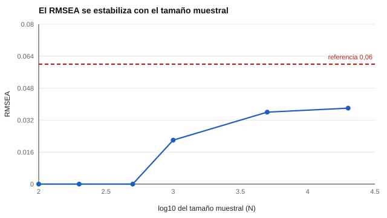

# 047 — Ajuste en modelos de ecuaciones estructurales


<!-- NAV -->
[← 046 — Rotaciones y criterios de retención de factor…](../046-rotaciones-y-criterios-de-retencion-de-factores/README.md) · [📚 Parte 04](../README.md) · [🗺️ Índice 001–200](../../../PROGRAMA.md) · [048 — Modelos bifactor y jerárquicos →](../048-modelos-bifactor-y-jerarquicos/README.md)
<!-- /NAV -->

**Parte 04 — Estructura y análisis factorial** · Nivel avanzado · 4 h · Estado `escrita`
**Pensada para:** quien lee artículos con modelos de ecuaciones estructurales y quien reporta ajuste.
**Prerrequisitos:** clase 043.

## ¿Para qué te sirve esto?

Los artículos que validan instrumentos reportan siglas: χ², RMSEA, CFI, TLI, SRMR. Muchos las usan como semáforo («CFI > 0,95, RMSEA < 0,06: el modelo es bueno»). Esta clase te enseña qué calcula cada índice, por qué el chi-cuadrado «rechaza todo» con muestras grandes y por qué los umbrales **no son reglas de oro**. Es una herramienta de lectura crítica para cualquier informe de validación.

## Al terminar esta clase podrás

- Calcular RMSEA, CFI y TLI a partir del chi-cuadrado y los grados de libertad.
- Explicar por qué el chi-cuadrado depende del tamaño muestral.
- Evitar la aplicación mecánica de umbrales.
- Plantear qué mirar además de los índices (los residuos).

## La idea en palabras simples

El chi-cuadrado mide el desajuste entre la matriz observada y la implicada por el modelo, **multiplicado por el tamaño de la muestra** (χ² = (N − 1)·F_min). Si N es muy grande, hasta un desajuste mínimo y sin importancia práctica produce un χ² «significativo». Por eso se usan otros índices que no crecen con N:

```
RMSEA = √( max(χ² − gl, 0) / (gl · (N − 1)) )
CFI   = 1 − max(χ²ₘ − glₘ, 0) / max(χ²₀ − gl₀, χ²ₘ − glₘ, 0)
TLI   = ( χ²₀/gl₀ − χ²ₘ/glₘ ) / ( χ²₀/gl₀ − 1 )
```

Hu y Bentler (1999) sugirieron combinaciones (RMSEA ≲ 0,06; CFI ≳ 0,95; SRMR ≲ 0,08), pero Marsh, Hau y Wen (2004) advirtieron contra tratarlas como reglas de oro.

## Cómo funciona, paso a paso

**1. Calcular el chi-cuadrado** y sus grados de libertad.

**2. Calcular los índices** que no dependen de N.

**3. Revisar los residuos** (clase 043): qué parte concreta del modelo no ajusta.

**Ejemplo resuelto.** χ² = 100, gl = 40, N = 500: RMSEA = √(60 / (40 · 499)) = √0,003 = **0,055**.



*Figura 1.* Con el mismo desajuste, el RMSEA se estabiliza aunque N crezca mucho.

## Si construyes el instrumento

- Reporta varios índices, el chi-cuadrado con sus grados de libertad y los residuos más grandes.
- No rechaces ni aceptes un modelo solo por un umbral.
- Compara con modelos alternativos plausibles.
- Recuerda que un buen ajuste no demuestra que el modelo sea el correcto.

## Si eres evaluado

- Cuando un manual dice «ajuste excelente», pregunta qué modelos alternativos se probaron.
- Un buen ajuste en una muestra no garantiza que la estructura valga para ti.
- La estructura de un instrumento es una hipótesis respaldada, no un hecho.

## Qué muestra el laboratorio

`lab.py` calcula los índices con F_min fijo en 0,06 y gl = 40 (valores ilustrativos, no de un estudio).

| N | χ² | p | RMSEA | CFI | TLI |
|---:|---:|---:|---:|---:|---:|
| 100 | 5,9 | 1,0000 | 0,000 | 1,000 | 1,194 |
| 500 | 29,9 | 0,8771 | 0,000 | 1,000 | 1,010 |
| 1.000 | 59,9 | 0,0222 | 0,022 | 0,993 | 0,991 |
| 5.000 | 299,9 | 0,0000 | 0,036 | 0,983 | 0,976 |
| 20.000 | 1.199,9 | 0,0000 | 0,038 | 0,981 | 0,973 |

**Análisis.** (1) Con el **mismo** desajuste, el chi-cuadrado rechaza el modelo en cuanto N es grande (p → 0). (2) RMSEA, CFI y TLI se estabilizan en 0,036 a 0,038, 0,98 y 0,97. (3) El TLI puede superar 1 con N pequeño. (4) Un buen ajuste no prueba que el modelo sea el correcto: modelos distintos pueden ajustar igual de bien.

## Errores frecuentes

- Rechazar un modelo solo por un χ² significativo con N grande.
- Aceptar un modelo solo por índices «buenos» sin revisar residuos.
- Aplicar umbrales de forma mecánica.
- Comparar índices entre modelos no anidados sin criterios adecuados.

## Lo mínimo que debes llevarte

1. El χ² crece con N; los demás índices, no.
2. Los umbrales son orientaciones, no reglas de oro.
3. Se reportan varios índices y los residuos.
4. Buen ajuste no es modelo verdadero.

## Ejercicios

- **Inicial.** ¿Qué pasa con χ² si se duplica N con el mismo F_min? *Solución: se duplica aproximadamente.*
- **Intermedio.** χ² = 50, gl = 50. *Solución: RMSEA = 0.*
- **Avanzado.** Cambia F_MIN a 0,15 en `lab.py` y describe cuándo RMSEA supera 0,06.
- **Aplicación.** Lee un artículo de validación y señala si discutió residuos además de los índices.

## Glosario

- **Chi-cuadrado (χ²):** estadístico de desajuste entre modelo y datos.
- **Grados de libertad (gl):** número de restricciones comprobables del modelo.
- **RMSEA, CFI, TLI:** índices de ajuste que no crecen con N.
- **Modelo nulo:** modelo base sin relaciones entre variables.

## Laboratorio

```bash
python classes/part-04-estructura-y-analisis-factorial/047-ajuste-en-modelos-de-ecuaciones-estructurales/lab.py
python classes/part-04-estructura-y-analisis-factorial/figuras.py
```

## Autoevaluación y criterios

1. ¿Por qué se reportan varios índices? 2. ¿Qué indica χ² < gl? 3. ¿Qué miras antes de aceptar un modelo?
Se logra la clase si puedes calcular los índices y discutir el desajuste concreto.

## Bibliografía

- Hu, L., & Bentler, P. M. (1999). Cutoff criteria for fit indexes in covariance structure analysis: Conventional criteria versus new alternatives. *Structural Equation Modeling*, 6(1), 1-55.
- Marsh, H. W., Hau, K.-T., & Wen, Z. (2004). In search of golden rules: Comment on hypothesis-testing approaches to setting cutoff values for fit indexes. *Structural Equation Modeling*, 11(3), 320-341.
- Kline, R. B. (2016). *Principles and Practice of Structural Equation Modeling* (4.ª ed.). Guilford.

---

<!-- NAV -->
[← 046 — Rotaciones y criterios de retención de factor…](../046-rotaciones-y-criterios-de-retencion-de-factores/README.md)  
[📚 Parte 04](../README.md) · [🗺️ Índice 001–200](../../../PROGRAMA.md)  
[048 — Modelos bifactor y jerárquicos →](../048-modelos-bifactor-y-jerarquicos/README.md)
<!-- /NAV -->
