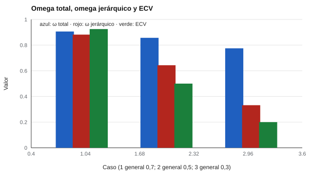

# 048 — Modelos bifactor y jerárquicos


<!-- NAV -->
[← 047 — Ajuste en modelos de ecuaciones estructurales](../047-ajuste-en-modelos-de-ecuaciones-estructurales/README.md) · [📚 Parte 04](../README.md) · [🗺️ Índice 001–200](../../../PROGRAMA.md) · [049 — Análisis de redes psicométricas →](../049-analisis-de-redes-psicometricas/README.md)
<!-- /NAV -->

**Parte 04 — Estructura y análisis factorial** · Nivel avanzado · 4 h · Estado `escrita`
**Pensada para:** quien decide si reportar un puntaje total o subpuntajes, y quien interpreta perfiles.
**Prerrequisitos:** clases 023 y 043.

## ¿Para qué te sirve esto?

Muchos instrumentos entregan un **puntaje total** y varios **subpuntajes** (por ejemplo, un total de bienestar y cuatro dimensiones). ¿Tiene sentido reportar ambos? Depende de cuánto del total corresponde a un rasgo **general** y cuánto a las dimensiones específicas. El modelo bifactor permite responder con números. Esta clase te enseña los índices (ω total, ω jerárquico y ECV) y te ayuda a decidir cómo reportar.

## Al terminar esta clase podrás

- Distinguir el modelo bifactor del modelo jerárquico de segundo orden.
- Calcular omega total, omega jerárquico y ECV.
- Decidir si el puntaje total puede interpretarse como el factor general.
- Reconocer por qué un buen ajuste del bifactor puede engañar.

## La idea en palabras simples

El modelo **bifactor** (Holzinger & Swineford, 1937; Reise, 2012) supone que cada ítem refleja **dos cosas**: un factor **general** que afecta a todos los ítems y un factor de **grupo** (una dimensión específica), ambos independientes. Con las cargas se calcula:

```
ω total  = (varianza del general + varianza de grupo) / varianza total
ω jerárquico (ωₕ) = varianza atribuible al general / varianza total
ECV = varianza común del general / varianza común total
```

Un **ω total alto** dice que el puntaje es fiable; un **ωₕ alto** dice que esa fiabilidad se debe sobre todo al factor general. Si ωₕ es bajo, el total mezcla varias dimensiones.

## Cómo funciona, paso a paso

**1. Estimar el modelo** (o, en el laboratorio, usar las cargas verdaderas).

**2. Calcular los tres índices.**

**3. Decidir:** con ωₕ y ECV altos, el total es interpretable como el factor general; si son bajos, conviene reportar subpuntajes.

**Ejemplo resuelto.** Caso 0,5 / 0,5 (9 ítems en 3 grupos de 3): var_general = (9·0,5)² = 20,25; var_grupo = 3·(3·0,5)² = 6,75; var_única = 9·(1 − 0,5) = 4,5; total = 31,5. ω = 27/31,5 = 0,857; ωₕ = 20,25/31,5 = 0,643.



*Figura 1.* El omega total se mantiene alto aunque el factor general sea débil; el jerárquico revela la diferencia.

## Si construyes el instrumento

- Calcula ωₕ y ECV antes de afirmar que el total mide «el rasgo general».
- Si el factor general es débil, reporta subpuntajes (y comprueba su fiabilidad).
- No elijas el bifactor solo por su buen ajuste: tiende a ajustar mejor por flexibilidad (Rodriguez et al., 2016).
- Revisa la estabilidad de las cargas de grupo (cargas negativas o casi nulas son una señal de alerta).

## Si eres evaluado

- Pregunta si el puntaje total que recibes representa una sola cosa.
- Si te dan subpuntajes, pregunta cuánta información propia aportan sobre el total.
- Un perfil con cuatro dimensiones puede ser, en gran parte, un único factor general repetido.

## Qué muestra el laboratorio

`lab.py` calcula los índices con 9 ítems (3 grupos de 3) y cargas verdaderas conocidas.

| Carga general | Carga específica | ω total | ωₕ | ECV |
|---:|---:|---:|---:|---:|
| 0,7 | 0,2 | 0,906 | 0,882 | 0,925 |
| 0,5 | 0,5 | 0,857 | 0,643 | 0,500 |
| 0,3 | 0,6 | 0,775 | 0,332 | 0,200 |

Simulación del caso 0,5/0,5: r(total, factor general) = 0,802; r² = 0,643, igual a ωₕ.

**Análisis.** (1) En el caso 0,5/0,5 la escala es fiable (ω = 0,86), pero solo ~64 % de la varianza del total es el factor general (ECV 0,50). (2) Con carga general 0,3, el ω total sigue en 0,775, pero ωₕ cae a 0,332: el total es fiable pero mide sobre todo las dimensiones específicas. (3) Interpretar el total como «el rasgo general» exige ωₕ y ECV altos; si no, hay que reportar subpuntajes. (4) Las cargas aquí son las verdaderas, no estimadas.

## Errores frecuentes

- Interpretar el total como «el rasgo general» con ωₕ y ECV bajos.
- Aceptar un bifactor solo por su ajuste.
- Usar cargas estimadas inestables sin revisarlas.
- Confundir fiabilidad del total con unidimensionalidad.

## Lo mínimo que debes llevarte

1. Bifactor = factor general + factores de grupo.
2. ω total mide fiabilidad; ωₕ, cuánto es del factor general.
3. ECV: proporción de la varianza común que es del general.
4. Con ωₕ bajo, reporta subpuntajes.

## Ejercicios

- **Inicial.** ¿Qué indica un ω alto con un ωₕ bajo? *Solución: la escala es fiable pero no unidimensional.*
- **Intermedio.** Calcula ωₕ con cargas 0,6 / 0,3, 9 ítems en 3 grupos. *Solución: var_gen = 29,16; grupo = 3·(0,9)² = 2,43; única = 9·(1 − 0,45) = 4,95; total 36,54; ωₕ = 0,798.*
- **Avanzado.** Cambia el número de ítems por grupo en `lab.py` y observa ECV.
- **Aplicación.** Revisa un instrumento con total y subpuntajes y decide qué reportarías.

## Glosario

- **Factor general:** factor que influye en todos los ítems.
- **Factor de grupo:** factor que influye solo en un subconjunto de ítems.
- **Omega jerárquico (ωₕ):** proporción de la varianza total debida al factor general.
- **ECV:** proporción de la varianza común explicada por el factor general.

## Laboratorio

```bash
python classes/part-04-estructura-y-analisis-factorial/048-modelos-bifactor-y-jerarquicos/lab.py
python classes/part-04-estructura-y-analisis-factorial/figuras.py
```

## Autoevaluación y criterios

1. ¿Cuándo reportarías subpuntajes? 2. ¿Por qué el ajuste del bifactor engaña? 3. ¿Qué es el ECV?
Se logra la clase si puedes calcular los tres índices y decidir cómo reportar el puntaje.

## Bibliografía

- Holzinger, K. J., & Swineford, F. (1937). The bi-factor method. *Psychometrika*, 2(1), 41-54. ✅ [DOI](https://doi.org/10.1007/bf02287965)
- Reise, S. P. (2012). The rediscovery of bifactor measurement models. *Multivariate Behavioral Research*, 47(5), 667-696. ✅ [DOI](https://doi.org/10.1080/00273171.2012.715555)
- Rodriguez, A., Reise, S. P., & Haviland, M. G. (2016). Evaluating bifactor models: Calculating and interpreting statistical indices. *Psychological Methods*, 21(2), 137-150. ✅ [DOI](https://doi.org/10.1037/met0000045)

Leyenda: ✅ existe en Crossref con título y año coincidentes (enlace al DOI); ⚠️ hay una obra de título parecido con otro año (no se enlaza: comprobar la edición); 🔎 no verificada automáticamente (libros sin DOI, normas y sitios web). Crossref confirma la existencia de la fuente, no que respalde cada afirmación de la clase. Ver [`docs/VERIFICACION_BIBLIOGRAFIA.md`](../../../docs/VERIFICACION_BIBLIOGRAFIA.md).

---

<!-- NAV -->
[← 047 — Ajuste en modelos de ecuaciones estructurales](../047-ajuste-en-modelos-de-ecuaciones-estructurales/README.md)  
[📚 Parte 04](../README.md) · [🗺️ Índice 001–200](../../../PROGRAMA.md)  
[049 — Análisis de redes psicométricas →](../049-analisis-de-redes-psicometricas/README.md)
<!-- /NAV -->
