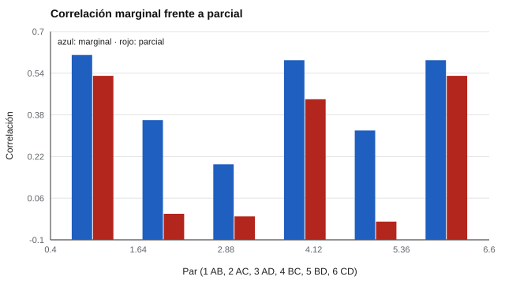

# 049 — Análisis de redes psicométricas


<!-- NAV -->
[← 048 — Modelos bifactor y jerárquicos](../048-modelos-bifactor-y-jerarquicos/README.md) · [📚 Parte 04](../README.md) · [🗺️ Índice 001–200](../../../PROGRAMA.md) · [050 — Datos ordinales y correlaciones policóricas →](../050-datos-ordinales-y-correlaciones-policoricas/README.md)
<!-- /NAV -->

**Parte 04 — Estructura y análisis factorial** · Nivel avanzado · 4 h · Estado `escrita`
**Pensada para:** quien estudia relaciones entre síntomas, conductas o ítems, y quien lee gráficos de redes.
**Prerrequisitos:** clases 041 y 027.

## ¿Para qué te sirve esto?

En los últimos años se han popularizado los gráficos de «redes»: círculos (nodos) unidos por líneas (aristas). Alternativa al análisis factorial, proponen que los síntomas o conductas **se influyen entre sí** en lugar de depender de una causa común oculta (Borsboom & Cramer, 2013). Esta clase te enseña la idea clave, la **correlación parcial**, y te advierte de lo que una red **no** puede decir.

## Al terminar esta clase podrás

- Distinguir correlación marginal de correlación parcial.
- Interpretar una red de correlaciones parciales.
- Reconocer los límites causales y de estimación de las redes.
- Leer críticamente un gráfico de red.

## La idea en palabras simples

Si A causa B, y B causa C, entonces A y C correlacionan aunque no se influyan directamente: la relación pasa **a través de B**. La **correlación marginal** mezcla todas estas rutas. La **correlación parcial** mide la relación entre A y C **una vez que se descuenta B** (y las demás variables). En una red, una arista dibuja una relación parcial distinta de cero: una asociación «directa».

A diferencia del modelo factorial, **no postula una causa común latente**.

## Cómo funciona, paso a paso

**1. Calcular las correlaciones marginales.**

**2. Calcular las correlaciones parciales** (condicionadas a las demás variables).

**3. Dibujar una arista** donde la parcial sea relevante (por ejemplo, |parcial| > 0,10).

**Ejemplo.** r_AB = 0,6; r_BC = 0,6; r_AC = 0,36: la parcial (A, C | B) = (0,36 − 0,36) / √(0,64 · 0,64) = **0**.



*Figura 1.* Las parciales recuperan la cadena A–B–C–D; las marginales sugieren aristas espurias.

## Si construyes el instrumento

- Usa redes para explorar relaciones entre elementos, no para probar causas.
- Con muestras pequeñas, usa estimación regularizada y reporta la precisión de las aristas y la estabilidad de la centralidad (Epskamp et al., 2018).
- No interpretes la «centralidad» como importancia sin estudios de estabilidad.
- Informa qué variables se incluyeron: cambiar los nodos cambia la red.

## Si eres evaluado

- Un gráfico de red es una descripción estadística de asociaciones en un grupo; no explica por qué te pasa algo a ti.
- Una arista no significa que una cosa cause la otra.
- Si te muestran una «red de tus síntomas», recuerda que es un resumen de grupos y requiere interpretación profesional.

## Qué muestra el laboratorio

`lab.py` simula una cadena A → B → C → D (cada eslabón con r ≈ 0,6, N = 5.000).

| Par | Correlación marginal | Parcial |
|---|---:|---:|
| A–B | 0,61 | 0,53 |
| A–C | 0,36 | −0,00 |
| A–D | 0,19 | −0,01 |
| B–C | 0,59 | 0,44 |
| B–D | 0,32 | −0,03 |
| C–D | 0,59 | 0,53 |

Aristas con |parcial| > 0,10: **A–B, B–C, C–D**.

**Análisis.** (1) Las parciales recuperan la cadena. (2) Las marginales sugieren aristas espurias (A–C, A–D, B–D). (3) Una red de correlaciones parciales es una descripción estadística de asociación condicional: no establece causalidad ni dirección. (4) Aquí no se regulariza; con muestras pequeñas, las parciales son ruidosas.

## Errores frecuentes

- Leer una arista como causalidad.
- Interpretar la centralidad como «importancia» sin estudio de estabilidad.
- Estimar redes con muestras pequeñas sin regularización.
- Comparar redes entre grupos sin pruebas formales.

## Lo mínimo que debes llevarte

1. Arista = correlación parcial relevante.
2. Las marginales mezclan rutas directas e indirectas.
3. Una red no es causalidad.
4. Con n pequeño, regulariza y reporta estabilidad.

## Ejercicios

- **Inicial.** ¿Qué indica una arista con parcial 0? *Solución: que no hay asociación directa una vez controladas las demás variables.*
- **Intermedio.** ¿Por qué A y C correlacionan 0,36 si no están conectados directamente? *Solución: por la mediación de B.*
- **Avanzado.** Añade en `lab.py` una causa común E que afecte a A y D y observa la red.
- **Aplicación.** Calcula las parciales de cuatro ítems de un cuestionario real y dibuja la red.

## Glosario

- **Red psicométrica:** representación de variables como nodos y asociaciones condicionales como aristas.
- **Correlación parcial:** correlación entre dos variables descontando las demás.
- **Centralidad:** medida de cuán conectado está un nodo.
- **Regularización:** técnica para estabilizar estimaciones con pocos datos.

## Laboratorio

```bash
python classes/part-04-estructura-y-analisis-factorial/049-analisis-de-redes-psicometricas/lab.py
python classes/part-04-estructura-y-analisis-factorial/figuras.py
```

## Autoevaluación y criterios

1. ¿Qué responde una red que no responde un modelo factorial? 2. ¿Qué no puede responder? 3. ¿Qué precauciones usas con n pequeño?
Se logra la clase si puedes calcular parciales e interpretar la red con cautela causal.

## Bibliografía

- Borsboom, D., & Cramer, A. O. J. (2013). Network analysis: An integrative approach to the structure of psychopathology. *Annual Review of Clinical Psychology*, 9, 91-121.
- Epskamp, S., & Fried, E. I. (2018). A tutorial on regularized partial correlation networks. *Psychological Methods*, 23(4), 617-634.
- Epskamp, S., Borsboom, D., & Fried, E. I. (2018). Estimating psychological networks and their accuracy: A tutorial paper. *Behavior Research Methods*, 50(1), 195-212.

---

<!-- NAV -->
[← 048 — Modelos bifactor y jerárquicos](../048-modelos-bifactor-y-jerarquicos/README.md)  
[📚 Parte 04](../README.md) · [🗺️ Índice 001–200](../../../PROGRAMA.md)  
[050 — Datos ordinales y correlaciones policóricas →](../050-datos-ordinales-y-correlaciones-policoricas/README.md)
<!-- /NAV -->
