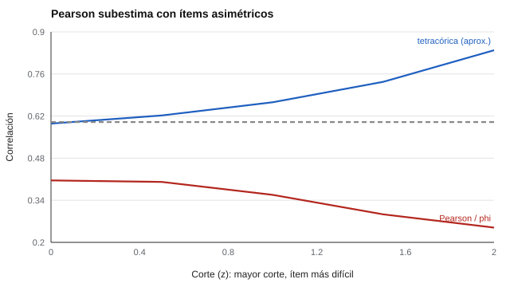

# 050 — Datos ordinales y correlaciones policóricas


<!-- NAV -->
[← 049 — Análisis de redes psicométricas](../049-analisis-de-redes-psicometricas/README.md) · [📚 Parte 04](../README.md) · [🗺️ Índice 001–200](../../../PROGRAMA.md) · [051 — Los límites que hacen falta superar →](../../part-05-teoria-de-respuesta-al-item/051-limites-de-la-teoria-clasica/README.md)
<!-- /NAV -->

**Parte 04 — Estructura y análisis factorial** · Nivel avanzado · 4 h · Estado `escrita`
**Pensada para:** quien analiza ítems con pocas categorías de respuesta y quien lee análisis factoriales de cuestionarios.
**Prerrequisitos:** clases 012 y 027.

## ¿Para qué te sirve esto?

La mayoría de los cuestionarios usan respuestas con 2 a 5 categorías. Si se analizan con la correlación de Pearson, **se subestima** la relación entre los rasgos que hay detrás, y más cuanto más «fáciles» o «difíciles» son los ítems. Eso puede incluso producir **factores falsos** que solo reflejan la dificultad. Esta clase te enseña cómo ocurre, cuál es la alternativa (las correlaciones tetracórica y policórica) y cuándo basta Pearson.

## Al terminar esta clase podrás

- Explicar por qué Pearson subestima el vínculo latente de variables ordinales.
- Distinguir correlaciones tetracórica y policórica.
- Reconocer los «factores de dificultad».
- Elegir el coeficiente según el número de categorías y la asimetría.

## La idea en palabras simples

Piensa en dos rasgos continuos (por ejemplo, ansiedad y preocupación) correlacionados 0,60. Si cada uno se registra solo como «sí/no» con un corte alto (casi todos responden «no»), casi no hay variación que correlacionar, y el **phi** (Pearson para dos categorías) cae. La correlación **tetracórica** (para dos categorías) y la **policórica** (para más de dos) estiman la correlación entre los rasgos **continuos subyacentes**, suponiendo que hay una normal detrás de las categorías.

Ferguson (1941) describió el artefacto de dificultad: ítems de distinta dificultad se agrupan en «factores» distintos aunque midan lo mismo.

## Cómo funciona, paso a paso

**1. Reconocer el problema:** pocas categorías y/o respuestas muy asimétricas.

**2. Estimar la correlación latente:** tetracórica o policórica (por máxima verosimilitud; Olsson, 1979).

**3. Usar estimadores adecuados** en el análisis factorial (por ejemplo, WLSMV; Flora & Curran, 2004).

**Ejemplo.** Dicotomizar ambas variables en la mediana da, en teoría, phi = (2/π)·arcsen(ρ) = 0,637 · arcsen(0,6) ≈ 0,41, coherente con el 0,406 observado: ya cuesta ~0,19 de correlación.



*Figura 1.* Cuanto más extremo el corte (ítem más difícil), más subestima el phi.

## Si construyes el instrumento

- Con 2 a 4 categorías, prefiere correlaciones policóricas y estimadores para datos ordinales.
- Con 5 o más categorías y distribuciones razonables, Pearson suele bastar.
- Revisa la asimetría de los ítems: ítems muy fáciles o muy difíciles producen artefactos.
- No pretendas que la policórica «arregle» ítems malos.

## Si eres evaluado

- Si el instrumento tiene ítems de sí/no, su estructura puede estar mal estimada si se usó el método inadecuado.
- Un factor que agrupa solo los ítems «más difíciles» probablemente refleja dificultad, no un rasgo.
- Pregunta qué método se usó para analizar los datos ordinales.

## Qué muestra el laboratorio

`lab.py` simula dos variables continuas con correlación latente 0,60 (N = 60.000) dicotomizadas en distintos cortes.

| Corte (z) | % de unos | Pearson / phi | Tetracórica (aprox.) |
|---:|---:|---:|---:|
| 0,0 | 50,2 % | 0,406 | 0,595 |
| 0,5 | 30,9 % | 0,401 | 0,622 |
| 1,0 | 16,0 % | 0,358 | 0,666 |
| 1,5 | 6,7 % | 0,293 | 0,734 |
| 2,0 | 2,4 % | 0,249 | 0,839 |

**Análisis.** (1) El phi (Pearson) baja de 0,406 a 0,249 al hacerse más asimétrica la dicotomía: subestima. (2) La tetracórica aproximada recupera ≈ 0,60 con cortes centrales. (3) La aproximación (Bonett & Price, 2005) es buena con cortes centrales y burda en los extremos (sobrestima con 2 % de unos); la estimación correcta es por máxima verosimilitud. (4) Ese artefacto crea «factores de dificultad» espurios en el análisis factorial de ítems dicotómicos con Pearson.

## Errores frecuentes

- Usar Pearson en ítems binarios o con 2–4 categorías sin considerar el artefacto.
- Aplicar policóricas con muestras pequeñas o con normalidad latente inverosímil.
- Creer que la policórica arregla ítems malos.
- Ignorar la asimetría de las respuestas.

## Lo mínimo que debes llevarte

1. Pearson subestima con pocas categorías y asimetría.
2. Tetracórica/policórica estiman la correlación latente.
3. La dificultad puede crear factores falsos.
4. Con 5 o más categorías, el problema es menor.

## Ejercicios

- **Inicial.** ¿Por qué phi baja cuando los ítems son muy fáciles? *Solución: casi todos responden igual y hay poca variación que correlacionar.*
- **Intermedio.** Con 5 categorías simétricas, ¿esperas mayor o menor sesgo que con 2? *Solución: menor.*
- **Avanzado.** Cambia RHO a 0,3 en `lab.py` y compara el sesgo relativo.
- **Aplicación.** Revisa un artículo con ítems dicotómicos y señala qué correlación usó.

## Glosario

- **Ítem ordinal:** ítem con categorías ordenadas.
- **Phi:** correlación de Pearson entre dos variables binarias.
- **Tetracórica / policórica:** estimaciones de la correlación latente a partir de 2 / más categorías.
- **Factor de dificultad:** factor espurio que agrupa ítems por su dificultad.

## Laboratorio

```bash
python classes/part-04-estructura-y-analisis-factorial/050-datos-ordinales-y-correlaciones-policoricas/lab.py
python classes/part-04-estructura-y-analisis-factorial/figuras.py
```

## Autoevaluación y criterios

1. ¿Qué es un factor de dificultad? 2. ¿Qué supuesto exige la policórica? 3. ¿Cuándo basta Pearson?
Se logra la clase si puedes elegir el coeficiente según las categorías y la asimetría.

## Bibliografía

- Ferguson, G. A. (1941). The factorial interpretation of test difficulty. *Psychometrika*, 6(5), 323-329. ✅ [DOI](https://doi.org/10.1007/bf02288588)
- Olsson, U. (1979). Maximum likelihood estimation of the polychoric correlation coefficient. *Psychometrika*, 44(4), 443-460. ✅ [DOI](https://doi.org/10.1007/bf02296207)
- Flora, D. B., & Curran, P. J. (2004). An empirical evaluation of alternative methods of estimation for confirmatory factor analysis with ordinal data. *Psychological Methods*, 9(4), 466-491. ✅ [DOI](https://doi.org/10.1037/1082-989x.9.4.466)
- Bonett, D. G., & Price, R. M. (2005). Inferential methods for the tetrachoric correlation coefficient. *Journal of Educational and Behavioral Statistics*, 30(2), 213-225. ✅ [DOI](https://doi.org/10.3102/10769986030002213)

Leyenda: ✅ existe en Crossref con título y año coincidentes (enlace al DOI); ⚠️ hay una obra de título parecido con otro año (no se enlaza: comprobar la edición); 🔎 no verificada automáticamente (libros sin DOI, normas y sitios web). Crossref confirma la existencia de la fuente, no que respalde cada afirmación de la clase. Ver [`docs/VERIFICACION_BIBLIOGRAFIA.md`](../../../docs/VERIFICACION_BIBLIOGRAFIA.md).

---

<!-- NAV -->
[← 049 — Análisis de redes psicométricas](../049-analisis-de-redes-psicometricas/README.md)  
[📚 Parte 04](../README.md) · [🗺️ Índice 001–200](../../../PROGRAMA.md)  
[051 — Los límites que hacen falta superar →](../../part-05-teoria-de-respuesta-al-item/051-limites-de-la-teoria-clasica/README.md)
<!-- /NAV -->
