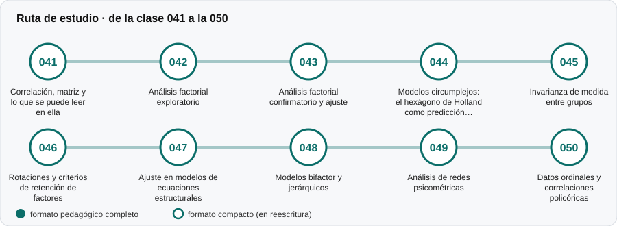

# 🧩 Parte 04 — Estructura y análisis factorial

**Nivel:** avanzado · **Duración estimada:** 4-5 semanas · **Clases:** 10

## De qué trata

Cómo se somete a prueba la estructura que un instrumento afirma tener (cuántas dimensiones, qué ítems pertenecen a cuál) y qué significa que los datos la contradigan.

## Por qué importa

Las escalas se interpretan según su estructura. Si los ítems no se agrupan como se supone, los puntajes por escala pierden sentido.

## Según tu papel

- **Si construyes o aplicas instrumentos:** Análisis factorial exploratorio y confirmatorio, rotaciones, ajuste, bifactor, redes, datos ordinales e invarianza.
- **Si eres evaluado o recibes resultados:** Te ayuda a entender por qué un informe entrega perfiles por dimensiones y cuánta confianza darles.

## Al terminar esta parte podrás

- Interpretar cargas factoriales y criterios de retención.
- Leer índices de ajuste con cautela.
- Explicar por qué se comprueba la invarianza antes de comparar grupos.

## Cómo estudiarla

Es la parte más matemática de las primeras. Se puede avanzar sin dominar el álgebra si se trabaja con los laboratorios.

## Ruta de estudio

## Clases en orden de estudio

Las clases están numeradas de forma consecutiva (001 a 200) en el orden de estudio: sigue el número.

| Orden | ID | Clase | Qué aprenderás | Formato | Horas |
|---:|---|---|---|---|---:|
| 1 | 041 | [Correlación, matriz y lo que se puede leer en ella](041-correlacion-y-matriz/README.md) | Leer una matriz de correlaciones: bloques, magnitudes y signos. | 🟡 compacto | 4 |
| 2 | 042 | [Análisis factorial exploratorio](042-analisis-factorial-exploratorio/README.md) | Explicar el modelo factorial común: cargas, comunalidades y unicidades. | 🟡 compacto | 6 |
| 3 | 043 | [Análisis factorial confirmatorio y ajuste](043-analisis-factorial-confirmatorio/README.md) | Distinguir AFC de AFE: el modelo se fija antes de ver los datos. | 🟡 compacto | 6 |
| 4 | 044 | [Modelos circumplejos: el hexágono de Holland como predicción falsable](044-modelos-circumplejos/README.md) | Explicar el modelo circumplejo y la predicción de orden de las correlaciones. | 🟡 compacto | 5 |
| 5 | 045 | [Invarianza de medida entre grupos](045-invarianza-de-medida/README.md) | Distinguir invarianza configural, métrica, escalar y estricta. | 🟡 compacto | 6 |
| 6 | 046 | [Rotaciones y criterios de retención de factores](046-rotaciones-y-criterios-de-retencion-de-factores/README.md) | Explicar por qué la solución factorial inicial no es única. | 🟡 compacto | 4 |
| 7 | 047 | [Ajuste en modelos de ecuaciones estructurales](047-ajuste-en-modelos-de-ecuaciones-estructurales/README.md) | Calcular RMSEA, CFI y TLI a partir de chi-cuadrado y grados de libertad. | 🟡 compacto | 4 |
| 8 | 048 | [Modelos bifactor y jerárquicos](048-modelos-bifactor-y-jerarquicos/README.md) | Distinguir el modelo bifactor del modelo jerárquico de segundo orden. | 🟡 compacto | 4 |
| 9 | 049 | [Análisis de redes psicométricas](049-analisis-de-redes-psicometricas/README.md) | Distinguir correlación marginal de correlación parcial. | 🟡 compacto | 4 |
| 10 | 050 | [Datos ordinales y correlaciones policóricas](050-datos-ordinales-y-correlaciones-policoricas/README.md) | Explicar por qué Pearson subestima el vínculo latente de variables ordinales. | 🟡 compacto | 4 |

[← Volver al índice del programa](../../README.md) · [Índice numérico de las 200 clases](../../PROGRAMA.md)
