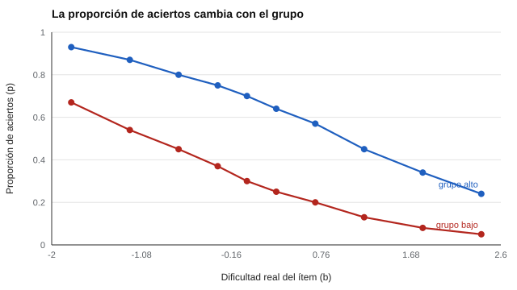

# 051 — Los límites que hay que superar: lo que la teoría clásica no resuelve


<!-- NAV -->
[← 050 — Datos ordinales y correlaciones policóricas](../../part-04-estructura-y-analisis-factorial/050-datos-ordinales-y-correlaciones-policoricas/README.md) · [📚 Parte 05](../README.md) · [🗺️ Índice 001–200](../../../PROGRAMA.md) · [052 — El modelo de Rasch →](../052-modelo-de-rasch/README.md)
<!-- /NAV -->

**Parte 05 — Teoría de respuesta al ítem** · Nivel avanzado · 4 h · Estado `escrita`
**Pensada para:** quien construye bancos de ítems, quien compara pruebas distintas y quien se pregunta por qué existe la «TRI».
**Prerrequisitos:** clases 015, 021 y 025.

## ¿Para qué te sirve esto?

Con la teoría clásica, la dificultad de un ítem (la proporción que acierta) **depende de quiénes lo respondieron**, y el puntaje de una persona **depende de qué ítems le tocaron**. Esto es un problema práctico: no puedes comparar el resultado de dos personas que rindieron pruebas distintas, ni reutilizar un ítem en otro grupo sin recalcular todo. La **teoría de respuesta al ítem (TRI)** propone una salida. Esta clase muestra, con datos, cuál es el problema, y qué promete la TRI.

## Al terminar esta clase podrás

- Enumerar tres límites de la teoría clásica (dependencia de la muestra, error único, puntaje dependiente del test).
- Mostrar con datos que la dificultad (p) y la discriminación (r ítem-resto) cambian con el grupo.
- Enunciar la propiedad de invarianza de parámetros de la TRI y su condición.
- Decir qué se pierde frente a la simplicidad clásica.

## La idea en palabras simples

La TRI cambia la pregunta. En vez de «¿cuántos ítems acertó la persona?», pregunta «**¿cuál es la probabilidad de que una persona con cierto nivel de rasgo (θ) acierte un ítem con ciertas características?**». Cada ítem queda descrito por **sus propios parámetros** (por ejemplo, su dificultad b), que no cambian según quién lo responda, y cada persona queda descrita por su θ, que no depende de qué ítems tuvo.

Es como describir la altura de un obstáculo (b) y la capacidad de salto de un atleta (θ): la altura del obstáculo no depende de quién salte, y la capacidad del atleta no depende de qué obstáculo le pongan.

## Cómo funciona, paso a paso

**1. Mostrar el problema clásico.** Se aplican los mismos 10 ítems a dos grupos: uno de habilidad baja (θ medio −1) y otro de alta (+1).

**2. Comparar.** La dificultad clásica p cambia mucho de un grupo a otro; la dificultad TRI (b) estimada no.

**Ejemplo resuelto.** Un ítem con p = 0,93 en el grupo alto y 0,67 en el bajo parece «fácil» o «medio» según el grupo; su b (−1,85 y −1,91) lo ubica en el mismo punto de la escala de habilidad.



*Figura 1.* El b estimado (línea) coincide en ambos grupos; la proporción de aciertos (puntos) no.

**3. La condición.** Esa invarianza vale **solo si el modelo se ajusta** a los datos y las muestras son razonables.

## Si construyes el instrumento

- La TRI sirve cuando necesitas bancos reutilizables, formas equivalentes o pruebas adaptativas.
- Exige más datos (cientos a miles de personas) y más supuestos que la teoría clásica.
- Comprueba el ajuste del modelo antes de confiar en la invarianza.
- Si el instrumento es pequeño y para un solo grupo, la teoría clásica puede bastar.

## Si eres evaluado

- Cuando dos personas rinden pruebas distintas y obtienen puntajes comparables, es porque se usó TRI para ponerlas en la misma escala.
- Un puntaje basado en TRI no es «el número de aciertos»: depende de **cuáles** ítems acertaste.
- Pregunta qué modelo se usó y si su ajuste se comprobó.

## Qué muestra el laboratorio

`lab.py` simula 10 ítems de dificultad conocida y dos grupos de habilidad media −1 y +1.

| Ítem | b real | p baja / alta | r baja / alta | b estimado baja / alta |
|---:|---:|---|---|---|
| 1 | −1,8 | 0,67 / 0,93 | 0,28 / 0,21 | −1,85 / −1,91 |
| 5 | 0,0 | 0,30 / 0,70 | 0,32 / 0,29 | 0,01 / 0,02 |
| 10 | 2,4 | 0,05 / 0,24 | 0,17 / 0,26 | 2,42 / 2,36 |

**Análisis.** (1) p y r cambian mucho con el grupo: el ítem «difícil» pasa a «fácil». (2) El b estimado coincide con el real en ambos grupos. (3) Esa propiedad (parámetros del ítem independientes de la muestra y habilidad independiente de los ítems) es lo que la TRI agrega. (4) **Aviso:** aquí la habilidad se conoce porque se simula; en datos reales se estima a la vez (clases 052 y 056).

## Errores frecuentes

- Creer que la TRI «resuelve» automáticamente la muestra: exige ajuste y muestras razonables.
- Interpretar la invarianza con ítems sesgados (DIF, clase 063).
- Usar TRI con muestras de decenas de personas.
- Pensar que la TRI es siempre superior a la teoría clásica.

## Lo mínimo que debes llevarte

1. En la teoría clásica, p y r dependen del grupo.
2. En la TRI, los parámetros del ítem no dependen del grupo (si el modelo ajusta).
3. La TRI permite comparar personas con pruebas distintas.
4. Tiene costos: más datos y más supuestos.

## Ejercicios

- **Inicial.** ¿Qué dos índices clásicos dependen de la muestra? *Solución: dificultad (p) y discriminación (r).*
- **Intermedio.** Si un ítem tiene p = 0,5 en un grupo con media 0 y b = 0, ¿cuál sería p en un grupo con media +1 (a = 1)? *Solución: ≈ logística(1) = 0,73.*
- **Avanzado.** Añade un tercer grupo con media 0 en `lab.py` y comprueba que el b estimado se mantiene.
- **Aplicación.** Explica a un colega, sin fórmulas, por qué dos formas de un examen pueden dar notas comparables con TRI.

## Glosario

- **TRI:** teoría de respuesta al ítem.
- **θ (theta):** nivel de la persona en el rasgo.
- **b:** dificultad del ítem en la escala del rasgo.
- **Invarianza de parámetros:** los parámetros del ítem no dependen del grupo.

## Laboratorio

```bash
python classes/part-05-teoria-de-respuesta-al-item/051-limites-de-la-teoria-clasica/lab.py
python classes/part-05-teoria-de-respuesta-al-item/figuras.py
```

## Autoevaluación y criterios

1. ¿Qué condiciones requiere la invarianza? 2. ¿Qué ventaja práctica trae para bancos de ítems? 3. ¿Qué se pierde frente a la simplicidad clásica?
Se logra la clase si puedes contrastar p y b entre grupos y declarar la condición de ajuste del modelo.

## Bibliografía

- Hambleton, R. K., & Jones, R. W. (1993). Comparison of classical test theory and item response theory and their applications to test development. *Educational Measurement: Issues and Practice*, 12(3), 38-47. 🔎 sin verificar (libro, norma o sitio no hallado en Crossref: comprobar a mano)
- Embretson, S. E., & Reise, S. P. (2000). *Item Response Theory for Psychologists*. Lawrence Erlbaum. 🔎 sin verificar (libro, norma o sitio no hallado en Crossref: comprobar a mano)
- Lord, F. M. (1980). *Applications of Item Response Theory to Practical Testing Problems*. Lawrence Erlbaum. ⚠️ hay una obra de título parecido en Crossref con otro año (2012): comprobar la edición a mano

Leyenda: ✅ existe en Crossref con título y año coincidentes (enlace al DOI); ⚠️ hay una obra de título parecido con otro año (no se enlaza: comprobar la edición); 🔎 no verificada automáticamente (libros sin DOI, normas y sitios web). Crossref confirma la existencia de la fuente, no que respalde cada afirmación de la clase. Ver [`docs/VERIFICACION_BIBLIOGRAFIA.md`](../../../docs/VERIFICACION_BIBLIOGRAFIA.md).

---

<!-- NAV -->
[← 050 — Datos ordinales y correlaciones policóricas](../../part-04-estructura-y-analisis-factorial/050-datos-ordinales-y-correlaciones-policoricas/README.md)  
[📚 Parte 05](../README.md) · [🗺️ Índice 001–200](../../../PROGRAMA.md)  
[052 — El modelo de Rasch →](../052-modelo-de-rasch/README.md)
<!-- /NAV -->
