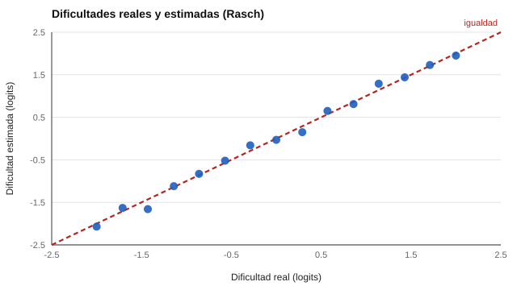

# 052 — El modelo de Rasch


<!-- NAV -->
[← 051 — Los límites que hacen falta superar](../051-limites-de-la-teoria-clasica/README.md) · [📚 Parte 05](../README.md) · [🗺️ Índice 001–200](../../../PROGRAMA.md) · [053 — Modelos de dos y tres parámetros →](../053-modelos-de-dos-y-tres-parametros/README.md)
<!-- /NAV -->

**Parte 05 — Teoría de respuesta al ítem** · Nivel avanzado · 5 h · Estado `escrita`
**Pensada para:** quien construye pruebas con escalas de medida comparables y quien lee resultados de pruebas estandarizadas.
**Prerrequisitos:** clase 051.

## ¿Para qué te sirve esto?

El modelo de Rasch es el más simple y el más usado de la TRI. Detrás de muchas evaluaciones nacionales e internacionales hay una escala de Rasch. Su gran ventaja: el **puntaje total basta** para estimar la habilidad. Su costo: exige que todos los ítems discriminen igual. Aprenderlo te sirve para entender cómo se construyen escalas «comunes» y para leer informes que hablan de «logits» o de «ajuste».

## Al terminar esta clase podrás

- Enunciar el modelo y su propiedad de suficiencia.
- Estimar dificultades y habilidades con un algoritmo explícito.
- Reconocer sus supuestos y su costo.
- Leer una estimación de Rasch de forma crítica.

## La idea en palabras simples

En el modelo de Rasch (1960), la probabilidad de acertar depende solo de la **diferencia** entre la habilidad de la persona (θ) y la dificultad del ítem (b):

```
P(acierto) = e^(θ − b) / (1 + e^(θ − b))
```

- Si θ = b, la probabilidad es 0,5.
- Cada unidad de diferencia multiplica los *odds* (probabilidades relativas) por e ≈ 2,72.
- Los valores de θ y b se expresan en **logits**.

Como solo importa la diferencia, el **puntaje total es un estadístico suficiente**: dos personas con el mismo puntaje tienen la misma estimación de θ, sin importar cuáles ítems acertaron.

## Cómo funciona, paso a paso

**1. Ejemplo.** θ = 1 y b = 0: P = 1 / (1 + e⁻¹) = **0,731**. θ = 0 y b = 1: P = **0,269**.

**2. Estimar.** El laboratorio implementa estimación conjunta de máxima verosimilitud (JMLE) con Newton-Raphson alternado: se estiman a la vez dificultades y habilidades, se excluyen las personas con puntaje 0 y perfecto y se aplica la corrección (K − 1)/K. Es didáctico, no un reemplazo de paquetes como eRm, TAM o mirt.

**3. Revisar.** Se comparan los parámetros estimados con los reales (en simulación) o se evalúa el ajuste de cada ítem (en datos reales).



*Figura 1.* Las dificultades estimadas siguen de cerca las reales (r = 0,997).

## Si construyes el instrumento

- Usa Rasch cuando quieras una escala simple, con interpretación directa y puntaje total suficiente.
- Comprueba el ajuste de cada ítem y no descartes ítems sin mirar su contenido.
- Con pocos ítems, JMLE sesga los parámetros; hay alternativas (CML, MML).
- No interpretes la escala como de intervalo sin comprobar el ajuste.

## Si eres evaluado

- Si te informan tu puntaje en «logits» o en una escala derivada, proviene de un modelo como este.
- En Rasch, solo cuenta **cuántos** ítems aciertas (no cuáles), y los ítems más difíciles pesan igual que los fáciles.
- Los puntajes extremos (todo o nada) no se pueden estimar con precisión.

## Qué muestra el laboratorio

`lab.py` simula 800 personas y 15 ítems de dificultad entre −2 y +2 (794 con estimación finita).

| Medida | Valor |
|---|---:|
| r (b real, b estimado) | 0,997 |
| RMSE de b | 0,095 |
| r (θ real, θ estimado) | 0,830 |

**Análisis.** (1) Las dificultades estimadas siguen casi exactamente a las reales (r = 0,997; error típico de 0,095 logits). (2) Las habilidades se recuperan peor (r = 0,830) porque con 15 ítems cada persona aporta poca información. (3) Esa simplicidad tiene un precio: asume igual discriminación en todos los ítems (clase 053). (4) Seis personas con puntaje 0 o perfecto quedan fuera de la estimación finita.

## Errores frecuentes

- Interpretar la escala de Rasch como de intervalo sin comprobar el ajuste.
- Descartar ítems que no ajustan sin mirar su contenido.
- Usar JMLE con pocos ítems sin advertir el sesgo.
- Estimar con muestras muy pequeñas.

## Lo mínimo que debes llevarte

1. P depende solo de θ − b.
2. El puntaje total es suficiente.
3. Se estima en logits.
4. El supuesto fuerte: todos los ítems discriminan igual.

## Ejercicios

- **Inicial.** ¿Cuál es P si θ = b? *Solución: 0,5.*
- **Intermedio.** Si b₁ = −1 y b₂ = 1, ¿en cuánto difieren los logits de acierto para la misma persona? *Solución: en 2.*
- **Avanzado.** Aumenta K a 30 en `lab.py` y observa el RMSE.
- **Aplicación.** Busca el informe técnico de una prueba nacional y señala si usó un modelo de Rasch.

## Glosario

- **Logit:** unidad de la escala de Rasch (logaritmo de los odds).
- **Odds:** cociente entre la probabilidad de acierto y de fallo.
- **Estadístico suficiente:** resumen que contiene toda la información sobre θ.
- **JMLE:** estimación conjunta de máxima verosimilitud.

## Laboratorio

```bash
python classes/part-05-teoria-de-respuesta-al-item/052-modelo-de-rasch/lab.py
python classes/part-05-teoria-de-respuesta-al-item/figuras.py
```

## Autoevaluación y criterios

1. ¿Por qué el puntaje total es suficiente? 2. ¿Qué supuesto es más fuerte que en 2PL? 3. ¿Qué se pierde al excluir puntajes extremos?
Se logra la clase si puedes estimar parámetros y discutir los supuestos.

## Bibliografía

- Rasch, G. (1960). *Probabilistic Models for Some Intelligence and Attainment Tests*. Danish Institute for Educational Research. ⚠️ hay una obra de título parecido en Crossref con otro año (2010): comprobar la edición a mano
- Wright, B. D., & Stone, M. H. (1979). *Best Test Design*. MESA Press. 🔎 sin verificar (libro, norma o sitio no hallado en Crossref: comprobar a mano)
- Andrich, D. (1988). *Rasch Models for Measurement*. Sage. ✅ [DOI](https://doi.org/10.4135/9781412985598)

Leyenda: ✅ existe en Crossref con título y año coincidentes (enlace al DOI); ⚠️ hay una obra de título parecido con otro año (no se enlaza: comprobar la edición); 🔎 no verificada automáticamente (libros sin DOI, normas y sitios web). Crossref confirma la existencia de la fuente, no que respalde cada afirmación de la clase. Ver [`docs/VERIFICACION_BIBLIOGRAFIA.md`](../../../docs/VERIFICACION_BIBLIOGRAFIA.md).

---

<!-- NAV -->
[← 051 — Los límites que hacen falta superar](../051-limites-de-la-teoria-clasica/README.md)  
[📚 Parte 05](../README.md) · [🗺️ Índice 001–200](../../../PROGRAMA.md)  
[053 — Modelos de dos y tres parámetros →](../053-modelos-de-dos-y-tres-parametros/README.md)
<!-- /NAV -->
