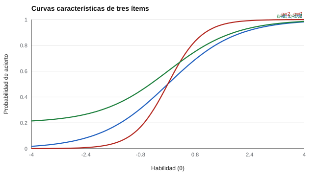

# 053 — Modelos de dos y tres parámetros


<!-- NAV -->
[← 052 — El modelo de Rasch](../052-modelo-de-rasch/README.md) · [📚 Parte 05](../README.md) · [🗺️ Índice 001–200](../../../PROGRAMA.md) · [054 — Función de información: dónde mide bien cada… →](../054-informacion-del-item/README.md)
<!-- /NAV -->

**Parte 05 — Teoría de respuesta al ítem** · Nivel avanzado · 5 h · Estado `escrita`
**Pensada para:** quien construye pruebas de opción múltiple y quien interpreta curvas de ítems.
**Prerrequisitos:** clase 052.

## ¿Para qué te sirve esto?

En Rasch todos los ítems discriminan igual y nadie acierta por azar. Eso casi nunca es cierto: algunos ítems separan mucho mejor a los buenos de los malos, y en las pruebas de alternativas se acierta a veces adivinando. Los modelos de **dos parámetros (2PL)** y **tres parámetros (3PL)** agregan esas dos realidades. Entenderlos te permite leer curvas de ítems, detectar ítems que no discriminan y no confundir «dificultad» con adivinación.

## Al terminar esta clase podrás

- Interpretar a (discriminación), b (dificultad) y c (adivinación).
- Recuperar parámetros con una regresión logística cuando θ se conoce.
- Mostrar la distorsión de ignorar c.
- Decidir cuándo es defendible un 3PL.

## La idea en palabras simples

La curva característica de un ítem dice cómo sube la probabilidad de acertar a medida que sube la habilidad.

- **a (discriminación):** qué tan empinada es la curva. Un ítem con a alto distingue bien entre quienes están justo por debajo y por encima de b.
- **b (dificultad):** el nivel de habilidad con que se acierta con probabilidad media.
- **c (adivinación):** el «piso» de la curva: aun quien no sabe nada acierta con probabilidad c (por ejemplo, 0,25 con 4 alternativas).

```
P(θ) = c + (1 − c) · logística( a·(θ − b) )          (Birnbaum, 1968)
```

En el 2PL, c = 0.

## Cómo funciona, paso a paso

**1. Ejemplo resuelto.** a = 2 y θ − b = 0,5: logística(1) = 0,731. Con c = 0,2: 0,2 + 0,8 · 0,731 = **0,785**.

**2. Comparar curvas.**

| (a, b, c) | θ = −3 | −1 | 0 | 1 | 3 |
|---|---:|---:|---:|---:|---:|
| (1, 0, 0) | 0,05 | 0,27 | 0,50 | 0,73 | 0,95 |
| (2, 0, 0) | 0,00 | 0,12 | 0,50 | 0,88 | 1,00 |
| (1, 0, 0,2) | 0,24 | 0,42 | 0,60 | 0,78 | 0,96 |



*Figura 1.* A mayor a, más empinada; con c, la curva no baja de 0,2.

**3. Qué pasa si se ignora c.** Un ítem 3PL (a = 1,5; b = 0,5; c = 0,2) ajustado como 2PL da a = 0,96 y b = 0,04: la curva se aplana y se desplaza.

## Si construyes el instrumento

- Usa 2PL cuando los ítems difieran en discriminación; usa 3PL en opción múltiple con adivinación notable.
- Para estimar c con estabilidad se necesitan muestras grandes (cientos a miles); a menudo se fija o se usa un prior.
- No interpretes b como «dificultad» sin mirar a y c.
- Revisa los ítems con a bajo: no distinguen entre personas.

## Si eres evaluado

- Un ítem muy discriminativo cuenta más información que uno que no discrimina, aunque ambos valgan «1 punto».
- En una prueba de alternativas, parte de tus aciertos puede ser azar; los modelos de 3PL lo consideran.
- Dos personas con el mismo número de aciertos pueden obtener puntajes distintos con 2PL o 3PL.

## Qué muestra el laboratorio

`lab.py` calcula curvas y estima parámetros por regresión logística con θ conocido (30.000 personas).

- Ítem 2PL verdadero (a = 1,5; b = 0,5) → estimado a = 1,50; b = 0,50.
- Ítem 3PL verdadero (a = 1,5; b = 0,5; c = 0,2) ajustado como 2PL → a = 0,96; b = 0,04.

**Análisis.** (1) Con el modelo correcto se recuperan los parámetros. (2) Sin el parámetro c, el 2PL «aplana» la curva (a baja de 1,5 a 0,96) y desplaza b (de 0,5 a 0,04). (3) En pruebas de opción múltiple con adivinación, ignorar c distorsiona la dificultad. (4) Pero el 3PL exige muestras grandes; y aquí θ se conoce solo porque se simula.

## Errores frecuentes

- Ajustar 2PL a ítems de opción múltiple con adivinación notable.
- Estimar c con muestras pequeñas.
- Interpretar b como «dificultad» sin considerar a y c.
- Creer que más parámetros siempre es mejor.

## Lo mínimo que debes llevarte

1. a = pendiente, b = posición, c = piso.
2. Ignorar c aplana la curva y desplaza b.
3. El 3PL necesita muestras grandes.
4. La elección del modelo se justifica.

## Ejercicios

- **Inicial.** ¿Cuánto vale P en θ = b para un ítem 3PL con c = 0,25? *Solución: c + (1 − c) · 0,5 = 0,625.*
- **Intermedio.** Compara P en θ = −1 para a = 1 y a = 2 (b = 0). *Solución: 0,27 y 0,12.*
- **Avanzado.** Ajusta en `lab.py` un c fijo conocido y comprueba que recuperas a y b.
- **Aplicación.** Dibuja a mano la curva de un ítem de alternativas con 4 opciones.

## Glosario

- **Curva característica del ítem:** relación entre θ y la probabilidad de acierto.
- **Discriminación (a):** pendiente de la curva.
- **Dificultad (b):** posición de la curva en la escala de θ.
- **Pseudo-adivinación (c):** asíntota inferior de la curva.

## Laboratorio

```bash
python classes/part-05-teoria-de-respuesta-al-item/053-modelos-de-dos-y-tres-parametros/lab.py
python classes/part-05-teoria-de-respuesta-al-item/figuras.py
```

## Autoevaluación y criterios

1. ¿Qué cambia al aumentar a? 2. ¿Cuándo es defendible el 3PL? 3. ¿Qué datos exige?
Se logra la clase si puedes interpretar los parámetros y justificar el modelo.

## Bibliografía

- Birnbaum, A. (1968). Some latent trait models and their use in inferring an examinee's ability. En F. M. Lord & M. R. Novick, *Statistical Theories of Mental Test Scores*. Addison-Wesley. 🔎 sin verificar (libro, norma o sitio no hallado en Crossref: comprobar a mano)
- Baker, F. B., & Kim, S.-H. (2004). *Item Response Theory: Parameter Estimation Techniques* (2.ª ed.). CRC Press. 🔎 sin verificar (libro, norma o sitio no hallado en Crossref: comprobar a mano)
- Embretson, S. E., & Reise, S. P. (2000). *Item Response Theory for Psychologists*. Lawrence Erlbaum. 🔎 sin verificar (libro, norma o sitio no hallado en Crossref: comprobar a mano)

Leyenda: ✅ existe en Crossref con título y año coincidentes (enlace al DOI); ⚠️ hay una obra de título parecido con otro año (no se enlaza: comprobar la edición); 🔎 no verificada automáticamente (libros sin DOI, normas y sitios web). Crossref confirma la existencia de la fuente, no que respalde cada afirmación de la clase. Ver [`docs/VERIFICACION_BIBLIOGRAFIA.md`](../../../docs/VERIFICACION_BIBLIOGRAFIA.md).

---

<!-- NAV -->
[← 052 — El modelo de Rasch](../052-modelo-de-rasch/README.md)  
[📚 Parte 05](../README.md) · [🗺️ Índice 001–200](../../../PROGRAMA.md)  
[054 — Función de información: dónde mide bien cada… →](../054-informacion-del-item/README.md)
<!-- /NAV -->
