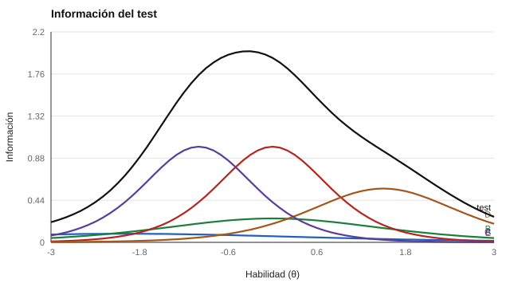

# 054 — Función de información: dónde mide bien cada ítem


<!-- NAV -->
[← 053 — Modelos de dos y tres parámetros](../053-modelos-de-dos-y-tres-parametros/README.md) · [📚 Parte 05](../README.md) · [🗺️ Índice 001–200](../../../PROGRAMA.md) · [055 — Testing adaptativo informatizado →](../055-testing-adaptativo/README.md)
<!-- /NAV -->

**Parte 05 — Teoría de respuesta al ítem** · Nivel avanzado · 4 h · Estado `escrita`
**Pensada para:** quien diseña tests para un rango específico del rasgo y quien interpreta su precisión.
**Prerrequisitos:** clase 053.

## ¿Para qué te sirve esto?

Con la teoría clásica, la precisión de un test se resume en un número (el alfa). Con TRI aparece algo más útil: **la precisión depende del nivel de la persona**. Un test puede medir muy bien a quienes están en el medio y mal a los extremos. La **función de información** te dice dónde mide bien cada ítem y el test completo. Es clave para diseñar un examen para un propósito concreto (por ejemplo, un corte de aprobación).

## Al terminar esta clase podrás

- Calcular la información de un ítem 2PL y la del test.
- Convertir información en error típico de estimación.
- Elegir ítems según el rango del rasgo que interesa.
- Explicar por qué la precisión es una curva y no un número.

## La idea en palabras simples

Una balanza de cocina sirve para pesar entre 100 g y 2 kg, pero no para pesar un camión ni una pluma. De forma parecida, un ítem aporta información sobre θ **cerca de su dificultad b**, y mucho más si su discriminación a es alta.

```
Iᵢ(θ) = a² · P(θ) · (1 − P(θ))
I_test(θ) = Σ Iᵢ(θ)
EE(θ) = 1 / √I_test(θ)
```

La información es máxima en θ = b y crece con a². El **error típico de estimación (EE)** es lo que queda de la «fiabilidad» en este marco (Lord, 1980; Hambleton et al., 1991).

## Cómo funciona, paso a paso

**1. Calcular la información de cada ítem** en varios niveles de θ.

**2. Sumar** para obtener la del test.

**3. Convertir** a error típico.

**Ejemplo resuelto.** a = 2, b = 0 en θ = 0: P = 0,5; I = 4 · 0,25 = 1,0. Para un EE de 0,30 se necesita I = 1 / 0,09 = 11,1.



*Figura 1.* La información del test (línea gruesa) es máxima en el centro y cae en los extremos.

## Si construyes el instrumento

- Define primero **dónde** necesitas precisión (por ejemplo, en el nivel de aprobación) y elige ítems con b cercano a ese punto.
- No supongas que más información siempre es mejor: también hay que cubrir el contenido.
- Recuerda que la información de un ítem 3PL es menor que la de un 2PL con los mismos a y b.
- Verifica que los parámetros estén bien estimados: la información depende de ellos.

## Si eres evaluado

- El error de tu puntaje puede ser distinto del de otra persona: si estás en un extremo, suele ser mayor.
- Un test pensado para decidir en un punto de corte mide mejor cerca de él.
- Pide el error típico de tu estimación, no solo la fiabilidad del test.

## Qué muestra el laboratorio

`lab.py` calcula la información de 5 ítems y del test.

| Ítem | θ = −2 | −1 | 0 | 1 | 2 |
|---|---:|---:|---:|---:|---:|
| A (a 0,6; b −2) | 0,09 | 0,08 | 0,06 | 0,04 | 0,03 |
| B (a 1,0; b 0) | 0,10 | 0,20 | 0,25 | 0,20 | 0,10 |
| C (a 2,0; b 0) | 0,07 | 0,42 | 1,00 | 0,42 | 0,07 |
| D (a 1,5; b 1,5) | 0,01 | 0,05 | 0,19 | 0,49 | 0,49 |
| E (a 2,0; b −1) | 0,42 | 1,00 | 0,42 | 0,07 | 0,01 |
| **Test** | 0,70 | 1,75 | 1,93 | 1,22 | 0,70 |
| Error típico | 1,20 | 0,76 | 0,72 | 0,90 | 1,19 |

**Análisis.** (1) C (a = 2) aporta cuatro veces la información de B (a = 1) en su zona; A casi no aporta en ninguna parte. (2) La precisión de un test **no es una cifra única**: es una curva. (3) Este test mide mejor entre −1 y 1 (error de 0,72 a 0,76) y peor en los extremos (hasta 2,18 en θ = −3). (4) Eso se decide al elegir ítems, no al interpretar puntajes.

## Errores frecuentes

- Tratar la información como fija: depende de la calidad de las estimaciones.
- Suponer que más información siempre es mejor.
- Olvidar que el 3PL aporta menos información que un 2PL equivalente.
- Usar un solo número de fiabilidad para toda la escala.

## Lo mínimo que debes llevarte

1. La información es máxima en θ = b y crece con a².
2. EE = 1 / √información.
3. La precisión es una curva.
4. Se elige ítems según el rango que interesa.

## Ejercicios

- **Inicial.** ¿Dónde es máxima la información de un ítem 2PL? *Solución: en θ = b.*
- **Intermedio.** Si I_test(θ) = 16, ¿cuál es el EE? *Solución: 0,25.*
- **Avanzado.** Elige en `lab.py` el ítem adicional que más reduzca el error en θ = 1,5.
- **Aplicación.** Diseña un test de cinco ítems para decidir en un corte de θ = 1.

## Glosario

- **Información del ítem:** cuánta precisión aporta un ítem en cada nivel de θ.
- **Información del test:** suma de las informaciones de sus ítems.
- **Error típico de estimación (EE):** precisión de la estimación de θ.
- **Discriminación (a):** pendiente de la curva del ítem.

## Laboratorio

```bash
python classes/part-05-teoria-de-respuesta-al-item/054-informacion-del-item/lab.py
python classes/part-05-teoria-de-respuesta-al-item/figuras.py
```

## Autoevaluación y criterios

1. ¿Por qué un ítem de a alto es más informativo? 2. ¿Cómo diseñarías un test para un corte en θ = 1? 3. ¿Cuál es la relación entre información y fiabilidad?
Se logra la clase si puedes calcular la información y elegir ítems para un rango.

## Bibliografía

- Lord, F. M. (1980). *Applications of Item Response Theory to Practical Testing Problems*. Lawrence Erlbaum. ⚠️ hay una obra de título parecido en Crossref con otro año (2012): comprobar la edición a mano
- Hambleton, R. K., Swaminathan, H., & Rogers, H. J. (1991). *Fundamentals of Item Response Theory*. Sage. ✅ [DOI](https://doi.org/10.2307/2075521)
- Embretson, S. E., & Reise, S. P. (2000). *Item Response Theory for Psychologists*. Lawrence Erlbaum. 🔎 sin verificar (libro, norma o sitio no hallado en Crossref: comprobar a mano)

Leyenda: ✅ existe en Crossref con título y año coincidentes (enlace al DOI); ⚠️ hay una obra de título parecido con otro año (no se enlaza: comprobar la edición); 🔎 no verificada automáticamente (libros sin DOI, normas y sitios web). Crossref confirma la existencia de la fuente, no que respalde cada afirmación de la clase. Ver [`docs/VERIFICACION_BIBLIOGRAFIA.md`](../../../docs/VERIFICACION_BIBLIOGRAFIA.md).

---

<!-- NAV -->
[← 053 — Modelos de dos y tres parámetros](../053-modelos-de-dos-y-tres-parametros/README.md)  
[📚 Parte 05](../README.md) · [🗺️ Índice 001–200](../../../PROGRAMA.md)  
[055 — Testing adaptativo informatizado →](../055-testing-adaptativo/README.md)
<!-- /NAV -->
