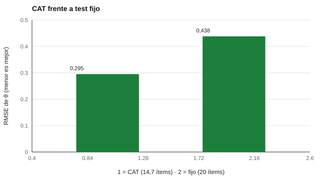

# 055 — Testing adaptativo informatizado


<!-- NAV -->
[← 054 — Función de información: dónde mide bien cada…](../054-informacion-del-item/README.md) · [📚 Parte 05](../README.md) · [🗺️ Índice 001–200](../../../PROGRAMA.md) · [056 — Estimación de parámetros y de habilidad →](../056-estimacion-de-parametros-y-de-habilidad/README.md)
<!-- /NAV -->

**Parte 05 — Teoría de respuesta al ítem** · Nivel avanzado · 5 h · Estado `escrita`
**Pensada para:** quien diseña o administra pruebas digitales, y quien las rinde.
**Prerrequisitos:** clases 053 y 054.

## ¿Para qué te sirve esto?

En un examen adaptativo, las preguntas que ves dependen de cómo vas respondiendo: si aciertas, te llegan más difíciles; si fallas, más fáciles. Resultado: **menos preguntas con la misma precisión**. Pruebas como los exámenes de acceso de algunos programas se administran así. Si construyes pruebas, es una de las aplicaciones más poderosas de la TRI; si las rindes, entender cómo funciona explica por qué tu prueba es distinta de la de tu compañero y por qué no siempre puedes volver atrás.

## Al terminar esta clase podrás

- Describir el ciclo de un CAT: estimar, seleccionar, administrar, detener.
- Comparar un CAT con un test fijo en precisión y longitud.
- Identificar los costos y riesgos del CAT.
- Decidir cuándo no usarías un CAT.

## La idea en palabras simples

Piensa en un entrenador que prueba a un atleta con barras de salto: si el atleta salta 1,60 m, no pierde tiempo con 1,00 m; sube a 1,80 m. Un **CAT** (Weiss, 1982; Wainer et al., 2000) hace lo mismo: después de cada respuesta, **estima** el nivel θ de la persona, **elige** el ítem que dé la máxima información en ese nivel, lo **administra** y repite hasta lograr la precisión deseada o un máximo de ítems.

Requiere un **banco calibrado** (con parámetros estimados) y reglas de selección y de parada.

## Cómo funciona, paso a paso

**1. Estimar** θ con las respuestas hasta ahora (aquí, EAP con prior normal).

**2. Seleccionar** el ítem no usado con mayor información en esa estimación.

**3. Administrar** el ítem y registrar la respuesta.

**4. Detener** si el error típico baja de un umbral (por ejemplo, 0,30) o se llega a un máximo (30 ítems).

**Ejemplo resuelto.** Con θ̂ = 0,8, el CAT elige el ítem no usado con mayor a²P(1 − P) en θ = 0,8: normalmente uno con b cerca de 0,8 y a alto.



*Figura 1.* El CAT alcanza mayor precisión con menos ítems.

## Si construyes el instrumento

- Necesitas un banco amplio y calibrado, con buen ajuste del modelo.
- Controla la exposición de los ítems para que no se «quemen» (clase 060) y asegura la cobertura de contenido.
- Piensa en la equidad: cada persona ve un test distinto y, en un CAT clásico, no puede revisar respuestas.
- Planifica seguridad, accesibilidad e infraestructura (parte 18).

## Si eres evaluado

- Si el siguiente ítem te parece más difícil, probablemente vas bien: el sistema se está ajustando a tu nivel.
- Tu puntaje no depende de cuántos ítems «fáciles» respondiste: depende de la dificultad y de tus aciertos.
- Si tienes ansiedad ante pruebas, pregunta si hay opciones (pausas, revisar respuestas).

## Qué muestra el laboratorio

`lab.py` simula un banco de 300 ítems 2PL y 300 examinados (EAP con prior normal; parada con EE < 0,30 o 30 ítems).

| Test | Ítems (media) | RMSE de θ |
|---|---:|---:|
| CAT | 14,7 | 0,295 |
| Fijo de 20 ítems al azar | 20,0 | 0,438 |

**Análisis.** (1) El CAT alcanza mayor precisión (0,295 frente a 0,438) con menos ítems (14,7 frente a 20). (2) Cada ítem se elige para dar la máxima información en el nivel de **esa** persona. (3) Costos: exige un banco calibrado, control de exposición y equidad en la experiencia de quien responde. (4) Los parámetros del banco se conocen (caso ideal); con un banco mal calibrado las estimaciones se sesgan.

## Errores frecuentes

- Creer que el CAT es «más justo» por defecto.
- No poder revisar o saltar ítems sin considerar su efecto en la ansiedad.
- Usar un banco mal calibrado.
- Implementar un CAT sin infraestructura segura y accesible.

## Lo mínimo que debes llevarte

1. Ciclo: estimar, seleccionar, administrar, detener.
2. Un CAT logra precisión con menos ítems.
3. Necesita banco calibrado y control de exposición.
4. La equidad y la seguridad requieren atención especial.

## Ejercicios

- **Inicial.** ¿Por qué el CAT puede ser más corto? *Solución: porque cada ítem aporta la máxima información en el nivel de esa persona.*
- **Intermedio.** ¿Qué EE exige una parada con I ≥ 16? *Solución: 0,25.*
- **Avanzado.** Cambia la regla de parada a EE < 0,20 y compara ítems y RMSE.
- **Aplicación.** Lista tres riesgos de un CAT para una prueba de admisión y cómo los mitigarías.

## Glosario

- **CAT:** test adaptativo informatizado.
- **Banco calibrado:** conjunto de ítems con parámetros estimados.
- **EAP:** estimación de θ como media a posteriori.
- **Exposición:** frecuencia con que un ítem se administra.

## Laboratorio

```bash
python classes/part-05-teoria-de-respuesta-al-item/055-testing-adaptativo/lab.py
python classes/part-05-teoria-de-respuesta-al-item/figuras.py
```

## Autoevaluación y criterios

1. ¿Qué componentes tiene un CAT? 2. ¿Qué riesgos de seguridad aparecen? 3. ¿Cuándo no usarías CAT?
Se logra la clase si puedes simular el ciclo y compararlo con un test fijo.

## Bibliografía

- Weiss, D. J. (1982). Improving measurement quality and efficiency with adaptive testing. *Applied Psychological Measurement*, 6(4), 473-492. ✅ [DOI](https://doi.org/10.1177/014662168200600408)
- Wainer, H., et al. (2000). *Computerized Adaptive Testing: A Primer* (2.ª ed.). Lawrence Erlbaum. ✅ [DOI](https://doi.org/10.4324/9781410605931)
- van der Linden, W. J., & Glas, C. A. W. (2010). *Elements of Adaptive Testing*. Springer. ✅ [DOI](https://doi.org/10.1007/978-0-387-85461-8)

Leyenda: ✅ existe en Crossref con título y año coincidentes (enlace al DOI); ⚠️ hay una obra de título parecido con otro año (no se enlaza: comprobar la edición); 🔎 no verificada automáticamente (libros sin DOI, normas y sitios web). Crossref confirma la existencia de la fuente, no que respalde cada afirmación de la clase. Ver [`docs/VERIFICACION_BIBLIOGRAFIA.md`](../../../docs/VERIFICACION_BIBLIOGRAFIA.md).

---

<!-- NAV -->
[← 054 — Función de información: dónde mide bien cada…](../054-informacion-del-item/README.md)  
[📚 Parte 05](../README.md) · [🗺️ Índice 001–200](../../../PROGRAMA.md)  
[056 — Estimación de parámetros y de habilidad →](../056-estimacion-de-parametros-y-de-habilidad/README.md)
<!-- /NAV -->
