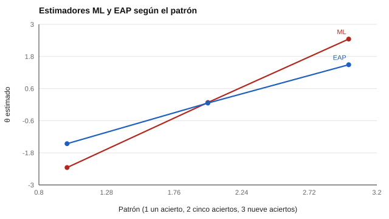

# 056 — Estimación de parámetros y de habilidad


<!-- NAV -->
[← 055 — Testing adaptativo informatizado](../055-testing-adaptativo/README.md) · [📚 Parte 05](../README.md) · [🗺️ Índice 001–200](../../../PROGRAMA.md) · [057 — Curvas características e información del test →](../057-curvas-caracteristicas-e-informacion-del-test/README.md)
<!-- /NAV -->

**Parte 05 — Teoría de respuesta al ítem** · Nivel avanzado · 4 h · Estado `escrita`
**Pensada para:** quien calcula puntajes con TRI y quien debe explicar por qué un resultado tiene «sesgo hacia la media».
**Prerrequisitos:** clases 052 a 054.

## ¿Para qué te sirve esto?

En TRI, el puntaje de una persona (θ) **se estima**, y hay más de una forma de hacerlo. Dos estimadores muy usados, ML y EAP, dan resultados distintos en los extremos: uno no existe cuando la persona acierta todo; el otro siempre da un número, pero lo «acerca» hacia el promedio. Esta clase te enseña esa diferencia, que importa cada vez que alguien te informa un puntaje TRI.

## Al terminar esta clase podrás

- Comparar la estimación por máxima verosimilitud (ML) y la bayesiana EAP.
- Explicar por qué ML no existe con puntajes extremos.
- Reconocer el sesgo hacia la media del EAP.
- Declarar y justificar el estimador elegido.

## La idea en palabras simples

Con los parámetros de los ítems conocidos, hay que averiguar **qué θ hace más probable** el patrón de respuestas observado.

- **ML (máxima verosimilitud):** elige el θ que maximiza la verosimilitud. Es insesgado en teoría, pero si la persona acierta todo (o nada), no hay máximo finito.
- **EAP (media a posteriori esperada; Bock & Mislevy, 1982):** combina los datos con un **prior** (aquí, una normal N(0, 1)) y promedia. Siempre da un número y reduce el error, a costa de acercar a todos hacia 0.

Elegir estimador es **elegir un sesgo**: se declara y se justifica.

## Cómo funciona, paso a paso

**1. Para cada patrón de respuestas**, calcular la verosimilitud sobre una rejilla de valores de θ.

**2. ML:** quedarse con el máximo (si existe).

**3. EAP:** ponderar θ por la verosimilitud por el prior y promediar.

**Ejemplo resuelto.** Patrón «5 aciertos»: ML ≈ 0,08 y EAP ≈ 0,06 apenas difieren (el patrón es consistente con el centro del prior); en patrones extremos EAP se acerca a 0 más que ML.



*Figura 1.* En los patrones extremos, el EAP «encoge» la estimación hacia el promedio.

## Si construyes el instrumento

- Usa EAP cuando necesites una estimación para todas las personas, y decláralo.
- Si el grupo tiene una media distinta del prior (por ejemplo, −1), ajusta el prior: de lo contrario el sesgo es mayor.
- No compares EAP entre grupos con priors distintos.
- Informa siempre el error típico junto a θ̂.

## Si eres evaluado

- Si acertaste todo o nada, tu puntaje exacto no se puede calcular con ML; el valor que ves depende del método usado.
- Dos informes con el mismo patrón pueden mostrar números distintos según el estimador.
- Pregunta qué método se usó y qué prior.

## Qué muestra el laboratorio

`lab.py` calcula ML y EAP para cinco patrones de un test de 10 ítems 2PL.

| Patrón | ML | EAP |
|---|---:|---:|
| Todo mal | indefinido | −1,92 |
| 1 acierto (el más fácil) | −2,35 | −1,46 |
| 5 aciertos (los 5 fáciles) | 0,08 | 0,06 |
| 9 aciertos (falla el más fácil) | 2,45 | 1,49 |
| Todo bien | indefinido | 1,96 |

RMSE sobre 3.000 personas: EAP **0,572** (todas); ML **0,699** (solo 2.918 con estimación finita).

**Análisis.** (1) ML es insesgado en teoría pero indefinido para puntajes extremos y ruidoso con pocos ítems. (2) EAP incorpora un prior y reduce el error, a costa de acercar a todos hacia 0 (por ejemplo, 2,45 pasa a 1,49). (3) El error de ML se calcula solo con las personas en que existe, lo que lo favorece. (4) Elegir estimador es elegir un sesgo: se declara y se justifica.

## Errores frecuentes

- Reportar θ de ML sin tratar los extremos.
- Usar un prior inadecuado para una población distinta.
- Comparar EAP entre grupos con priors distintos.
- No informar el error típico.

## Lo mínimo que debes llevarte

1. ML no existe con puntajes extremos.
2. EAP siempre existe, pero encoge hacia la media.
3. El prior influye sobre todo con pocos ítems.
4. Se declara el estimador y el prior.

## Ejercicios

- **Inicial.** ¿Por qué ML falla con puntaje perfecto? *Solución: la verosimilitud sigue creciendo sin alcanzar un máximo finito.*
- **Intermedio.** Si el prior es N(0, 1) y los datos informan poco, ¿hacia dónde se acerca θ̂? *Solución: a 0.*
- **Avanzado.** Cambia el prior a N(1, 1) en `lab.py` y observa la estimación de «todo mal».
- **Aplicación.** Para un examen de admisión, justifica qué estimador usarías.

## Glosario

- **ML:** estimación por máxima verosimilitud.
- **EAP:** media esperada a posteriori.
- **Prior:** distribución supuesta de θ antes de ver los datos.
- **Encogimiento:** acercamiento de las estimaciones hacia la media.

## Laboratorio

```bash
python classes/part-05-teoria-de-respuesta-al-item/056-estimacion-de-parametros-y-de-habilidad/lab.py
python classes/part-05-teoria-de-respuesta-al-item/figuras.py
```

## Autoevaluación y criterios

1. ¿Qué es un prior y quién lo elige? 2. ¿Qué estimador usarías para una admisión y por qué? 3. ¿Qué reportarías además de θ̂?
Se logra la clase si puedes comparar estimadores y declarar el sesgo elegido.

## Bibliografía

- Bock, R. D., & Mislevy, R. J. (1982). Adaptive EAP estimation of ability in a microcomputer environment. *Applied Psychological Measurement*, 6(4), 431-444.
- Baker, F. B., & Kim, S.-H. (2004). *Item Response Theory: Parameter Estimation Techniques* (2.ª ed.). CRC Press.

---

<!-- NAV -->
[← 055 — Testing adaptativo informatizado](../055-testing-adaptativo/README.md)  
[📚 Parte 05](../README.md) · [🗺️ Índice 001–200](../../../PROGRAMA.md)  
[057 — Curvas características e información del test →](../057-curvas-caracteristicas-e-informacion-del-test/README.md)
<!-- /NAV -->
