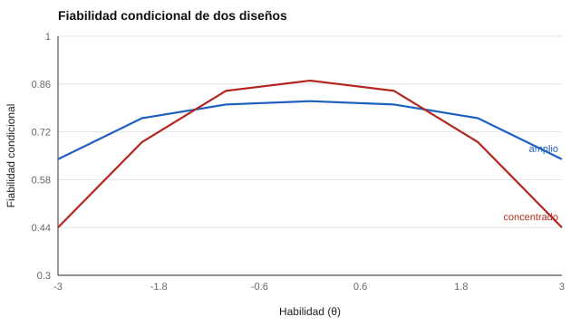

# 057 — Curvas características e información del test


<!-- NAV -->
[← 056 — Estimación de parámetros y de habilidad](../056-estimacion-de-parametros-y-de-habilidad/README.md) · [📚 Parte 05](../README.md) · [🗺️ Índice 001–200](../../../PROGRAMA.md) · [058 — Modelos de respuesta graduada →](../058-modelos-de-respuesta-graduada/README.md)
<!-- /NAV -->

**Parte 05 — Teoría de respuesta al ítem** · Nivel avanzado · 4 h · Estado `escrita`
**Pensada para:** quien diseña pruebas para propósitos específicos (cribado, certificación, descripción de una población) y quien interpreta su precisión.
**Prerrequisitos:** clase 054.

## ¿Para qué te sirve esto?

Un mismo número de ítems puede repartirse de maneras muy distintas: algunos tests miden muy bien alrededor de un punto y mal en los extremos; otros miden decentemente en todo el rango. ¿Cuál conviene? Depende del **propósito**. Esta clase te enseña a construir la curva de información de un test, a convertirla en una «fiabilidad condicional» y a diseñar la distribución de dificultades según lo que quieres decidir.

## Al terminar esta clase podrás

- Construir la curva de información de un test.
- Calcular la fiabilidad condicional aproximada ρ(θ) = I / (I + 1).
- Diseñar la distribución de dificultades según el propósito.
- Comunicar la precisión como una curva y no como una cifra.

## La idea en palabras simples

Si θ tiene varianza 1, una aproximación de la fiabilidad **en un nivel concreto** es:

```
ρ(θ) ≈ I(θ) / ( I(θ) + 1 )
```

Con I = 4, ρ = 0,80 y EE = 1/√4 = 0,5. Un test puede ser excelente en el centro y mediocre en los extremos, y ese patrón se decide al elegir los ítems. Hay dos estrategias:

- **Concentrada:** ítems con dificultad cerca del punto de decisión (útil para cribados con un corte).
- **Amplia:** ítems repartidos en todo el rango (útil para describir a toda la población).

## Cómo funciona, paso a paso

**1. Calcular la información** del test en varios niveles de θ.

**2. Convertir** a error típico y a fiabilidad condicional.

**3. Comparar diseños** y elegir según el propósito.



*Figura 1.* El diseño concentrado gana en el centro y pierde en los extremos.

## Si construyes el instrumento

- Define el rango y el punto de decisión antes de elegir los ítems.
- Usa la curva de información como especificación del test, junto con la tabla de contenido (clase 016).
- No reportes solo una fiabilidad global de un test pensado para decidir en una zona.
- La aproximación ρ = I / (I + 1) supone θ con varianza 1; ajústala si no es así.

## Si eres evaluado

- Si estás cerca del punto de corte, un test concentrado en ese punto es más justo para tu decisión.
- Si estás lejos del centro, tu resultado puede ser menos preciso.
- Pregunta para qué rango fue diseñado el test.

## Qué muestra el laboratorio

`lab.py` compara dos tests de 20 ítems 2PL (a = 1,2).

| Test | θ | −3 | −2 | −1 | 0 | 1 | 2 | 3 |
|---|---|---:|---:|---:|---:|---:|---:|---:|
| Amplio (b de −2,5 a 2,5) | I | 1,78 | 3,09 | 3,94 | 4,19 | 3,94 | 3,09 | 1,78 |
| | ρ(θ) | 0,64 | 0,76 | 0,80 | 0,81 | 0,80 | 0,76 | 0,64 |
| Concentrada (b de −0,5 a 0,5) | I | 0,79 | 2,27 | 5,10 | 6,97 | 5,10 | 2,27 | 0,79 |
| | ρ(θ) | 0,44 | 0,69 | 0,84 | 0,87 | 0,84 | 0,69 | 0,44 |

**Análisis.** (1) La concentrada es la más precisa en el centro (fiabilidad condicional 0,87) pero cae a 0,44 en |θ| = 3, donde la amplia conserva 0,64. (2) Para un cribado con punto de corte hay que concentrar la información donde está el corte. (3) Para describir a toda la población, hay que repartirla. (4) La curva, no una cifra, guía ese diseño.

## Errores frecuentes

- Reportar solo una fiabilidad global de un test pensado para decidir en una zona.
- Usar ρ = I / (I + 1) con una distribución de θ de otra varianza.
- Desatender la cobertura de contenido al elegir ítems por información.
- Concentrar la información sin saber dónde estará el corte.

## Lo mínimo que debes llevarte

1. La información del test es la suma de la de sus ítems.
2. ρ(θ) ≈ I / (I + 1) con θ de varianza 1.
3. Concentrar o repartir depende del propósito.
4. La precisión se comunica con una curva.

## Ejercicios

- **Inicial.** ¿Dónde pondrías las dificultades de un test de selección con corte en θ = 1? *Solución: alrededor de 1.*
- **Intermedio.** I = 9: ¿ρ y EE? *Solución: ρ = 0,90; EE = 0,33.*
- **Avanzado.** Diseña en `lab.py` un test de 20 ítems con ρ ≥ 0,80 en [−2, 2].
- **Aplicación.** Explica a una familia, sin fórmulas, qué significa que un test «mide mejor en el centro».

## Glosario

- **Fiabilidad condicional:** fiabilidad en un nivel concreto de θ.
- **Información del test:** suma de la información de los ítems.
- **Punto de decisión:** nivel de θ en que se toma una decisión.
- **Test concentrado / amplio:** con ítems agrupados o repartidos.

## Laboratorio

```bash
python classes/part-05-teoria-de-respuesta-al-item/057-curvas-caracteristicas-e-informacion-del-test/lab.py
python classes/part-05-teoria-de-respuesta-al-item/figuras.py
```

## Autoevaluación y criterios

1. ¿Qué ventaja tiene una curva frente a una cifra? 2. ¿Cuándo concentrar y cuándo repartir? 3. ¿Cómo comunicarías esta precisión a una familia?
Se logra la clase si puedes diseñar un test para un propósito y justificarlo con la curva.

## Bibliografía

- Samejima, F. (1977). A use of the information function in tailored testing. *Applied Psychological Measurement*, 1(3), 233-247.
- Embretson, S. E., & Reise, S. P. (2000). *Item Response Theory for Psychologists*. Lawrence Erlbaum.

---

<!-- NAV -->
[← 056 — Estimación de parámetros y de habilidad](../056-estimacion-de-parametros-y-de-habilidad/README.md)  
[📚 Parte 05](../README.md) · [🗺️ Índice 001–200](../../../PROGRAMA.md)  
[058 — Modelos de respuesta graduada →](../058-modelos-de-respuesta-graduada/README.md)
<!-- /NAV -->
