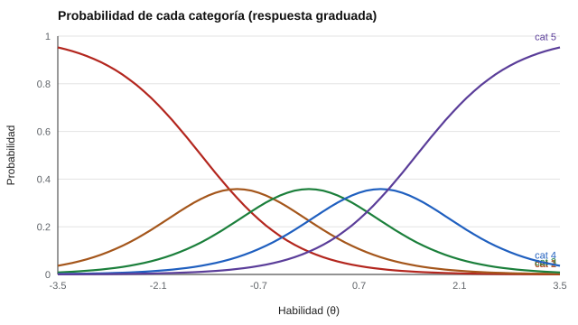

# 058 — Modelos de respuesta graduada


<!-- NAV -->
[← 057 — Curvas características e información del test](../057-curvas-caracteristicas-e-informacion-del-test/README.md) · [📚 Parte 05](../README.md) · [🗺️ Índice 001–200](../../../PROGRAMA.md) · [059 — Equiparación y vinculación de puntajes →](../059-equiparacion-y-vinculacion-de-puntajes/README.md)
<!-- /NAV -->

**Parte 05 — Teoría de respuesta al ítem** · Nivel avanzado · 4 h · Estado `escrita`
**Pensada para:** quien analiza cuestionarios con escalas tipo Likert y quien diseña categorías de respuesta.
**Prerrequisitos:** clases 012 y 053.

## ¿Para qué te sirve esto?

Los modelos de Rasch y 2PL son para ítems de acierto/error. Pero la mayoría de los cuestionarios usan respuestas **ordenadas** (de «nunca» a «siempre»). El **modelo de respuesta graduada** de Samejima (1969) extiende la TRI a ese caso: dice, para cada nivel de rasgo, **qué probabilidad hay de elegir cada categoría**. Sirve para saber si las categorías están bien diseñadas y para entender qué tan informativo es cada ítem.

## Al terminar esta clase podrás

- Entender el modelo de respuesta graduada para ítems Likert.
- Calcular probabilidades por categoría y la puntuación esperada.
- Diagnosticar categorías mal diseñadas.
- Explicar por qué no se supone que las categorías sean equidistantes.

## La idea en palabras simples

Para un ítem con categorías ordenadas 1 a 5, el modelo no pregunta «¿qué categoría elige?» sino una serie de preguntas en cadena: «¿elige 2 o más?», «¿elige 3 o más?»… Cada una tiene una curva logística con su propio umbral (b₁ < b₂ < b₃ < b₄) y una pendiente común a.

```
P*(k) = logística( a · (θ − b_k) )       (probabilidad de elegir la categoría k o más)
P(k) = P*(k) − P*(k + 1)                  (probabilidad de elegir exactamente k)
```

Cada categoría debería ser la más probable en algún tramo de θ; si una nunca lo es, está mal diseñada o sus umbrales están desordenados.

## Cómo funciona, paso a paso

**1. Calcular** las probabilidades acumuladas con los umbrales y a.

**2. Restar** para obtener la probabilidad por categoría.

**3. Calcular la puntuación esperada** (la media de las categorías ponderada por sus probabilidades).

**Ejemplo resuelto.** θ = 0, a = 1,5: P*(2) = logística(1,5 · 1,5) = 0,905; P*(3) = logística(0,75) = 0,679; P(cat 2) = 0,905 − 0,679 = 0,226 ≈ 0,23.



*Figura 1.* Las cinco categorías se suceden a lo largo del rasgo, cada una más probable en su tramo.

## Si construyes el instrumento

- Revisa si cada categoría es la más probable en algún tramo; si no, considera fusionarla.
- No trates las categorías como equidistantes: el modelo no lo supone.
- Verifica que el instrumento tenga estructura simple (parte 04), porque el modelo es unidimensional.
- Usa las curvas para decidir cuántas categorías ofrecer (clase 012).

## Si eres evaluado

- Elegir «4» en lugar de «5» no es una diferencia de un punto fijo: el modelo asigna distintas «distancias» según el ítem.
- Un ítem cuyas categorías no se distinguen aporta poco: si dudas entre dos opciones, es normal.
- Tu puntaje se estima con el patrón completo de respuestas, no solo con la suma.

## Qué muestra el laboratorio

`lab.py` calcula las probabilidades con a = 1,5 y umbrales −1,5; −0,5; 0,5; 1,5.

| θ | cat 1 | cat 2 | cat 3 | cat 4 | cat 5 | Puntuación esperada |
|---:|---:|---:|---:|---:|---:|---:|
| −2 | 0,68 | 0,23 | 0,07 | 0,02 | 0,01 | 1,44 |
| 0 | 0,10 | 0,23 | 0,36 | 0,23 | 0,10 | 3,00 |
| 2 | 0,01 | 0,02 | 0,07 | 0,23 | 0,68 | 4,56 |

Con θ ~ N(0, 1), las frecuencias simuladas (0,157; 0,207; 0,266; 0,205; 0,165) coinciden con las del modelo (0,161; 0,206; 0,260; 0,208; 0,165).

**Análisis.** (1) Cada categoría es la «más probable» en un tramo de θ. (2) Si una categoría nunca lo es, está mal diseñada o los umbrales están desordenados. (3) El modelo trata las respuestas como ordinales: no supone que la distancia entre 1 y 2 sea la misma que entre 4 y 5. (4) Los parámetros son conocidos; con datos reales se estiman.

## Errores frecuentes

- Tratar las categorías como equidistantes.
- Ignorar categorías que nunca son las más probables.
- Aplicar el modelo a una escala multidimensional.
- Confundir la puntuación esperada con la respuesta de una persona.

## Lo mínimo que debes llevarte

1. El modelo gradúa la probabilidad de cada categoría según θ.
2. Los umbrales deben estar ordenados.
3. Una categoría que nunca domina está mal diseñada.
4. No supone equidistancia.

## Ejercicios

- **Inicial.** ¿Por qué las probabilidades por categoría suman 1? *Solución: porque la persona elige exactamente una categoría.*
- **Intermedio.** ¿Cuál es la categoría más probable en θ = 1? *Solución: la 4 (0,36).*
- **Avanzado.** Desordena dos umbrales en `lab.py` y observa qué categoría desaparece.
- **Aplicación.** Revisa un ítem Likert con tus datos y comprueba si todas las categorías son las más probables en algún tramo.

## Glosario

- **Respuesta graduada:** respuesta en categorías ordenadas.
- **Umbral (b_k):** nivel de θ en que la categoría k o más tiene probabilidad 0,5.
- **Probabilidad acumulada:** probabilidad de elegir una categoría o más.
- **Puntuación esperada:** valor medio de las categorías ponderado por sus probabilidades.

## Laboratorio

```bash
python classes/part-05-teoria-de-respuesta-al-item/058-modelos-de-respuesta-graduada/lab.py
python classes/part-05-teoria-de-respuesta-al-item/figuras.py
```

## Autoevaluación y criterios

1. ¿Qué diferencia hay entre el GRM y el crédito parcial? 2. ¿Cuántas categorías te parecen útiles y por qué? 3. ¿Cómo se relaciona con la clase 012?
Se logra la clase si puedes calcular probabilidades y diagnosticar categorías.

## Bibliografía

- Samejima, F. (1969). Estimation of latent ability using a response pattern of graded scores. *Psychometrika Monograph Supplement*, 34(4, Pt. 2), No. 17.
- Embretson, S. E., & Reise, S. P. (2000). *Item Response Theory for Psychologists*. Lawrence Erlbaum.

---

<!-- NAV -->
[← 057 — Curvas características e información del test](../057-curvas-caracteristicas-e-informacion-del-test/README.md)  
[📚 Parte 05](../README.md) · [🗺️ Índice 001–200](../../../PROGRAMA.md)  
[059 — Equiparación y vinculación de puntajes →](../059-equiparacion-y-vinculacion-de-puntajes/README.md)
<!-- /NAV -->
