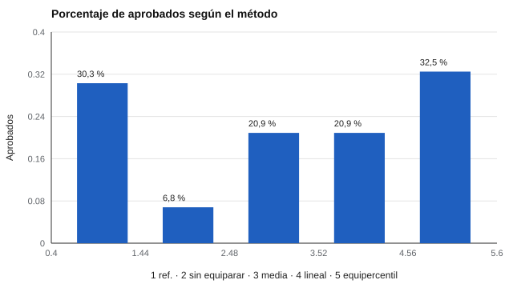

# 059 — Equiparación y vinculación de puntajes


<!-- NAV -->
[← 058 — Modelos de respuesta graduada](../058-modelos-de-respuesta-graduada/README.md) · [📚 Parte 05](../README.md) · [🗺️ Índice 001–200](../../../PROGRAMA.md) · [060 — Diseño de bancos para pruebas adaptativas →](../060-diseno-de-bancos-para-pruebas-adaptativas/README.md)
<!-- /NAV -->

**Parte 05 — Teoría de respuesta al ítem** · Nivel avanzado · 4 h · Estado `escrita`
**Pensada para:** quien administra pruebas con varias formas o años, y quien es evaluado con una de ellas.
**Prerrequisitos:** clases 052 y 061.

## ¿Para qué te sirve esto?

Muchas pruebas importantes tienen **varias formas** (versiones del examen por año, o por fecha). Aunque se construyan con cuidado, una forma puede resultar un poco más difícil. Si el mismo corte se aplica a ambas, quienes rinden la forma difícil **aprueban menos solo por la forma**. La **equiparación** ajusta los puntajes para que sean intercambiables. Entenderla te permite revisar si una decisión es justa entre formas y años.

## Al terminar esta clase podrás

- Distinguir equiparación de otras formas de vinculación.
- Aplicar equiparación por media, lineal y equipercentil en un diseño de grupos aleatorios.
- Evaluar el efecto sobre decisiones con punto de corte.
- Reconocer las condiciones que exige una buena equiparación.

## La idea en palabras simples

Equiparar es hacer **intercambiables** los puntajes de formas distintas del mismo test (Kolen & Brennan, 2014; Holland & Dorans, 2006). Exige: mismo constructo, misma fiabilidad, simetría y equidad. Los diseños comunes son grupos aleatorios (cada forma a un grupo equivalente) o ítems ancla (ítems comunes a ambas formas).

- **Media:** suma la diferencia de medias.
- **Lineal:** iguala media y dispersión.
- **Equipercentil:** iguala **toda la distribución**: el percentil 40 de una forma se corresponde con el percentil 40 de la otra.

Con formas de contenido distinto solo hay «vinculación», no equiparación.

## Cómo funciona, paso a paso

**1. Verificar el diseño** (grupos equivalentes o ítems ancla).

**2. Calcular la transformación** (media, lineal o equipercentil).

**3. Aplicar el corte** a los puntajes equiparados.

**Ejemplo.** Medias X = 20,01 e Y = 17,23: la equiparación de medias suma 2,78; un puntaje de 15 en Y equivale a 17,78 en X.



*Figura 1.* Sin equiparar, el grupo que rindió la forma difícil aprueba mucho menos solo por la forma.

## Si construyes el instrumento

- Planifica la equiparación desde el diseño de las formas (ítems ancla o grupos aleatorios).
- Usa muestras grandes; con pocas personas, el equipercentil es inestable y requiere suavizado.
- No apliques el mismo corte a formas distintas sin equiparar.
- Recuerda que la equiparación no corrige un constructo distinto.

## Si eres evaluado

- Si hay varias formas de la prueba, pregunta cómo se asegura que ninguna te perjudique.
- Un corte «único» solo es justo si los puntajes están equiparados.
- Si cambió el examen de un año a otro, tu puntaje puede no ser comparable sin equiparación.

## Qué muestra el laboratorio

`lab.py` simula dos formas de 40 ítems (Y es más difícil en 0,4; 6.000 personas por forma; corte 22 en la escala X).

| Método | Aprobados con Y equiparada |
|---|---:|
| Forma X (referencia) | 0,303 |
| Sin equiparar | 0,068 |
| Media | 0,209 |
| Lineal | 0,209 |
| Equipercentil | 0,325 |

**Análisis.** (1) Sin equiparar, quienes rinden la forma difícil aprueban 6,8 % frente a 30,3 %: una diferencia solo atribuible a la forma. (2) Media y lineal corrigen parte, pero no la forma de la distribución. (3) El equipercentil se acerca a la tasa de referencia (0,325) porque iguala toda la distribución. (4) Requieren un diseño que justifique la equivalencia de grupos (o ítems ancla) y muestras grandes.

## Errores frecuentes

- Equiparar con grupos no equivalentes sin ítems ancla.
- Aplicar equipercentil con muestras pequeñas sin suavizado.
- Usar el mismo corte sin equiparar cuando las formas difieren.
- Llamar «equiparación» a una vinculación entre constructos distintos.

## Lo mínimo que debes llevarte

1. Equiparar hace intercambiables los puntajes de formas distintas.
2. Sin equiparar, un corte común es injusto.
3. El equipercentil iguala toda la distribución.
4. Exige un diseño y muestras adecuados.

## Ejercicios

- **Inicial.** ¿Qué diferencia hay entre equiparar y vincular? *Solución: equiparar exige mismo constructo y hace los puntajes intercambiables; vincular es más general.*
- **Intermedio.** Medias 30 y 26: ¿qué puntaje en X corresponde a 28 en Y por media? *Solución: 32.*
- **Avanzado.** Disminuye N a 300 en `lab.py` y describe la inestabilidad del equipercentil.
- **Aplicación.** Un examen tiene dos fechas con formas distintas: ¿cómo diseñarías la equiparación?

## Glosario

- **Equiparación:** transformación que hace intercambiables puntajes de formas distintas.
- **Ítem ancla:** ítem común a dos formas.
- **Equipercentil:** método que iguala los percentiles de ambas formas.
- **Vinculación:** relación entre puntajes de pruebas que no son intercambiables.

## Laboratorio

```bash
python classes/part-05-teoria-de-respuesta-al-item/059-equiparacion-y-vinculacion-de-puntajes/lab.py
python classes/part-05-teoria-de-respuesta-al-item/figuras.py
```

## Autoevaluación y criterios

1. ¿Qué es un diseño de ítems ancla? 2. ¿Por qué importa la equivalencia de grupos? 3. ¿Qué riesgo hay si no se equipara?
Se logra la clase si puedes equiparar y evaluar el efecto sobre un corte.

## Bibliografía

- Kolen, M. J., & Brennan, R. L. (2014). *Test Equating, Scaling, and Linking* (3.ª ed.). Springer.
- Holland, P. W., & Dorans, N. J. (2006). Linking and equating. En R. L. Brennan (Ed.), *Educational Measurement* (4.ª ed.). ACE/Praeger.

---

<!-- NAV -->
[← 058 — Modelos de respuesta graduada](../058-modelos-de-respuesta-graduada/README.md)  
[📚 Parte 05](../README.md) · [🗺️ Índice 001–200](../../../PROGRAMA.md)  
[060 — Diseño de bancos para pruebas adaptativas →](../060-diseno-de-bancos-para-pruebas-adaptativas/README.md)
<!-- /NAV -->
