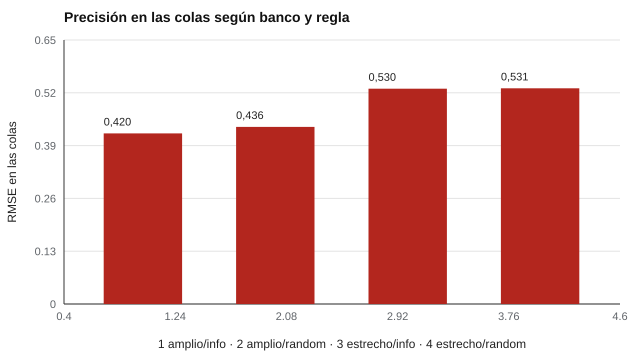

# 060 — Diseño de bancos para pruebas adaptativas


<!-- NAV -->
[← 059 — Equiparación y vinculación de puntajes](../059-equiparacion-y-vinculacion-de-puntajes/README.md) · [📚 Parte 05](../README.md) · [🗺️ Índice 001–200](../../../PROGRAMA.md) · [061 — Baremos, percentiles y puntajes tipificados →](../../part-06-baremos-sesgo-y-equidad/061-baremos-y-percentiles/README.md)
<!-- /NAV -->

**Parte 05 — Teoría de respuesta al ítem** · Nivel avanzado · 5 h · Estado `escrita`
**Pensada para:** quien administra bancos de ítems y pruebas adaptativas, y quien las rinde.
**Prerrequisitos:** clases 055 y 057.

## ¿Para qué te sirve esto?

Un examen adaptativo es tan bueno como su **banco de ítems**. Si el banco no tiene ítems para los extremos, esas personas quedan mal medidas. Y si un puñado de ítems se usa con casi todos, se «filtran» y pierden valor. Esta clase te enseña a diseñar un banco con buena cobertura y a controlar la **exposición** de ítems, un equilibrio entre precisión y seguridad que afecta a cualquier prueba de alto impacto.

## Al terminar esta clase podrás

- Relacionar la cobertura del banco con la precisión en las colas.
- Medir la exposición de ítems.
- Comparar reglas de selección con control de exposición.
- Plantear la reposición periódica del banco.

## La idea en palabras simples

Si la regla de selección es «siempre el ítem más informativo», los mismos pocos ítems (los de mejor calidad) aparecen en casi todos los exámenes: **exposición alta**, riesgo de filtración. La alternativa, **randomesque**, elige al azar entre los *k* ítems más informativos: se reparte la exposición a cambio de una pequeña pérdida de precisión. Además, un banco concentrado en un rango **no informa en las colas**.

## Cómo funciona, paso a paso

**1. Diseñar la cobertura:** ítems en todo el rango de θ y de contenido.

**2. Elegir la regla de selección** (máxima información o randomesque).

**3. Medir** la precisión (RMSE, incluyendo las colas), la exposición máxima y los ítems sin uso.

**Ejemplo.** Exposición ideal con 150 ítems y 15 por persona = 15/150 = 10 %. Una exposición máxima del 100 % indica un ítem que todos ven: si se filtra, deja de ser informativo.



*Figura 1.* El banco estrecho mide peor en las colas.

## Si construyes el instrumento

- Planifica un banco con cobertura temática y de dificultad, y un plan de reposición periódica.
- Controla la exposición, no solo el promedio sino también el máximo.
- Audita en producción qué ítems se usan, cuáles no y si hay señales de filtración.
- Reconoce que el banco real se calibra con error.

## Si eres evaluado

- Que el examen se adapte a ti no significa que sea más fácil: busca medir con precisión en tu nivel.
- La seguridad del banco protege la validez de tu resultado y la de los demás.
- Si crees que se filtraron ítems, puedes informarlo a quien administra la prueba.

## Qué muestra el laboratorio

`lab.py` compara bancos de 150 ítems con un CAT de 15 ítems y 400 examinados (θ ~ N(0; 1,3)).

| Banco / regla | RMSE | RMSE colas | Exposición máx. | Ítems sin uso |
|---|---:|---:|---:|---:|
| Amplio / máx. información | 0,333 | 0,420 | 1,00 | 82 |
| Amplio / randomesque | 0,350 | 0,436 | 0,75 | 69 |
| Estrecho / máx. información | 0,372 | 0,530 | 1,00 | 96 |
| Estrecho / randomesque | 0,375 | 0,531 | 0,59 | 82 |

**Análisis.** (1) El banco estrecho mide peor en las colas (0,53 frente a 0,42): no tiene ítems que informen ahí. (2) La máxima información pura sobreexpone unos pocos ítems (exposición máxima 1,00) y deja muchos sin usar (hasta 96 de 150). (3) La regla aleatorizada reparte la exposición con un costo pequeño de precisión (0,333 → 0,350). (4) Diseñar el banco es decidir su cobertura; aquí los parámetros son conocidos, en un banco real se calibran con error.

## Errores frecuentes

- Diseñar el banco sin plan de contenido.
- Medir la exposición solo en promedio.
- Ignorar la reposición periódica de ítems.
- Concentrar el banco en un rango sin saber dónde estará la población.

## Lo mínimo que debes llevarte

1. La calidad del CAT depende del banco.
2. Máxima información sobreexpone unos pocos ítems.
3. Randomesque reparte la exposición con poco costo de precisión.
4. Un banco necesita reposición y auditoría.

## Ejercicios

- **Inicial.** ¿Qué ocurre con un banco concentrado cuando llega un examinado extremo? *Solución: se mide con poca precisión.*
- **Intermedio.** Si 40 de 150 ítems nunca se usan, ¿qué fracción del banco es «inútil»? *Solución: 26,7 %.*
- **Avanzado.** Cambia `k_top` a 10 en `lab.py` y reporta precisión y exposición.
- **Aplicación.** Escribe un plan de reposición de un banco de 300 ítems.

## Glosario

- **Banco de ítems:** colección de ítems calibrados para una prueba.
- **Exposición:** proporción de examinados que reciben un ítem.
- **Randomesque:** regla que elige al azar entre los k más informativos.
- **Colas:** extremos del rango de θ.

## Laboratorio

```bash
python classes/part-05-teoria-de-respuesta-al-item/060-diseno-de-bancos-para-pruebas-adaptativas/lab.py
python classes/part-05-teoria-de-respuesta-al-item/figuras.py
```

## Autoevaluación y criterios

1. ¿Qué compromisos existen entre precisión y seguridad? 2. ¿Cómo se repone un banco? 3. ¿Qué datos auditarías en producción?
Se logra la clase si puedes diseñar un banco y justificar la regla de exposición.

## Bibliografía

- Way, W. D. (1998). Protecting the integrity of computerized testing item pools. *Educational Measurement: Issues and Practice*, 17(4), 17-27. ✅ [DOI](https://doi.org/10.1111/j.1745-3992.1998.tb00632.x)
- van der Linden, W. J., & Glas, C. A. W. (2010). *Elements of Adaptive Testing*. Springer. ✅ [DOI](https://doi.org/10.1007/978-0-387-85461-8)

Leyenda: ✅ existe en Crossref con título y año coincidentes (enlace al DOI); ⚠️ hay una obra de título parecido con otro año (no se enlaza: comprobar la edición); 🔎 no verificada automáticamente (libros sin DOI, normas y sitios web). Crossref confirma la existencia de la fuente, no que respalde cada afirmación de la clase. Ver [`docs/VERIFICACION_BIBLIOGRAFIA.md`](../../../docs/VERIFICACION_BIBLIOGRAFIA.md).

---

<!-- NAV -->
[← 059 — Equiparación y vinculación de puntajes](../059-equiparacion-y-vinculacion-de-puntajes/README.md)  
[📚 Parte 05](../README.md) · [🗺️ Índice 001–200](../../../PROGRAMA.md)  
[061 — Baremos, percentiles y puntajes tipificados →](../../part-06-baremos-sesgo-y-equidad/061-baremos-y-percentiles/README.md)
<!-- /NAV -->
