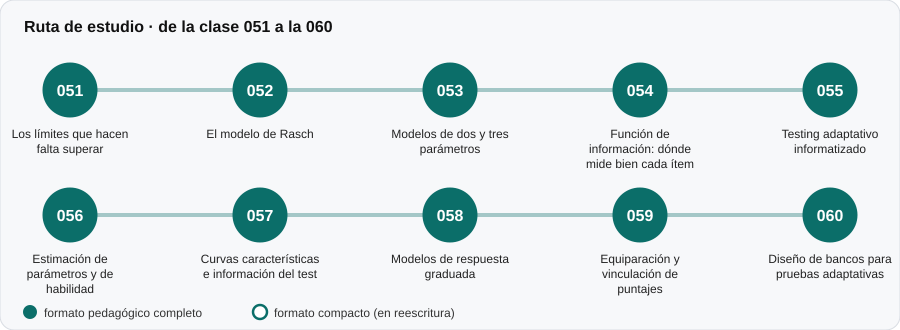

# 📈 Parte 05 — Teoría de respuesta al ítem

**Nivel:** avanzado · **Duración estimada:** 4-5 semanas · **Clases:** 10

## De qué trata

El cambio de paradigma que pasa del puntaje total a la relación entre la persona, el ítem y el rasgo latente. Rasch, modelos de dos y tres parámetros, información, pruebas adaptativas y equiparación.

## Por qué importa

Permite medir con la misma escala en pruebas distintas y ajustar la prueba a la persona, base de las evaluaciones adaptativas.

## Según tu papel

- **Si construyes o aplicas instrumentos:** Estimación de parámetros, curvas de información, diseño de bancos y equiparación de formas.
- **Si eres evaluado o recibes resultados:** Explica por qué dos personas pueden recibir preguntas distintas y aun así obtener puntajes comparables.

## Al terminar esta parte podrás

- Leer una curva característica del ítem.
- Explicar por qué un test mide mejor en cierto rango.
- Describir cómo funciona una prueba adaptativa.

## Cómo estudiarla

Requiere haber visto las partes 02 y 04. Ejecuta los laboratorios para ver las curvas.

## Ruta de estudio

## Clases en orden de estudio

Las clases están numeradas de forma consecutiva (001 a 200) en el orden de estudio: sigue el número.

| Orden | ID | Clase | Qué aprenderás | Formato | Horas |
|---:|---|---|---|---|---:|
| 1 | 051 | [Los límites que hacen falta superar](051-limites-de-la-teoria-clasica/README.md) | Enumerar tres límites de la teoría clásica (dependencia de la muestra, error único, puntaje dependiente del test). | ✅ pedagógico | 4 |
| 2 | 052 | [El modelo de Rasch](052-modelo-de-rasch/README.md) | Enunciar el modelo y su propiedad de suficiencia. | ✅ pedagógico | 6 |
| 3 | 053 | [Modelos de dos y tres parámetros](053-modelos-de-dos-y-tres-parametros/README.md) | Interpretar a (discriminación), b (dificultad) y c (adivinación). | ✅ pedagógico | 6 |
| 4 | 054 | [Función de información: dónde mide bien cada ítem](054-informacion-del-item/README.md) | Calcular la información de un ítem 2PL y la del test. | ✅ pedagógico | 5 |
| 5 | 055 | [Testing adaptativo informatizado](055-testing-adaptativo/README.md) | Describir el ciclo de un CAT: estimar, seleccionar, administrar, detener. | ✅ pedagógico | 6 |
| 6 | 056 | [Estimación de parámetros y de habilidad](056-estimacion-de-parametros-y-de-habilidad/README.md) | Comparar la estimación por máxima verosimilitud (ML) y la bayesiana EAP. | ✅ pedagógico | 4 |
| 7 | 057 | [Curvas características e información del test](057-curvas-caracteristicas-e-informacion-del-test/README.md) | Construir la curva de información de un test. | ✅ pedagógico | 4 |
| 8 | 058 | [Modelos de respuesta graduada](058-modelos-de-respuesta-graduada/README.md) | Entender el modelo de respuesta graduada para ítems Likert. | ✅ pedagógico | 4 |
| 9 | 059 | [Equiparación y vinculación de puntajes](059-equiparacion-y-vinculacion-de-puntajes/README.md) | Distinguir equiparación de otras formas de vinculación. | ✅ pedagógico | 4 |
| 10 | 060 | [Diseño de bancos para pruebas adaptativas](060-diseno-de-bancos-para-pruebas-adaptativas/README.md) | Relacionar la cobertura del banco con la precisión en las colas. | ✅ pedagógico | 4 |

[← Volver al índice del programa](../../README.md) · [Índice numérico de las 200 clases](../../PROGRAMA.md)
