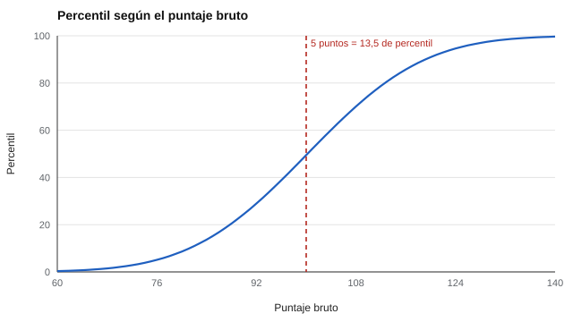

# 061 — Baremos, percentiles y puntajes tipificados


<!-- NAV -->
[← 060 — Diseño de bancos para pruebas adaptativas](../../part-05-teoria-de-respuesta-al-item/060-diseno-de-bancos-para-pruebas-adaptativas/README.md) · [📚 Parte 06](../README.md) · [🗺️ Índice 001–200](../../../PROGRAMA.md) · [062 — La muestra normativa: a quién se compara la p… →](../062-elegir-la-muestra-normativa/README.md)
<!-- /NAV -->

**Parte 06 — Baremos, sesgo y equidad** · Nivel avanzado · 4 h · Estado `escrita`
**Pensada para:** quien interpreta puntajes (docentes, orientadores, selectores) y quien recibe un informe con percentiles.
**Prerrequisitos:** clases 004, 025 y 026.

## ¿Para qué te sirve esto?

Un puntaje de 115 no dice nada hasta que se sabe **con quién se compara**. El **baremo** (o norma) traduce el puntaje bruto a una posición dentro de un grupo de referencia: «percentil 84», «T = 60». Es la forma en que casi todo informe te dice si un resultado es «alto» o «bajo». Esta clase te enseña a calcular estas transformaciones, a leerlas sin engaño (por ejemplo, un percentil exagera las diferencias en el centro) y a reconocer que el propio baremo tiene incertidumbre.

## Al terminar esta clase podrás

- Calcular rango percentil, z y T desde una muestra normativa.
- Explicar por qué los percentiles no son equidistantes.
- Estimar la incertidumbre del propio baremo.
- Comunicar un percentil a una familia sin malentendidos.

## La idea en palabras simples

- **Rango percentil:** el porcentaje del grupo de referencia que está **por debajo** de tu puntaje (con la mitad de los empates). Percentil 84 = superaste al 84 % del grupo.
- **Puntaje z:** cuántas desviaciones típicas estás sobre o bajo la media: z = (x − media) / DE.
- **Puntaje T:** una versión del z con media 50 y DE 10: T = 50 + 10·z.

Los percentiles son fáciles de entender pero **engañan**: en el centro de la distribución, pocos puntos brutos cambian mucho el percentil; en las colas, muchos puntos apenas lo mueven. Los puntajes z y T, en cambio, conservan la proporcionalidad.

## Cómo funciona, paso a paso

**1. Reunir una muestra normativa** (idealmente grande y representativa, clase 062).

**2. Calcular** media y DE, y el percentil de cada puntaje bruto.

**3. Transformar:** z y T.

**Ejemplo resuelto.** z = 1,00 → percentil 84 → T = 60. Un salto de 5 puntos en el centro mueve el percentil mucho más que el mismo salto en una cola.



*Figura 1.* El percentil exagera las diferencias en el centro de la distribución.

**4. Cuidar la incertidumbre del baremo.** Con una muestra normativa pequeña, el percentil estimado es inestable.

## Si construyes el instrumento

- Publica la ficha del baremo: tamaño, fecha, lugar y criterios de selección de la muestra.
- Informa la incertidumbre del percentil, sobre todo con muestras pequeñas.
- No sumes ni promedies percentiles.
- Revisa y actualiza los baremos: envejecen.

## Si eres evaluado

- Pregunta **con quién** te compararon y cuántas personas formaban el grupo.
- Un percentil 60 y uno 70 pueden diferir muy poco en puntos brutos; uno 95 y uno 99, mucho.
- Un baremo antiguo o de otro país puede no corresponder a tu situación.

## Qué muestra el laboratorio

`lab.py` construye una norma de 5.000 personas (media 100,2; DE 14,8).

| Bruto | Percentil | z | T |
|---:|---:|---:|---:|
| 70 | 2,2 | −2,03 | 29,7 |
| 85 | 15,3 | −1,02 | 39,8 |
| 100 | 49,9 | −0,01 | 49,9 |
| 115 | 84,0 | 1,00 | 60,0 |
| 130 | 97,7 | 2,01 | 70,1 |

Misma diferencia de 5 puntos brutos, distinto salto de percentil: 97 → 102 = **13,5**; 82 → 87 = 7,6; 127 → 132 = **2,0**.

Incertidumbre del percentil del puntaje 120 (bootstrap): error típico **2,53** con n = 100 y **0,61** con n = 2.000.

**Análisis.** (1) Los puntajes tipificados conservan las diferencias proporcionales; el percentil las exagera en el centro. (2) Una diferencia de 5 puntos vale 13,5 puntos de percentil en el centro y solo 2,0 en la cola. (3) Un baremo con pocas personas tiene su propio error: por eso se informa el tamaño de la muestra normativa. (4) La norma simulada es casi normal; con distribuciones asimétricas los percentiles se comportan distinto.

## Errores frecuentes

- Sumar o promediar percentiles.
- Reportar un percentil sin la muestra normativa (n, año, lugar, criterios).
- Aplicar un baremo a una población distinta de la normativa.
- Tratar un baremo viejo como vigente.

## Lo mínimo que debes llevarte

1. Un percentil es una posición dentro de un grupo de referencia.
2. z y T conservan las diferencias; el percentil las exagera en el centro.
3. El baremo tiene incertidumbre.
4. Siempre se informa la muestra normativa.

## Ejercicios

- **Inicial.** ¿Qué T corresponde a z = −1? *Solución: 40.*
- **Intermedio.** Puntaje 118 con media 100 y DE 15. *Solución: z = 1,2; T = 62; percentil ≈ 88.*
- **Avanzado.** Calcula el error típico del percentil para n = 500 en `lab.py`.
- **Aplicación.** Explica a una familia, en tres frases, qué significa «percentil 70».

## Glosario

- **Baremo (norma):** tabla que convierte un puntaje bruto en una posición dentro de un grupo.
- **Rango percentil:** porcentaje del grupo por debajo del puntaje.
- **Puntaje z / T:** puntajes tipificados con media 0 / 50.
- **Muestra normativa:** grupo de referencia del baremo.

## Laboratorio

```bash
python classes/part-06-baremos-sesgo-y-equidad/061-baremos-y-percentiles/lab.py
python classes/part-06-baremos-sesgo-y-equidad/figuras.py
```

## Autoevaluación y criterios

1. ¿Por qué un percentil exagera diferencias en el centro? 2. ¿Qué informa un manual normativo mínimo? 3. ¿Cómo comunicarías un percentil a una familia?
Se logra la clase si puedes transformar puntajes y reportar la incertidumbre del baremo.

## Bibliografía

- Angoff, W. H. (1984). *Scales, Norms, and Equivalent Scores*. Educational Testing Service.
- Anastasi, A., & Urbina, S. (1997). *Psychological Testing* (7.ª ed.). Prentice Hall.
- Crocker, L., & Algina, J. (1986). *Introduction to Classical and Modern Test Theory*. Holt, Rinehart & Winston.

---

<!-- NAV -->
[← 060 — Diseño de bancos para pruebas adaptativas](../../part-05-teoria-de-respuesta-al-item/060-diseno-de-bancos-para-pruebas-adaptativas/README.md)  
[📚 Parte 06](../README.md) · [🗺️ Índice 001–200](../../../PROGRAMA.md)  
[062 — La muestra normativa: a quién se compara la p… →](../062-elegir-la-muestra-normativa/README.md)
<!-- /NAV -->
