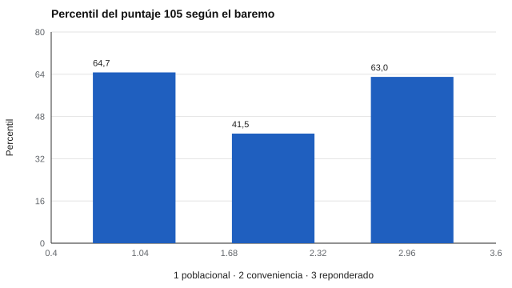

# 062 — La muestra normativa: a quién se compara la persona


<!-- NAV -->
[← 061 — Baremos, percentiles y puntajes tipificados](../061-baremos-y-percentiles/README.md) · [📚 Parte 06](../README.md) · [🗺️ Índice 001–200](../../../PROGRAMA.md) · [063 — Funcionamiento diferencial del ítem (DIF) →](../063-funcionamiento-diferencial-del-item/README.md)
<!-- /NAV -->

**Parte 06 — Baremos, sesgo y equidad** · Nivel avanzado · 4 h · Estado `escrita`
**Pensada para:** quien construye o elige baremos y quien recibe un resultado comparado con un grupo.
**Prerrequisitos:** clase 061.

## ¿Para qué te sirve esto?

El baremo responde la pregunta «¿comparado con quién?». Y la respuesta cambia el resultado: la **misma persona** con el **mismo puntaje** puede aparecer «sobre el promedio» o «bajo el promedio» según el grupo con que se la compare. Si construyes un baremo, esta clase te muestra qué cuidar. Si eres evaluado, te da las preguntas que conviene hacer antes de aceptar un «percentil».

## Al terminar esta clase podrás

- Explicar cómo la composición de la muestra normativa cambia el percentil de una persona.
- Aplicar la reponderación por estratos (post-estratificación).
- Listar lo que debe declarar la ficha de un baremo.
- Reconocer lo que la reponderación no corrige.

## La idea en palabras simples

Una **muestra de conveniencia** (voluntarios, estudiantes de una universidad) rara vez representa a la población. Si en una universidad hay mucha gente con educación superior y las personas con educación superior puntúan más, el baremo de esa universidad hace que casi todos parezcan «bajo el promedio».

Si se conocen los pesos reales de los **estratos** (por ejemplo, nivel educativo, sexo, región), se puede **reponderar**: dar más peso a los estratos subrepresentados y menos a los sobrerrepresentados. Es la **post-estratificación**.

## Cómo funciona, paso a paso

**1. Conocer** la composición de la población (por ejemplo, 40 % / 40 % / 20 % en tres niveles educativos).

**2. Calcular los pesos:** peso = proporción poblacional / proporción muestral.

**Ejemplo.** Estrato «superior»: 20 % en la población y 70 % en la muestra → peso 0,20 / 0,70 = 0,29 por observación. Estrato «básica»: 0,40 / 0,05 = 8,0.

**3. Calcular el percentil** con los datos ponderados.



*Figura 1.* La misma persona, con el mismo puntaje, queda en percentiles muy distintos según el baremo.

## Si construyes el instrumento

- Declara en la ficha del baremo: quiénes, cuándo, dónde, cuántos y cómo se eligieron.
- Repondera por estratos conocidos, pero no creas que eso vuelve representativa una muestra autoseleccionada.
- Evita pesos extremos (estratos con muy pocas observaciones).
- No uses normas de otro país o época sin evidencia de equivalencia; en el contexto chileno, no asumas equivalencia con normas extranjeras.

## Si eres evaluado

- Pregunta qué grupo de referencia se usó y si se parece a ti (edad, curso, región, idioma).
- Un resultado «bajo el promedio» con una norma poco representativa puede no significar lo que parece.
- Las *ITC Guidelines on Test Use* (2013) piden documentar la muestra normativa.

## Qué muestra el laboratorio

`lab.py` simula una población con tres niveles educativos (40/40/20 %) y una muestra de conveniencia universitaria (5/25/70 %).

| Baremo | Percentil del puntaje 105 |
|---|---:|
| Poblacional | 64,7 |
| Conveniencia (universidad) | 41,5 |
| Conveniencia reponderada | 63,0 |

**Análisis.** (1) La misma persona queda «sobre la media» (64,7) o «bajo la media» (41,5) según con quién se la compare. (2) La reponderación recupera casi el valor poblacional (63,0). (3) Corrige la composición **conocida** (educación), no el resto de las diferencias entre la muestra y la población. (4) Por eso la ficha de un baremo debe declarar quiénes, cuándo, dónde, cuántos y cómo se eligieron.

## Errores frecuentes

- Reponderar con pocas observaciones por estrato.
- Creer que la reponderación vuelve representativa una muestra autoseleccionada.
- Usar normas de otro país o época sin evidencia de equivalencia.
- No documentar la muestra normativa.

## Lo mínimo que debes llevarte

1. El baremo es «comparado con quién».
2. Una muestra de conveniencia sesga el percentil.
3. La reponderación corrige la composición conocida.
4. La ficha del baremo declara quiénes, cuándo, dónde, cuántos y cómo.

## Ejercicios

- **Inicial.** Nombra cuatro datos obligatorios en la ficha de un baremo. *Solución: tamaño, fecha, lugar y criterios de selección.*
- **Intermedio.** Peso de un estrato con 30 % poblacional y 10 % muestral. *Solución: 3,0.*
- **Avanzado.** Cambia la composición de la muestra de conveniencia en `lab.py` y observa cuándo la reponderación falla.
- **Aplicación.** Revisa el manual de un test y evalúa si su muestra normativa te representa.

## Glosario

- **Muestra normativa:** grupo con el que se construye el baremo.
- **Muestra de conveniencia:** muestra de personas fáciles de reunir, no seleccionadas al azar.
- **Estrato:** subgrupo definido por una característica (educación, sexo, región).
- **Post-estratificación:** reponderación de una muestra según la composición poblacional.

## Laboratorio

```bash
python classes/part-06-baremos-sesgo-y-equidad/062-elegir-la-muestra-normativa/lab.py
python classes/part-06-baremos-sesgo-y-equidad/figuras.py
```

## Autoevaluación y criterios

1. ¿Qué corrige y qué no la post-estratificación? 2. ¿Qué haces cuando no existe baremo local? 3. ¿Cómo informar a la persona evaluada?
Se logra la clase si puedes comparar baremos y declarar las limitaciones de una norma.

## Bibliografía

- International Test Commission (2013). *ITC Guidelines on Test Use*. ITC. 🔎 sin verificar (libro, norma o sitio no hallado en Crossref: comprobar a mano)
- Lumley, T. (2010). *Complex Surveys: A Guide to Analysis Using R*. Wiley. 🔎 sin verificar (libro, norma o sitio no hallado en Crossref: comprobar a mano)
- AERA, APA, & NCME (2014). *Standards for Educational and Psychological Testing*. 🔎 sin verificar (libro, norma o sitio no hallado en Crossref: comprobar a mano)

Leyenda: ✅ existe en Crossref con título y año coincidentes (enlace al DOI); ⚠️ hay una obra de título parecido con otro año (no se enlaza: comprobar la edición); 🔎 no verificada automáticamente (libros sin DOI, normas y sitios web). Crossref confirma la existencia de la fuente, no que respalde cada afirmación de la clase. Ver [`docs/VERIFICACION_BIBLIOGRAFIA.md`](../../../docs/VERIFICACION_BIBLIOGRAFIA.md).

---

<!-- NAV -->
[← 061 — Baremos, percentiles y puntajes tipificados](../061-baremos-y-percentiles/README.md)  
[📚 Parte 06](../README.md) · [🗺️ Índice 001–200](../../../PROGRAMA.md)  
[063 — Funcionamiento diferencial del ítem (DIF) →](../063-funcionamiento-diferencial-del-item/README.md)
<!-- /NAV -->
