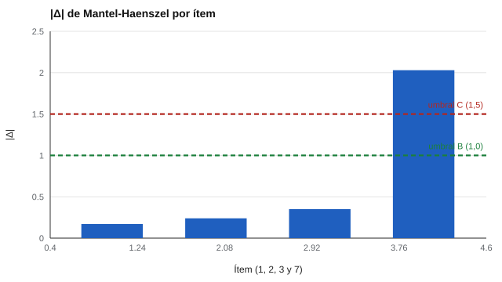

# 063 — Funcionamiento diferencial del ítem (DIF)


<!-- NAV -->
[← 062 — La muestra normativa: a quién se compara la p…](../062-elegir-la-muestra-normativa/README.md) · [📚 Parte 06](../README.md) · [🗺️ Índice 001–200](../../../PROGRAMA.md) · [064 — Sesgo predictivo y definiciones de equidad →](../064-sesgo-predictivo-y-equidad/README.md)
<!-- /NAV -->

**Parte 06 — Baremos, sesgo y equidad** · Nivel avanzado · 5 h · Estado `escrita`
**Pensada para:** quien revisa la equidad de ítems y pruebas, y quien es evaluado con ellas.
**Prerrequisitos:** clases 015 y 052.

## ¿Para qué te sirve esto?

Si dos grupos obtienen puntajes distintos, ¿el test está sesgado? No necesariamente: puede que los grupos **realmente** difieran en el rasgo (a eso se le llama **impacto**). El sesgo a nivel de ítem se llama **DIF** (funcionamiento diferencial del ítem): un ítem que, **entre personas del mismo nivel de rasgo**, favorece a un grupo. Detectarlo permite revisar ítems injustos sin confundir «los grupos difieren» con «el test es sesgado».

## Al terminar esta clase podrás

- Distinguir impacto de DIF.
- Calcular el estadístico de Mantel-Haenszel y la clasificación ETS.
- Decidir qué hacer con un ítem con DIF.
- Explicar por qué un ítem con DIF no se elimina automáticamente.

## La idea en palabras simples

- **Impacto:** los grupos difieren en el puntaje total.
- **DIF:** a igual nivel del rasgo, los grupos difieren en la probabilidad de acertar **un ítem**.

El método de **Mantel-Haenszel** (Holland & Thayer, 1988) compara a personas de ambos grupos **con el mismo puntaje total** (el «mismo nivel») y mira si un grupo acierta más el ítem. Se resume en una razón de odds α_MH (1 = sin DIF) y se transforma a la escala Δ_MH = −2,35 · ln(α_MH).

La clasificación ETS (Zwick, 2012) la divide en **A** (|Δ| < 1: despreciable), **B** (1 a 1,5) y **C** (> 1,5 con significación: grande).

## Cómo funciona, paso a paso

**1. Agrupar a las personas por puntaje total** (estratos de igual nivel).

**2. En cada estrato**, contar aciertos y fallos de cada grupo.

**3. Combinar** con la fórmula de MH:

```
α_MH = Σ(Aₛ·Dₛ/Tₛ) / Σ(Bₛ·Cₛ/Tₛ)          Δ_MH = −2,35·ln(α_MH)
```

**Ejemplo resuelto.** Estrato con A = 30, B = 20, C = 20, D = 30: α = (30·30) / (20·20) = 2,25; Δ = −2,35 · ln 2,25 = −1,91 → magnitud C si es significativo.



*Figura 1.* Solo el ítem 7 (DIF sembrado) se señala; el resto queda cerca de cero.

## Si construyes el instrumento

- Haz análisis de DIF en el piloto, por sexo, edad, tipo de colegio, idioma, etc.
- No elimines ítems automáticamente: revisa el contenido, la relevancia para el constructo y el efecto sobre el puntaje.
- Con muestras pequeñas, MH tiene poca potencia; con DIF no uniforme, usa regresión logística u otro método (clase 177).
- Un DIF estadístico puede ser irrelevante en lo práctico.

## Si eres evaluado

- Si un grupo del que formas parte rinde menos en una prueba, eso no prueba que haya sesgo; el DIF es el análisis que lo examina ítem por ítem.
- Tienes derecho a preguntar si se revisó la equidad de los ítems.
- Un ítem con vocabulario o contexto ajeno a tu experiencia puede tener DIF contra ti.

## Qué muestra el laboratorio

`lab.py` simula 2 grupos y 20 ítems; el grupo focal tiene habilidad −0,5 y el ítem 7 tiene DIF uniforme de +0,8.

| Ítem | α_MH | Δ | χ² | Clase |
|---:|---:|---:|---:|---|
| 1 | 0,93 | 0,17 | 1,5 | A |
| 2 | 0,90 | 0,24 | 3,0 | A |
| 3 | 0,86 | 0,35 | 7,0 | A |
| **7** | **2,38** | **−2,03** | **281,3** | **C** |

Puntaje total medio: 10,1 (referencia) y 8,1 (focal): ese es el impacto.

**Análisis.** (1) El grupo focal puntúa menos en **todos** los ítems (impacto), y aun así el método solo señala el ítem 7: compara personas del mismo nivel. (2) Impacto (diferencia de grupos) no es DIF (diferencia a igual nivel). (3) Un ítem con DIF no se elimina automáticamente: se revisa su contenido para entender si el sesgo es irrelevante para el constructo. (4) El DIF sembrado es uniforme y grande; en la práctica es más sutil.

## Errores frecuentes

- Eliminar automáticamente ítems con DIF.
- Confundir DIF con diferencia de grupos.
- Usar MH con muestras pequeñas o con DIF no uniforme.
- Ignorar que el criterio interno (puntaje total) puede contaminarse si hay muchos ítems con DIF.

## Lo mínimo que debes llevarte

1. Impacto: los grupos difieren; DIF: un ítem funciona distinto a igual nivel.
2. MH compara a personas del mismo puntaje total.
3. La clasificación ETS usa A, B y C.
4. Un ítem con DIF se revisa, no se elimina sin más.

## Ejercicios

- **Inicial.** ¿Qué compara MH que no compara una diferencia de medias? *Solución: personas del mismo nivel de rasgo.*
- **Intermedio.** α = 0,5: ¿Δ y clase? *Solución: Δ = −2,35·ln 0,5 = 1,63 → C.*
- **Avanzado.** Añade en `lab.py` un segundo ítem con DIF en dirección contraria y observa el efecto sobre el criterio interno.
- **Aplicación.** Propón cómo revisarías el contenido de un ítem señalado con DIF clase C.

## Glosario

- **DIF:** funcionamiento diferencial del ítem.
- **Impacto:** diferencia entre grupos en el puntaje.
- **Mantel-Haenszel:** método que compara grupos dentro de estratos de puntaje total.
- **Grupo focal / de referencia:** grupo de interés / de comparación.

## Laboratorio

```bash
python classes/part-06-baremos-sesgo-y-equidad/063-funcionamiento-diferencial-del-item/lab.py
python classes/part-06-baremos-sesgo-y-equidad/figuras.py
```

## Autoevaluación y criterios

1. ¿Qué es impacto? 2. ¿Qué haces con un ítem C? 3. ¿Qué grupos eliges como focal y por qué?
Se logra la clase si puedes distinguir impacto de DIF y decidir con criterio sustantivo.

## Bibliografía

- Mantel, N., & Haenszel, W. (1959). Statistical aspects of the analysis of data from retrospective studies of disease. *Journal of the National Cancer Institute*, 22(4), 719-748.
- Holland, P. W., & Thayer, D. T. (1988). Differential item performance and the Mantel-Haenszel procedure. En H. Wainer & H. I. Braun (Eds.), *Test Validity*. Lawrence Erlbaum.
- Zwick, R. (2012). *A Review of ETS Differential Item Functioning Assessment Procedures*. ETS Research Report RR-12-08.

---

<!-- NAV -->
[← 062 — La muestra normativa: a quién se compara la p…](../062-elegir-la-muestra-normativa/README.md)  
[📚 Parte 06](../README.md) · [🗺️ Índice 001–200](../../../PROGRAMA.md)  
[064 — Sesgo predictivo y definiciones de equidad →](../064-sesgo-predictivo-y-equidad/README.md)
<!-- /NAV -->
