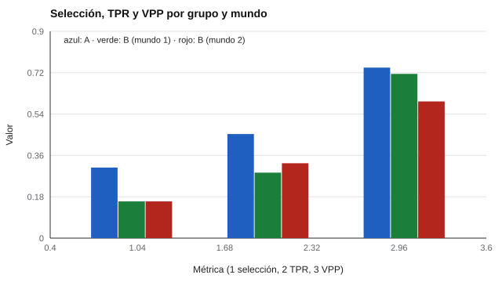

# 064 — Sesgo predictivo y definiciones de equidad


<!-- NAV -->
[← 063 — Funcionamiento diferencial del ítem (DIF)](../063-funcionamiento-diferencial-del-item/README.md) · [📚 Parte 06](../README.md) · [🗺️ Índice 001–200](../../../PROGRAMA.md) · [065 — Adaptación transcultural y equivalencia →](../065-adaptacion-transcultural/README.md)
<!-- /NAV -->

**Parte 06 — Baremos, sesgo y equidad** · Nivel avanzado · 5 h · Estado `escrita`
**Pensada para:** quien decide con pruebas (selección, admisión, algoritmos) y quien es afectado por esas decisiones.
**Prerrequisitos:** clases 034 y 035.

## ¿Para qué te sirve esto?

Cuando una prueba se usa para decidir (admisión, contratación, un algoritmo de riesgo), surge la pregunta: **¿es justa?** La respuesta depende de qué se entienda por justicia. El modelo de Cleary pregunta si el test **predice igual** en todos los grupos. Pero hay otras definiciones (igual tasa de selección, igual acierto entre quienes sí rinden bien, igual valor predictivo) y, como muestra esta clase, **no pueden cumplirse todas a la vez**. Entenderlo evita discusiones donde cada parte usa una definición distinta sin saberlo.

## Al terminar esta clase podrás

- Aplicar el modelo de Cleary de sesgo predictivo.
- Comparar selección, tasa de verdaderos positivos y valor predictivo entre grupos.
- Explicar por qué las definiciones de equidad no pueden cumplirse a la vez.
- Plantear quién y cómo decide qué equidad priorizar.

## La idea en palabras simples

**Modelo de Cleary (1968):** un test no tiene sesgo predictivo si la recta de regresión del criterio sobre el test es **la misma** en todos los grupos (mismo intercepto y pendiente). Si hay un grupo cuyo desempeño real es menor que el predicho con la misma recta común, el test **sobre-predice** para ese grupo.

Pero, aun con una recta común, puede haber diferencias en:

- **Selección:** qué proporción de cada grupo supera el corte.
- **TPR (tasa de verdaderos positivos):** de quienes **sí** rendirían bien, qué proporción es seleccionada.
- **VPP (valor predictivo positivo):** de quienes son seleccionados, qué proporción rinde bien.

Cuando las **tasas base** (qué proporción rinde bien en cada grupo) difieren, no hay un corte que iguale todas esas métricas (Kleinberg et al., 2017; Chouldechova, 2017).

## Cómo funciona, paso a paso

**1. Ajustar la regresión** del criterio sobre el test por grupo.

**2. Comparar** intercepto y pendiente (Cleary).

**3. Calcular selección, TPR y VPP** con un corte común.

**4. Reflexionar:** ¿qué definición de equidad priorizar? Es una decisión de valor, informada por las consecuencias (clase 035).

**Ejemplo.** Si la recta común predice Y = 0,5 para X = 1 y el grupo B promedia 0,2 en ese X, el test sobre-predice a B (diferencia de intercepto).



*Figura 1.* En el mundo 2 (B rinde menos a igual puntaje) el VPP de B cae a 0,60.

## Si construyes el instrumento

- Prueba el modelo de Cleary con tus datos, por grupo.
- Informa selección, TPR y VPP por grupo, y las tasas base.
- Documenta qué definición de equidad adoptaste y por qué; esa decisión corresponde a quienes se ven afectados y a quienes responden por la decisión, no solo al equipo técnico.
- Revisa si el criterio (por ejemplo, la evaluación del supervisor) está también sesgado.

## Si eres evaluado

- «El test es justo» puede significar cosas distintas: pregunta qué definición se usó.
- Una decisión automatizada debe poder revisarse por una persona y explicarse (parte 07).
- Tienes derecho a conocer cómo se evaluó el efecto de la prueba en distintos grupos.

## Qué muestra el laboratorio

`lab.py` usa un corte común X ≥ 0,5 y define «buen desempeño» como Y > 0.

| Mundo | Grupo | Selección | TPR | VPP | Tasa base |
|---|---|---:|---:|---:|---:|
| 1 (misma recta) | A | 0,307 | 0,453 | 0,742 | 0,503 |
| | B | 0,160 | 0,285 | 0,715 | 0,401 |
| 2 (B rinde menos en Y a igual X) | A | 0,307 | 0,453 | 0,742 | 0,503 |
| | B | 0,160 | 0,326 | 0,595 | 0,293 |

**Análisis.** (1) En el mundo 1 las rectas coinciden (el test predice igual en ambos grupos) y aun así las tasas de selección, TPR y VPP difieren, porque las tasas base y las medias difieren: **no existe un corte que iguale todas las métricas**. (2) En el mundo 2, el VPP cae en B (0,595): el corte común sobre-predice el desempeño de B. (3) Elegir qué equidad priorizar es una decisión de valor, informada por las consecuencias, no un cálculo. (4) Son datos simulados con relaciones lineales.

## Errores frecuentes

- Declarar «el test es justo» porque la recta es común, sin mirar las consecuencias.
- Elegir una definición de equidad por conveniencia técnica.
- Ignorar que el criterio también puede estar sesgado.
- Delegar a un algoritmo una decisión de valor sin revisión humana.

## Lo mínimo que debes llevarte

1. Cleary: la misma recta de predicción en todos los grupos.
2. Selección, TPR y VPP miden cosas distintas.
3. Con tasas base distintas, no se pueden igualar todas a la vez.
4. Elegir una definición de equidad es una decisión de valor.

## Ejercicios

- **Inicial.** ¿Qué compara el modelo de Cleary? *Solución: intercepto y pendiente de la recta de predicción por grupo.*
- **Intermedio.** Si las tasas base son iguales, ¿es posible igualar selección y TPR a la vez? *Solución: sí, en general.*
- **Avanzado.** Cambia la tasa base de B en `lab.py` y observa las tres métricas.
- **Aplicación.** Escribe cómo documentarías la decisión de qué equidad priorizar en un proceso de admisión.

## Glosario

- **Sesgo predictivo:** el test predice distinto en grupos distintos.
- **TPR:** proporción de quienes rinden bien que son seleccionados.
- **VPP:** proporción de seleccionados que rinden bien.
- **Tasa base:** proporción de un grupo que rinde bien.

## Laboratorio

```bash
python classes/part-06-baremos-sesgo-y-equidad/064-sesgo-predictivo-y-equidad/lab.py
python classes/part-06-baremos-sesgo-y-equidad/figuras.py
```

## Autoevaluación y criterios

1. ¿Qué definición de equidad priorizas en admisión y por qué? 2. ¿Quién decide? 3. ¿Cómo documentas la decisión?
Se logra la clase si puedes evaluar el sesgo predictivo y discutir definiciones de equidad.

## Bibliografía

- Cleary, T. A. (1968). Test bias: Prediction of grades of Negro and white students in integrated colleges. *Journal of Educational Measurement*, 5(2), 115-124.
- Kleinberg, J., Mullainathan, S., & Raghavan, M. (2017). Inherent trade-offs in the fair determination of risk scores. *ITCS 2017*.
- Chouldechova, A. (2017). Fair prediction with disparate impact: A study of bias in recidivism prediction instruments. *Big Data*, 5(2), 153-163.

---

<!-- NAV -->
[← 063 — Funcionamiento diferencial del ítem (DIF)](../063-funcionamiento-diferencial-del-item/README.md)  
[📚 Parte 06](../README.md) · [🗺️ Índice 001–200](../../../PROGRAMA.md)  
[065 — Adaptación transcultural y equivalencia →](../065-adaptacion-transcultural/README.md)
<!-- /NAV -->
