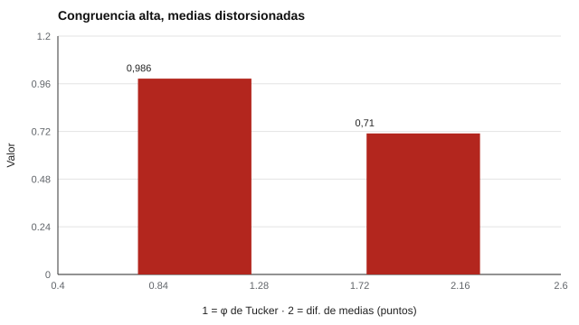

# 065 — Adaptación transcultural y equivalencia


<!-- NAV -->
[← 064 — Sesgo predictivo y definiciones de equidad](../064-sesgo-predictivo-y-equidad/README.md) · [📚 Parte 06](../README.md) · [🗺️ Índice 001–200](../../../PROGRAMA.md) · [066 — Puntajes estándar: z, T y estaninos →](../066-puntajes-estandar-z-t-y-estaninos/README.md)
<!-- /NAV -->

**Parte 06 — Baremos, sesgo y equidad** · Nivel avanzado · 5 h · Estado `escrita`
**Pensada para:** quien adapta instrumentos a otros idiomas o culturas, y quien es evaluado con un instrumento adaptado.
**Prerrequisitos:** clases 045 y 063.

## ¿Para qué te sirve esto?

Muchos de los instrumentos que usamos nacieron en otro idioma y otro país. Traducirlos y aplicarlos sin más es una receta para los errores: una frase puede significar algo distinto, un ejemplo puede ser ajeno a nuestra cultura, y los puntajes pueden dejar de ser comparables. Esta clase te enseña qué implica una **adaptación** (que va mucho más allá de traducir) y cómo comprobar la **equivalencia** entre versiones.

## Al terminar esta clase podrás

- Describir el proceso de adaptación de un instrumento.
- Calcular la congruencia de Tucker entre cargas de dos versiones.
- Reconocer que la similitud factorial no implica comparabilidad de medias.
- Diseñar un plan de adaptación y evaluación de equivalencia.

## La idea en palabras simples

Adaptar un test es decidir y comprobar **tres equivalencias** (Hambleton et al., 2005): **conceptual** (el constructo significa lo mismo en ambas culturas), **lingüística** (las frases se entienden igual) y **métrica** (los puntajes se comportan igual). Las *ITC Guidelines* (2017) recomiendan: traducción y retrotraducción con revisión de expertos, prueba piloto cognitiva (entrevistas a personas de la población objetivo) y comprobación de invarianza (clase 045).

La **congruencia de Tucker (φ)** compara los patrones de cargas factoriales entre dos versiones: un φ alto significa que los ítems se agrupan parecido. Pero **no basta**.

## Cómo funciona, paso a paso

**1. Traducir y retrotraducir**, con revisión de expertos.

**2. Piloto cognitivo** con personas de la población objetivo.

**3. Estudio de equivalencia:** comparar cargas (φ), invarianza (configural, métrica, escalar) y DIF.

**4. Recién entonces** comparar puntajes entre idiomas.

**Ejemplo resuelto.** Cargas (0,7; 0,7; 0,7) y (0,7; 0,35; 0,7): numerador = 0,49 + 0,245 + 0,49 = 1,225; denominador = √(1,47 · 1,1025) = 1,273; φ = **0,962**: «similar» pese a un ítem con la mitad de carga.



*Figura 1.* La congruencia de las cargas es alta, pero un ítem desplazado distorsiona la comparación de medias.

## Si construyes el instrumento

- Planifica la adaptación como un estudio, no como una traducción.
- Documenta cada paso (traductores, revisores, piloto, cambios).
- Comprueba invarianza antes de comparar puntajes entre versiones.
- Un instrumento adaptado necesita su propio estudio de fiabilidad y validez y su propia norma local; no uses normas del país de origen sin estudio.

## Si eres evaluado

- Si el instrumento está traducido, pregunta si fue adaptado y estudiado en tu contexto.
- Una frase que te resulte extraña o ajena puede ser un problema de adaptación; señálalo.
- Un puntaje comparado con una norma extranjera puede no ser interpretable.

## Qué muestra el laboratorio

`lab.py` simula 8 ítems: el ítem 3 está mal traducido (carga 0,35) y el ítem 5 está desplazado en la versión adaptada (media 0,62); el rasgo medio es **igual** en ambas versiones.

| Medida | Valor |
|---|---:|
| Congruencia de Tucker de las cargas | 0,986 |
| Diferencia de medias de la escala | 0,71 (DE de la escala 5,89) |

**Análisis.** (1) φ es alto aunque haya un ítem defectuoso y uno que desplaza la media. (2) La diferencia de medias (0,71) no existe en el rasgo: es un artefacto del instrumento. (3) La adaptación transcultural requiere traducción y retrotraducción, prueba piloto cognitiva y pruebas de invarianza antes de comparar puntajes entre idiomas (ITC, 2017). (4) Los datos son simulados con defectos sembrados.

## Errores frecuentes

- Declarar equivalencia por φ alto o por alfa similar.
- Traducir sin retrotraducir ni hacer piloto cognitivo.
- Usar normas del país de origen sin estudio local.
- Comparar medias entre idiomas sin invarianza escalar.

## Lo mínimo que debes llevarte

1. Adaptar no es traducir.
2. Hay tres equivalencias: conceptual, lingüística y métrica.
3. φ alto no garantiza comparabilidad de medias.
4. Se necesita invarianza antes de comparar.

## Ejercicios

- **Inicial.** ¿Qué diferencia hay entre traducir y adaptar? *Solución: adaptar incluye equivalencia conceptual, piloto y estudios de equivalencia.*
- **Intermedio.** Calcula φ para (0,6; 0,6) y (0,6; 0,3). *Solución: 0,54 / √(0,72 · 0,45) = 0,949.*
- **Avanzado.** Añade un tercer ítem con carga baja y observa φ.
- **Aplicación.** Escribe un plan de adaptación para un cuestionario de bienestar a tu contexto.

## Glosario

- **Adaptación transcultural:** proceso de llevar un instrumento a otra cultura o idioma con evidencia de equivalencia.
- **Retrotraducción:** traducir de vuelta al idioma original para comparar.
- **Piloto cognitivo:** entrevistas para comprobar la comprensión.
- **Congruencia de Tucker (φ):** índice de similitud entre patrones de cargas.

## Laboratorio

```bash
python classes/part-06-baremos-sesgo-y-equidad/065-adaptacion-transcultural/lab.py
python classes/part-06-baremos-sesgo-y-equidad/figuras.py
```

## Autoevaluación y criterios

1. ¿Qué evidencia mínima pedirías para comparar medias entre idiomas? 2. ¿Qué es una prueba piloto cognitiva? 3. ¿Cómo documentarías el proceso?
Se logra la clase si puedes diseñar un plan de adaptación y evaluación de equivalencia.

## Bibliografía

- Hambleton, R. K., Merenda, P. F., & Spielberger, C. D. (Eds.) (2005). *Adapting Educational and Psychological Tests for Cross-Cultural Assessment*. Lawrence Erlbaum. ✅ [DOI](https://doi.org/10.4324/9781410611758)
- International Test Commission (2017). *The ITC Guidelines for Translating and Adapting Tests* (2.ª ed.). *International Journal of Testing*, 18(2), 101-134. ✅ [DOI](https://doi.org/10.1080/15305058.2017.1398166)
- Lorenzo-Seva, U., & ten Berge, J. M. F. (2006). Tucker's congruence coefficient as a meaningful index of factor similarity. *Methodology*, 2(2), 57-64. ✅ [DOI](https://doi.org/10.1027/1614-2241.2.2.57)

Leyenda: ✅ existe en Crossref con título y año coincidentes (enlace al DOI); ⚠️ hay una obra de título parecido con otro año (no se enlaza: comprobar la edición); 🔎 no verificada automáticamente (libros sin DOI, normas y sitios web). Crossref confirma la existencia de la fuente, no que respalde cada afirmación de la clase. Ver [`docs/VERIFICACION_BIBLIOGRAFIA.md`](../../../docs/VERIFICACION_BIBLIOGRAFIA.md).

---

<!-- NAV -->
[← 064 — Sesgo predictivo y definiciones de equidad](../064-sesgo-predictivo-y-equidad/README.md)  
[📚 Parte 06](../README.md) · [🗺️ Índice 001–200](../../../PROGRAMA.md)  
[066 — Puntajes estándar: z, T y estaninos →](../066-puntajes-estandar-z-t-y-estaninos/README.md)
<!-- /NAV -->
