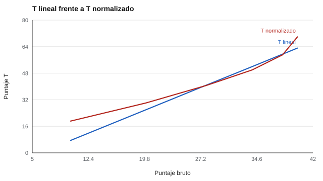

# 066 — Puntajes estándar: z, T y estaninos


<!-- NAV -->
[← 065 — Adaptación transcultural y equivalencia](../065-adaptacion-transcultural/README.md) · [📚 Parte 06](../README.md) · [🗺️ Índice 001–200](../../../PROGRAMA.md) · [067 — Normas por edad y por curso escolar →](../067-normas-por-edad-y-por-curso-escolar/README.md)
<!-- /NAV -->

**Parte 06 — Baremos, sesgo y equidad** · Nivel avanzado · 3 h · Estado `escrita`
**Pensada para:** quien convierte puntajes a escalas de reporte y quien lee informes con T, estaninos u otras escalas.
**Prerrequisitos:** clase 061.

## ¿Para qué te sirve esto?

Los informes rara vez muestran el puntaje bruto: muestran un «T = 60», un «estanino 7» o un «CI 110». Son **puntajes estándar**, escalas que facilitan leer y comparar. Pero hay dos formas de construirlos, **lineal** y **normalizada**, y dan lecturas distintas cuando la distribución no es simétrica. Saber la diferencia te permite leer un informe con criterio y exigir que el manual diga cuál se usó.

## Al terminar esta clase podrás

- Convertir un bruto a z, T y estanino.
- Distinguir la transformación lineal de la normalizada.
- Decidir cuándo normalizar y cómo declararlo.
- Reconocer lo que ocultan los estaninos.

## La idea en palabras simples

- **Lineal:** se resta la media y se divide por la DE (z) y se reescala: T = 50 + 10·z; estanino ≈ 5 + 2·z (acotado a 1–9). **Conserva la forma** de la distribución: si era asimétrica, sigue siéndolo.
- **Normalizada (de área):** el bruto se pasa a rango percentil, de ahí al valor correspondiente de una distribución normal y luego a la escala deseada. **Fuerza una forma normal.**
- **Estaninos** (del inglés *standard nine*): nueve bandas, con cortes en los percentiles acumulados 4, 11, 23, 40, 60, 77, 89 y 96.

## Cómo funciona, paso a paso

**1. Elegir la transformación** (lineal o normalizada) y declararla.

**2. Calcular** z, T o estanino.

**Ejemplo.** z = −1 → T = 40; estanino lineal = 5 − 2 = 3. Percentil 84 → z = 1 → T = 60.



*Figura 1.* El puntaje máximo equivale a T = 63 (lineal) o T = 70 (normalizado).

## Si construyes el instrumento

- Normaliza solo si hay razones para suponer que el rasgo se distribuye normalmente: una asimetría puede ser real.
- Declara la transformación en el manual.
- No compares T de pruebas con transformaciones distintas.
- Usa estaninos cuando la medida no es muy precisa: agrupan y reducen la sensación de falsa precisión.

## Si eres evaluado

- Pregunta qué escala se usó y con qué grupo de referencia.
- Un estanino 5 cubre a todos los que están en el centro (percentiles 40 a 60): no hay diferencia «real» entre estar en 41 o en 59.
- Un T = 70 no significa lo mismo si se calculó normalizado o linealmente en una prueba con techo.

## Qué muestra el laboratorio

`lab.py` transforma los puntajes de una prueba fácil con techo (0 a 40; media 32,9; DE 5,4; asimetría negativa).

| Bruto | Percentil | T lineal | T normalizado | Estanino lineal | Estanino normalizado |
|---:|---:|---:|---:|---:|---:|
| 10 | 0,1 | 7,4 | 19,1 | 1 | 1 |
| 20 | 2,4 | 26,0 | 30,1 | 1 | 1 |
| 28 | 17,7 | 40,9 | 40,7 | 3 | 3 |
| 34 | 50,2 | 52,0 | 50,0 | 5 | 5 |
| 38 | 81,9 | 59,5 | 59,1 | 7 | 7 |
| 40 | 97,8 | 63,2 | 70,1 | 8 | 9 |

**Análisis.** (1) Con distribución asimétrica, T lineal y T normalizado coinciden en el centro y divergen en la cola larga (63,2 frente a 70,1). (2) La normalización es una decisión con supuestos, y se declara en el manual. (3) Los estaninos agrupan en nueve bandas: ocultan diferencias pequeñas, que es justo lo que se quiere cuando la medida no es tan precisa (clase 025). (4) Es una prueba simulada con techo; con otras distribuciones, la diferencia cambia.

## Errores frecuentes

- Normalizar sin justificar que el rasgo sea normal.
- Comparar T de pruebas con transformaciones distintas.
- Informar estaninos como si tuvieran la precisión del bruto.
- No declarar la transformación en el manual.

## Lo mínimo que debes llevarte

1. Lineal conserva la forma; normalizada fuerza una normal.
2. T = 50 + 10·z; estanino ≈ 5 + 2·z.
3. En colas de distribuciones asimétricas, ambas difieren.
4. Se declara la transformación.

## Ejercicios

- **Inicial.** ¿Qué puntaje T equivale al percentil 50 normalizado? *Solución: 50.*
- **Intermedio.** z = 1,5: ¿T y estanino? *Solución: T = 65; estanino = 8.*
- **Avanzado.** Cambia la forma de la distribución en `lab.py` a una asimétrica positiva y compara las dos transformaciones.
- **Aplicación.** Revisa un manual y señala qué transformación usa y si la declara.

## Glosario

- **Puntaje z:** desviaciones típicas respecto de la media.
- **Puntaje T:** escala con media 50 y DE 10.
- **Estanino:** escala de nueve bandas con media 5 y DE ≈ 2.
- **Normalización:** transformación que fuerza una distribución normal.

## Laboratorio

```bash
python classes/part-06-baremos-sesgo-y-equidad/066-puntajes-estandar-z-t-y-estaninos/lab.py
python classes/part-06-baremos-sesgo-y-equidad/figuras.py
```

## Autoevaluación y criterios

1. ¿Cuándo normalizar? 2. ¿Qué cambia en la cola? 3. ¿Cómo se declara en el manual?
Se logra la clase si puedes transformar puntajes y justificar la elección.

## Bibliografía

- Angoff, W. H. (1984). *Scales, Norms, and Equivalent Scores*. Educational Testing Service. 🔎 sin verificar (libro, norma o sitio no hallado en Crossref: comprobar a mano)
- Anastasi, A., & Urbina, S. (1997). *Psychological Testing* (7.ª ed.). Prentice Hall. 🔎 sin verificar (libro, norma o sitio no hallado en Crossref: comprobar a mano)

Leyenda: ✅ existe en Crossref con título y año coincidentes (enlace al DOI); ⚠️ hay una obra de título parecido con otro año (no se enlaza: comprobar la edición); 🔎 no verificada automáticamente (libros sin DOI, normas y sitios web). Crossref confirma la existencia de la fuente, no que respalde cada afirmación de la clase. Ver [`docs/VERIFICACION_BIBLIOGRAFIA.md`](../../../docs/VERIFICACION_BIBLIOGRAFIA.md).

---

<!-- NAV -->
[← 065 — Adaptación transcultural y equivalencia](../065-adaptacion-transcultural/README.md)  
[📚 Parte 06](../README.md) · [🗺️ Índice 001–200](../../../PROGRAMA.md)  
[067 — Normas por edad y por curso escolar →](../067-normas-por-edad-y-por-curso-escolar/README.md)
<!-- /NAV -->
