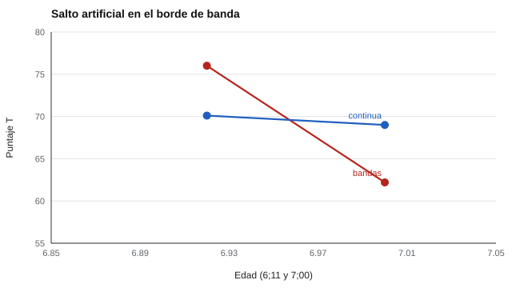

# 067 — Normas por edad y por curso escolar


<!-- NAV -->
[← 066 — Puntajes estándar: z, T y estaninos](../066-puntajes-estandar-z-t-y-estaninos/README.md) · [📚 Parte 06](../README.md) · [🗺️ Índice 001–200](../../../PROGRAMA.md) · [068 — Equidad en evaluaciones de alto impacto →](../068-equidad-en-evaluaciones-de-alto-impacto/README.md)
<!-- /NAV -->

**Parte 06 — Baremos, sesgo y equidad** · Nivel avanzado · 4 h · Estado `escrita`
**Pensada para:** quien construye o usa pruebas con niños y adolescentes, y las familias que reciben sus resultados.
**Prerrequisitos:** clases 061 y 066.

## ¿Para qué te sirve esto?

Un niño de 6 años y 11 meses y otro de 7 años exactos tienen casi la misma edad, pero si el baremo está organizado por **años enteros**, pueden recibir puntajes muy distintos **solo por el lado del corte** en que cayeron. En la infancia el rendimiento cambia rápido con la edad, y cómo se construya la norma importa. Esta clase te enseña la diferencia entre baremos por bandas y por **normalización continua**, y entre normas por edad y por curso.

## Al terminar esta clase podrás

- Comparar normas por bandas y normalización continua.
- Reconocer el «salto» artificial en los bordes de banda.
- Distinguir norma por edad de norma por curso.
- Decidir cuál conviene para una prueba concreta.

## La idea en palabras simples

- **Por bandas:** un baremo para cada tramo (por ejemplo, un baremo para 6 años, otro para 7). Es simple, pero tiene escalones.
- **Continua:** la media (y la DE) se modelan como una **función suave de la edad** con regresión (Zachary & Gorsuch, 1985). Cada niño se compara con la media esperada **a su edad exacta**.

- **Norma por edad:** compara con niños de la misma edad.
- **Norma por curso:** compara con niños del mismo curso; el curso mide también la **instrucción recibida**.

## Cómo funciona, paso a paso

**1. Reunir una muestra** que cubra todas las edades.

**2. Ajustar la curva** de la media (y de la DE) según la edad.

**3. Calcular el T** de cada niño respecto de la media esperada a su edad.

**Ejemplo resuelto.** Media real a los 7;0 = 10 + 9 − 0,45 = 18,55 → T = 50 + 10 · (30 − 18,55) / 6 = 69,1 (continua: 69,0). La banda de 6 años promedia ~14,4 en el borde: T = 50 + 10 · (30 − 14,4) / 6 = 76,0, es decir, 7 puntos de T por encima solo por la banda.



*Figura 1.* Con bandas, dos niños casi iguales en edad reciben puntajes T muy distintos.

## Si construyes el instrumento

- En edades de cambio rápido, usa bandas estrechas o normalización continua.
- Exige una muestra que cubra todo el rango de edad y no extrapoles fuera de él.
- Modela también la DE: puede cambiar con la edad.
- Decide entre edad y curso según lo que se evalúa (la lectura inicial depende más del curso que de la edad).

## Si eres evaluado

- Si tu hijo o hija está cerca del borde de una banda de edad, pregunta si la norma es continua o por bandas.
- Un resultado «bajo» con una norma por años enteros puede deberse a estar en el extremo joven de la banda.
- En un mismo curso, niños de distinta edad pueden ser comparados con normas de curso o de edad: pregunta cuál se usó.

## Qué muestra el laboratorio

`lab.py` simula niños de 6 a 13 años (N = 3.000; media cuadrática; DE 6) y compara un mismo bruto de 30 en dos niños casi de la misma edad.

| Niño con bruto 30 | Banda | Continua |
|---|---:|---:|
| 6;11 | T = 76,0 | T = 70,1 |
| 7;00 | T = 62,2 | T = 69,0 |

Error de la media en el borde de banda (e = 7,0): bandas **4,17** y **4,14**; continua **0,05**.

**Análisis.** (1) Con bandas, dos niños casi iguales en edad reciben T muy distintos (76,0 y 62,2, una diferencia de casi 14 puntos) solo por el lado del corte. (2) La normalización continua los trata parecido (70,1 y 69,0). (3) Exige modelar bien la forma de la curva y la DE, y una muestra normativa que cubra toda la edad. (4) Las normas por curso y por edad pueden diferir: el curso mide también instrucción recibida.

## Errores frecuentes

- Usar una banda ancha en una edad de cambio rápido.
- Extrapolar la curva fuera de la edad de la muestra normativa.
- Suponer que la DE no cambia con la edad.
- Aplicar una norma de otro curso o país a estudiantes chilenos sin evidencia de equivalencia.

## Lo mínimo que debes llevarte

1. Las bandas crean saltos artificiales en los bordes.
2. La normalización continua evita los escalones.
3. Edad y curso responden preguntas distintas.
4. La muestra debe cubrir todas las edades.

## Ejercicios

- **Inicial.** ¿Qué es mejor para una prueba de lectura inicial: edad o curso? *Guía: curso, porque refleja la instrucción recibida.*
- **Intermedio.** Si el rendimiento medio sube 5 puntos por año, ¿qué error introduce una banda anual a mitad de año? *Solución: ≈ 2,5.*
- **Avanzado.** Modifica la curva de `media_real` para un tramo plano y observa si la regresión cuadrática ajusta.
- **Aplicación.** Explica a una familia por qué su hijo recibió puntajes distintos en dos pruebas con bandas distintas.

## Glosario

- **Banda de edad:** tramo de edad con un baremo propio.
- **Normalización continua:** baremo basado en una función suave de la edad.
- **Norma por curso:** compara con estudiantes del mismo curso.
- **Efecto de borde:** salto de puntaje entre bandas contiguas.

## Laboratorio

```bash
python classes/part-06-baremos-sesgo-y-equidad/067-normas-por-edad-y-por-curso-escolar/lab.py
python classes/part-06-baremos-sesgo-y-equidad/figuras.py
```

## Autoevaluación y criterios

1. ¿Qué datos necesita una norma continua? 2. ¿Qué riesgo trae el ajuste paramétrico? 3. ¿Cómo decidirías edad o curso?
Se logra la clase si puedes construir y comparar ambas normas.

## Bibliografía

- Zachary, R. A., & Gorsuch, R. L. (1985). Continuous norming: Implications for the WAIS-R. *Journal of Clinical Psychology*, 41(1), 86-94. ✅ [DOI](https://doi.org/10.1002/1097-4679(198501)41:1<86::aid-jclp2270410115>3.0.co;2-w)
- Oosterhuis, H. E. M., van der Ark, L. A., & Sijtsma, K. (2016). Sample size requirements for traditional and regression-based norms. *Assessment*, 23(2), 191-202. ✅ [DOI](https://doi.org/10.1177/1073191115580638)

Leyenda: ✅ existe en Crossref con título y año coincidentes (enlace al DOI); ⚠️ hay una obra de título parecido con otro año (no se enlaza: comprobar la edición); 🔎 no verificada automáticamente (libros sin DOI, normas y sitios web). Crossref confirma la existencia de la fuente, no que respalde cada afirmación de la clase. Ver [`docs/VERIFICACION_BIBLIOGRAFIA.md`](../../../docs/VERIFICACION_BIBLIOGRAFIA.md).

---

<!-- NAV -->
[← 066 — Puntajes estándar: z, T y estaninos](../066-puntajes-estandar-z-t-y-estaninos/README.md)  
[📚 Parte 06](../README.md) · [🗺️ Índice 001–200](../../../PROGRAMA.md)  
[068 — Equidad en evaluaciones de alto impacto →](../068-equidad-en-evaluaciones-de-alto-impacto/README.md)
<!-- /NAV -->
