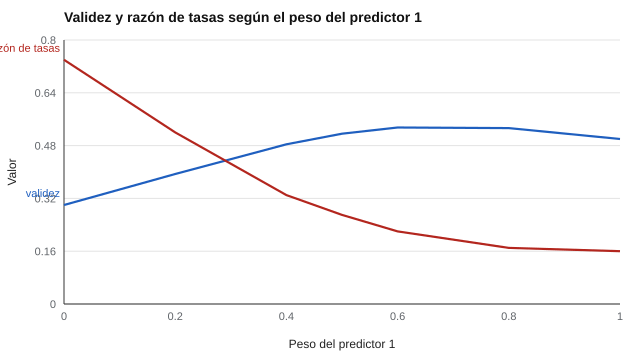

# 068 — Equidad en evaluaciones de alto impacto


<!-- NAV -->
[← 067 — Normas por edad y por curso escolar](../067-normas-por-edad-y-por-curso-escolar/README.md) · [📚 Parte 06](../README.md) · [🗺️ Índice 001–200](../../../PROGRAMA.md) · [069 — Acomodaciones y diseño universal de la evalua… →](../069-acomodaciones-y-diseno-universal-de-la-evaluacion/README.md)
<!-- /NAV -->

**Parte 06 — Baremos, sesgo y equidad** · Nivel avanzado · 4 h · Estado `escrita`
**Pensada para:** quien diseña procesos de selección o admisión, y quien es evaluado en ellos.
**Prerrequisitos:** clases 034, 035 y 064.

## ¿Para qué te sirve esto?

En selección o admisión se combinan varios predictores (una prueba cognitiva, una entrevista, una prueba de personalidad). Los más válidos a veces muestran mayores diferencias entre grupos, y eso genera el **dilema diversidad-validez** (Pyburn et al., 2008; Ployhart & Holtz, 2008). Esta clase te muestra cómo **cuantificar** ese compromiso con una fórmula simple, de modo que la discusión sea honesta: cuánto de una cosa se sacrifica por la otra, y quién decide.

## Al terminar esta clase podrás

- Calcular validez y diferencia de grupos de un compuesto de predictores.
- Cuantificar el compromiso entre validez e impacto adverso.
- Declarar los supuestos de un análisis de ponderación.
- Plantear alternativas al re-ponderar.

## La idea en palabras simples

Si combinas dos predictores con pesos w₁ y w₂, la **validez** del compuesto y su **diferencia entre grupos (d)** se calculan así (Sackett & Ellingson, 1997):

```
sd = √(w₁² + w₂² + 2·w₁·w₂·r)
validez = (w₁·v₁ + w₂·v₂) / sd
d = (w₁·d₁ + w₂·d₂) / sd
```

Si uno de los predictores tiene gran diferencia de grupos (d alto), darle **menos peso** reduce el impacto adverso, pero también puede reducir la validez. El cálculo permite ver **cuánta validez cuesta cada punto de diversidad**.

## Cómo funciona, paso a paso

**1. Reunir** validez, d y correlación entre predictores (en el laboratorio, valores ilustrativos: P1 validez 0,50, d = 1,0; P2 validez 0,30, d = 0,2; r = 0,20).

**2. Variar los pesos** y calcular validez, d del compuesto, tasa de selección de la minoría y razón (se selecciona el 20 % superior del grupo mayoritario).

**Ejemplo resuelto.** w₁ = w₂ = 0,5: sd = √(0,25 + 0,25 + 0,1) = 0,775; validez = (0,25 + 0,15) / 0,775 = 0,516; d = (0,5 + 0,1) / 0,775 = 0,775.



*Figura 1.* Más peso al predictor con menor diferencia de grupos mejora la razón de tasas y, pasado cierto punto, baja la validez.

## Si construyes el instrumento

- Calcula la curva con **tus** datos: los números del laboratorio son ilustrativos.
- Considera alternativas al re-ponderar: cambiar el método (entrevista estructurada, muestras de trabajo), ampliar el reclutamiento o revisar el criterio.
- Explicita qué se valora y quién decide cuánta validez se sacrifica.
- Una estrategia de ponderación debe ser justificable y auditable.

## Si eres evaluado

- Pregunta cómo se combinan las pruebas y por qué con esos pesos.
- Una prueba muy válida puede tener efectos desiguales entre grupos; el proceso debería haberlo analizado.
- Tienes derecho a conocer los criterios generales de decisión.

## Qué muestra el laboratorio

`lab.py` calcula la validez y la razón de tasas para distintos pesos del predictor 1.

| Peso P1 | Validez | d compuesto | Tasa minoría | Razón |
|---:|---:|---:|---:|---:|
| 1,0 | 0,500 | 1,000 | 0,033 | 0,16 |
| 0,8 | 0,533 | 0,974 | 0,035 | 0,17 |
| 0,6 | 0,535 | 0,866 | 0,044 | 0,22 |
| 0,5 | 0,516 | 0,775 | 0,053 | 0,27 |
| 0,4 | 0,484 | 0,663 | 0,066 | 0,33 |
| 0,2 | 0,394 | 0,417 | 0,104 | 0,52 |
| 0,0 | 0,300 | 0,200 | 0,149 | 0,74 |

**Análisis.** (1) Bajar el peso del predictor con mayor diferencia de grupos reduce el impacto adverso (razón de 0,16 a 0,74). (2) Hasta un peso de 0,6 la validez incluso sube (0,535) gracias a la información complementaria; después cae. (3) El costo de cada punto de diversidad en validez se puede calcular, y esa es la discusión honesta. (4) Los números dependen de los supuestos; con valores de otro contexto la curva cambia. No hay ponderación «correcta» sin decidir antes qué se valora, y quién lo decide.

## Errores frecuentes

- Tratar los números del laboratorio como valores del mundo real.
- Optimizar solo validez o solo diversidad sin explicitar el valor de cada una.
- Omitir alternativas al re-ponderar.
- Usar una ponderación sin poder justificarla ni auditarla.

## Lo mínimo que debes llevarte

1. Existe un compromiso entre validez e impacto adverso.
2. Se puede cuantificar con una fórmula simple.
3. Los resultados dependen de los supuestos.
4. Decidir cuánto sacrificar es una decisión de valor.

## Ejercicios

- **Inicial.** ¿Qué es el dilema diversidad-validez? *Solución: el tradeoff entre predictores más válidos y diferencias entre grupos.*
- **Intermedio.** Calcula la validez para w₁ = 0,2, w₂ = 0,8. *Solución: sd = √(0,04 + 0,64 + 0,064) = 0,863; (0,10 + 0,24) / 0,863 = 0,394.*
- **Avanzado.** Cambia r a 0,5 y describe qué ocurre con la validez del compuesto.
- **Aplicación.** Diseña un proceso de selección con tres métodos y justifica los pesos.

## Glosario

- **Compuesto de predictores:** combinación ponderada de varios predictores.
- **Impacto adverso:** menor tasa de selección de un grupo.
- **Dilema diversidad-validez:** tradeoff entre validez del proceso y diferencias entre grupos.
- **d:** diferencia entre grupos en desviaciones típicas.

## Laboratorio

```bash
python classes/part-06-baremos-sesgo-y-equidad/068-equidad-en-evaluaciones-de-alto-impacto/lab.py
python classes/part-06-baremos-sesgo-y-equidad/figuras.py
```

## Autoevaluación y criterios

1. ¿Quién decide cuánta validez se sacrifica? 2. ¿Qué alternativas al re-ponderar existen? 3. ¿Qué evidencia local necesitas?
Se logra la clase si puedes calcular el compromiso y declarar los supuestos y valores involucrados.

## Bibliografía

- Sackett, P. R., & Ellingson, J. E. (1997). The effects of forming multi-predictor composites on group differences and adverse impact. *Personnel Psychology*, 50(3), 707-721. ✅ [DOI](https://doi.org/10.1111/j.1744-6570.1997.tb00711.x)
- Pyburn, K. M., Ployhart, R. E., & Kravitz, D. A. (2008). The diversity-validity dilemma: Overview and legal context. *Personnel Psychology*, 61(1), 143-151. ✅ [DOI](https://doi.org/10.1111/j.1744-6570.2008.00108.x)
- Ployhart, R. E., & Holtz, B. C. (2008). The diversity-validity dilemma: Strategies for reducing racioethnic and sex subgroup differences and adverse impact in selection. *Personnel Psychology*, 61(1), 153-172. ✅ [DOI](https://doi.org/10.1111/j.1744-6570.2008.00109.x)

Leyenda: ✅ existe en Crossref con título y año coincidentes (enlace al DOI); ⚠️ hay una obra de título parecido con otro año (no se enlaza: comprobar la edición); 🔎 no verificada automáticamente (libros sin DOI, normas y sitios web). Crossref confirma la existencia de la fuente, no que respalde cada afirmación de la clase. Ver [`docs/VERIFICACION_BIBLIOGRAFIA.md`](../../../docs/VERIFICACION_BIBLIOGRAFIA.md).

---

<!-- NAV -->
[← 067 — Normas por edad y por curso escolar](../067-normas-por-edad-y-por-curso-escolar/README.md)  
[📚 Parte 06](../README.md) · [🗺️ Índice 001–200](../../../PROGRAMA.md)  
[069 — Acomodaciones y diseño universal de la evalua… →](../069-acomodaciones-y-diseno-universal-de-la-evaluacion/README.md)
<!-- /NAV -->
