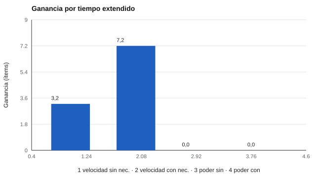

# 069 — Acomodaciones y diseño universal de la evaluación


<!-- NAV -->
[← 068 — Equidad en evaluaciones de alto impacto](../068-equidad-en-evaluaciones-de-alto-impacto/README.md) · [📚 Parte 06](../README.md) · [🗺️ Índice 001–200](../../../PROGRAMA.md) · [070 — Estudios de invarianza entre grupos →](../070-estudios-de-invarianza-entre-grupos/README.md)
<!-- /NAV -->

**Parte 06 — Baremos, sesgo y equidad** · Nivel avanzado · 4 h · Estado `escrita`
**Pensada para:** quien diseña evaluaciones accesibles, quien decide apoyos y quien necesita ajustes para rendir una prueba.
**Prerrequisitos:** clases 009 y 068.

## ¿Para qué te sirve esto?

Una persona con baja visión, con dislexia o con un trastorno de la atención puede necesitar condiciones distintas para mostrar lo que sabe: más tiempo, un formato ampliado, lectura en voz alta. La pregunta de diseño es: ¿ese ajuste **corrige un sesgo** o **cambia lo que se mide**? La respuesta depende de qué constructo se quiere evaluar. Esta clase te da un criterio claro para decidirlo, y te muestra cómo el **diseño universal** reduce la necesidad de ajustes desde el inicio.

## Al terminar esta clase podrás

- Distinguir acomodación, modificación y diseño universal.
- Analizar el efecto del tiempo extendido según el tipo de prueba.
- Decidir si una acomodación preserva el constructo.
- Aplicar principios básicos de diseño universal.

## La idea en palabras simples

- **Acomodación:** cambia las **condiciones** (tiempo, formato, apoyos) **sin cambiar el constructo**.
- **Modificación:** cambia **lo que se mide** (por ejemplo, simplificar los ítems).
- **Diseño universal** (Thompson et al., 2002): diseñar la evaluación desde el inicio para que sea accesible a la mayor diversidad de personas: instrucciones claras, tiempo holgado cuando el constructo no es la velocidad, formatos accesibles.

La clave: **¿la velocidad forma parte del constructo?** Si no, dar más tiempo corrige un sesgo. Si sí (por ejemplo, fluidez lectora), cambia lo que se mide.

## Cómo funciona, paso a paso

**1. Definir el constructo** y si incluye la velocidad.

**2. Evaluar el efecto** de la acomodación en quienes la necesitan y en quienes no.

**3. Decidir** si preserva el constructo.

**Ejemplo.** Un modelo de juguete (40 ítems; p de acierto 0,80; velocidades 1,2 y 0,6 ítems/min; tiempo × 1,5). Ganancia = 0,8 · (min(40, v · 1,5T) − min(40, v · T)). Con v = 0,6 y T = 30: 0,8 · (27 − 18) = **7,2**.



*Figura 1.* En la prueba de poder el tiempo extendido no cambia nada; en la de velocidad ayuda a ambos grupos.

## Si construyes el instrumento

- Decide si la velocidad es parte del constructo y decláralo.
- Si no lo es, da tiempo holgado a todos (diseño universal) en lugar de depender de acomodaciones.
- Decide las acomodaciones por **necesidad funcional**, no por etiqueta diagnóstica.
- Informa las acomodaciones cuando sean relevantes para interpretar el resultado. En Chile, consulta la normativa educativa vigente sobre apoyos y adecuaciones.

## Si eres evaluado

- Tienes derecho a solicitar apoyos razonables; informa con anticipación qué necesitas.
- Una acomodación no es «ventaja»: busca que el resultado refleje lo que sabes y no una barrera.
- Pregunta si la prueba mide velocidad: eso cambia qué ajustes son pertinentes.

## Qué muestra el laboratorio

`lab.py` aplica el modelo a una prueba de velocidad (30 min) y una de poder (90 min).

| Prueba | Grupo | Normal | Extendido | Ganancia |
|---|---|---:|---:|---:|
| Velocidad (30 min) | sin necesidad | 28,8 | 32,0 | 3,2 |
| Velocidad (30 min) | con necesidad | 14,4 | 21,6 | 7,2 |
| Poder (90 min) | sin necesidad | 32,0 | 32,0 | 0,0 |
| Poder (90 min) | con necesidad | 32,0 | 32,0 | 0,0 |

**Análisis.** (1) En la prueba de velocidad, el tiempo extendido ayuda más al grupo con necesidad (7,2) y también al otro (3,2): la velocidad es parte de lo que se mide. (2) En la de poder, donde todos terminan, no cambia nada. (3) La pregunta de diseño es si la velocidad forma parte del constructo: si no, la acomodación corrige un sesgo; si sí, cambia lo que se mide. (4) El modelo separa velocidad y habilidad por construcción: es una hipótesis simplificadora.

## Errores frecuentes

- Decidir acomodaciones por etiqueta diagnóstica sin evaluar la necesidad funcional.
- Asumir que cualquier tiempo extra es neutral.
- No declarar la acomodación cuando afecta la interpretación.
- Confundir acomodación con modificación.

## Lo mínimo que debes llevarte

1. Acomodación cambia condiciones; modificación cambia lo que se mide.
2. Todo depende de si la velocidad es parte del constructo.
3. El diseño universal reduce la necesidad de acomodar.
4. Se decide por necesidad funcional.

## Ejercicios

- **Inicial.** ¿Cuándo el tiempo extendido cambia el constructo? *Solución: cuando la velocidad forma parte de lo que se mide.*
- **Intermedio.** v = 1,2 y T = 20 min: ¿cuántos ítems intenta y cuál es el puntaje esperado? *Solución: 24 ítems; 19,2.*
- **Avanzado.** Añade una prueba intermedia (45 min) y describe la ganancia de cada grupo.
- **Aplicación.** Lista cinco principios de diseño universal que aplicarías a una prueba escolar.

## Glosario

- **Acomodación:** cambio de condiciones sin cambiar el constructo.
- **Modificación:** cambio de la tarea que altera lo que se mide.
- **Diseño universal:** diseño de la evaluación para que sea accesible desde el inicio.
- **Necesidad funcional:** dificultad concreta que requiere un apoyo para rendir.

## Laboratorio

```bash
python classes/part-06-baremos-sesgo-y-equidad/069-acomodaciones-y-diseno-universal-de-la-evaluacion/lab.py
python classes/part-06-baremos-sesgo-y-equidad/figuras.py
```

## Autoevaluación y criterios

1. ¿Qué evidencia necesitarías para sostener una acomodación? 2. ¿Qué principios de diseño universal aplicarías? 3. ¿Qué dice la normativa educativa chilena sobre apoyos? (consultar la fuente vigente)
Se logra la clase si puedes evaluar una acomodación frente al constructo.

## Bibliografía

- Sireci, S. G., Scarpati, S. E., & Li, S. (2005). Test accommodations for students with disabilities: An analysis of the interaction hypothesis. *Review of Educational Research*, 75(4), 457-490.
- Thompson, S. J., Johnstone, C. J., & Thurlow, M. L. (2002). *Universal Design Applied to Large Scale Assessments* (NCEO Synthesis Report 44). University of Minnesota.
- AERA, APA, & NCME (2014). *Standards for Educational and Psychological Testing*.

---

<!-- NAV -->
[← 068 — Equidad en evaluaciones de alto impacto](../068-equidad-en-evaluaciones-de-alto-impacto/README.md)  
[📚 Parte 06](../README.md) · [🗺️ Índice 001–200](../../../PROGRAMA.md)  
[070 — Estudios de invarianza entre grupos →](../070-estudios-de-invarianza-entre-grupos/README.md)
<!-- /NAV -->
