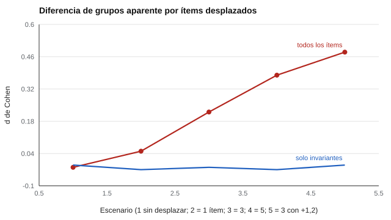

# 070 — Estudios de invarianza entre grupos


<!-- NAV -->
[← 069 — Acomodaciones y diseño universal de la evalua…](../069-acomodaciones-y-diseno-universal-de-la-evaluacion/README.md) · [📚 Parte 06](../README.md) · [🗺️ Índice 001–200](../../../PROGRAMA.md) · [071 — Los Standards de AERA, APA y NCME →](../../part-07-uso-responsable-y-certificacion/071-estandares-aera-apa-ncme/README.md)
<!-- /NAV -->

**Parte 06 — Baremos, sesgo y equidad** · Nivel avanzado · 5 h · Estado `escrita`
**Pensada para:** quien diseña o lee estudios que comparan grupos con un mismo instrumento.
**Prerrequisitos:** clases 045 y 047.

## ¿Para qué te sirve esto?

La clase 045 explicó qué es la invarianza. Aquí se trata de **hacerla**: qué secuencia de modelos ajustar, con qué criterios decidir y, sobre todo, **cuánto se distorsiona una comparación de medias cuando la invarianza falla**. Verás con números cómo unos pocos ítems desplazados pueden crear una «diferencia de grupos» que no existe en el rasgo.

## Al terminar esta clase podrás

- Planificar una secuencia de modelos configural, métrico y escalar.
- Aplicar criterios de decisión basados en el cambio del CFI.
- Cuantificar el efecto de la no invarianza sobre la comparación de medias.
- Explicar qué es la invarianza parcial y cuándo es aceptable.

## La idea en palabras simples

La secuencia habitual (Byrne et al., 1989): se ajusta el modelo **configural** (misma estructura) y luego se agregan restricciones de igualdad de **cargas** (métrico) y de **interceptos** (escalar). En cada paso se compara el ajuste: Cheung y Rensvold (2002) sugieren que una caída del CFI mayor a 0,01 indica que la restricción no se sostiene.

Si falla, se puede buscar **invarianza parcial**: liberar los ítems problemáticos (con justificación sustantiva) y comparar medias solo con los ítems invariantes.

## Cómo funciona, paso a paso

**1. Ajustar el modelo configural.**

**2. Imponer cargas iguales** y mirar ΔCFI.

**3. Imponer interceptos iguales** y mirar ΔCFI.

**Ejemplo resuelto.** ΔCFI entre configural (0,962) y métrico (0,958) = 0,004 ≤ 0,01: se acepta la invarianza métrica. Entre métrico y escalar (0,940), ΔCFI = 0,018 > 0,01: se examina qué interceptos liberar (valores ilustrativos).



*Figura 1.* Los ítems desplazados fabrican una diferencia de grupos que desaparece al usar solo los invariantes.

## Si construyes el instrumento

- Planifica la secuencia antes de analizar y regístrala.
- No liberes parámetros hasta que ajuste sin justificación sustantiva.
- Comparar medias con muy pocos ítems invariantes no es confiable.
- No apliques el umbral ΔCFI de forma mecánica con muestras pequeñas o modelos complejos.

## Si eres evaluado

- Una diferencia entre grupos que se te informa puede ser un artefacto del instrumento.
- Pregunta si se estudió la invarianza antes de comparar a tu grupo con otros.
- Si el instrumento fue modificado para lograr invarianza, debería explicarse por qué.

## Qué muestra el laboratorio

`lab.py` simula 10 ítems con el **mismo rasgo medio** en ambos grupos y desplaza los interceptos del grupo B.

| Ítems con desplazamiento | Desplazamiento | d (todos los ítems) | d (solo invariantes) |
|---:|---:|---:|---:|
| 0 | 0,0 | −0,02 | −0,01 |
| 1 | 0,6 | 0,05 | −0,03 |
| 3 | 0,6 | 0,22 | −0,02 |
| 5 | 0,6 | 0,38 | −0,03 |
| 3 | 1,2 | 0,48 | −0,01 |

**Análisis.** (1) El rasgo medio es **igual**, pero con ítems desplazados aparece una «diferencia de grupos» que es puro artefacto del instrumento y crece con la cantidad y el tamaño del desplazamiento (hasta 0,48 DE). (2) Al conservar solo ítems invariantes (invarianza parcial) vuelve a cerca de 0. (3) Exige que haya suficientes ítems invariantes y justificación sustantiva de los excluidos. (4) El laboratorio conoce cuáles ítems están desplazados; en la práctica se descubren con el modelo.

## Errores frecuentes

- Liberar parámetros hasta que ajuste sin justificación sustantiva.
- Comparar medias con muy pocos ítems invariantes.
- Aplicar el umbral ΔCFI mecánicamente.
- Suponer que se sabe cuáles ítems están desplazados.

## Lo mínimo que debes llevarte

1. La secuencia: configural, métrico, escalar.
2. ΔCFI > 0,01 es una señal, no una regla universal.
3. Ítems desplazados fabrican diferencias de grupos.
4. La invarianza parcial exige ítems invariantes suficientes y justificación.

## Ejercicios

- **Inicial.** ¿Qué nivel de invarianza permite comparar medias? *Solución: escalar.*
- **Intermedio.** Si 4 de 10 ítems no son invariantes, ¿qué riesgos hay con la invarianza parcial? *Guía: quedan pocos ítems y se puede cambiar el significado de la escala.*
- **Avanzado.** En `lab.py` desplaza un ítem a +2,0 y compara d con y sin él.
- **Aplicación.** Redacta qué reportarías en un artículo sobre un estudio de invarianza.

## Glosario

- **Invarianza configural / métrica / escalar:** igual estructura / cargas / interceptos entre grupos.
- **ΔCFI:** cambio del índice CFI al agregar restricciones.
- **Invarianza parcial:** invarianza que se cumple tras liberar algunos parámetros.
- **Artefacto:** efecto producido por el instrumento y no por el rasgo.

## Laboratorio

```bash
python classes/part-06-baremos-sesgo-y-equidad/070-estudios-de-invarianza-entre-grupos/lab.py
python classes/part-06-baremos-sesgo-y-equidad/figuras.py
```

## Autoevaluación y criterios

1. ¿Cuántos ítems invariantes se necesitan? 2. ¿Qué reportarías en un artículo? 3. ¿Qué haces si no hay invarianza escalar?
Se logra la clase si puedes planificar la secuencia y estimar el sesgo de comparación.

## Bibliografía

- Byrne, B. M., Shavelson, R. J., & Muthén, B. (1989). Testing for the equivalence of factor covariance and mean structures: The issue of partial measurement invariance. *Psychological Bulletin*, 105(3), 456-466.
- Cheung, G. W., & Rensvold, R. B. (2002). Evaluating goodness-of-fit indexes for testing measurement invariance. *Structural Equation Modeling*, 9(2), 233-255.
- Putnick, D. L., & Bornstein, M. H. (2016). Measurement invariance conventions and reporting. *Developmental Review*, 41, 71-90.

---

<!-- NAV -->
[← 069 — Acomodaciones y diseño universal de la evalua…](../069-acomodaciones-y-diseno-universal-de-la-evaluacion/README.md)  
[📚 Parte 06](../README.md) · [🗺️ Índice 001–200](../../../PROGRAMA.md)  
[071 — Los Standards de AERA, APA y NCME →](../../part-07-uso-responsable-y-certificacion/071-estandares-aera-apa-ncme/README.md)
<!-- /NAV -->
