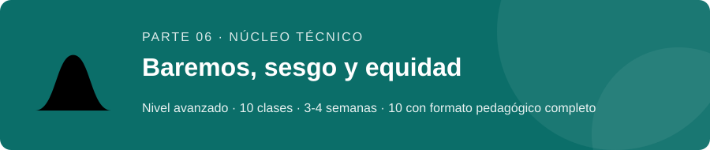
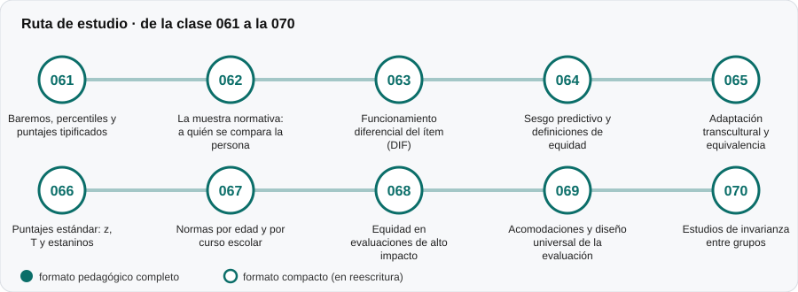

# ⚖️ Parte 06 — Baremos, sesgo y equidad

**Nivel:** avanzado · **Duración estimada:** 3-4 semanas · **Clases:** 10

## De qué trata

Qué convierte un puntaje bruto en un percentil o un puntaje estándar, y cómo se detecta que un instrumento mide distinto según a quién se aplica.

## Por qué importa

Un puntaje sin norma no dice si es alto o bajo, y una norma de otro grupo puede perjudicar a quien se evalúa.

## Según tu papel

- **Si construyes o aplicas instrumentos:** Muestras normativas, puntajes z y T, normas por edad, DIF, sesgo predictivo, acomodaciones y adaptación transcultural.
- **Si eres evaluado o recibes resultados:** Te permite preguntar con qué grupo te compararon y si esa comparación es justa.

## Al terminar esta parte podrás

- Construir y leer un baremo.
- Detectar funcionamiento diferencial de un ítem.
- Discutir distintas definiciones de equidad y sus conflictos.

## Cómo estudiarla

Cierra el bloque técnico central. Lee con calma las clases de equidad: no existe una definición única.

## Ruta de estudio

## Clases en orden de estudio

Las clases están numeradas de forma consecutiva (001 a 200) en el orden de estudio: sigue el número.

| Orden | ID | Clase | Qué aprenderás | Formato | Horas |
|---:|---|---|---|---|---:|
| 1 | 061 | [Baremos, percentiles y puntajes tipificados](061-baremos-y-percentiles/README.md) | Calcular rango percentil, z y T desde una muestra normativa. | 🟡 compacto | 4 |
| 2 | 062 | [La muestra normativa: a quién se compara la persona](062-elegir-la-muestra-normativa/README.md) | Explicar cómo la composición de la muestra normativa cambia el percentil de una persona. | 🟡 compacto | 4 |
| 3 | 063 | [Funcionamiento diferencial del ítem (DIF)](063-funcionamiento-diferencial-del-item/README.md) | Distinguir impacto de DIF. | 🟡 compacto | 6 |
| 4 | 064 | [Sesgo predictivo y definiciones de equidad](064-sesgo-predictivo-y-equidad/README.md) | Aplicar el modelo de Cleary de sesgo predictivo. | 🟡 compacto | 5 |
| 5 | 065 | [Adaptación transcultural y equivalencia](065-adaptacion-transcultural/README.md) | Describir el proceso de adaptación de un instrumento. | 🟡 compacto | 5 |
| 6 | 066 | [Puntajes estándar: z, T y estaninos](066-puntajes-estandar-z-t-y-estaninos/README.md) | Convertir un bruto a z, T y estanino. | 🟡 compacto | 4 |
| 7 | 067 | [Normas por edad y por curso escolar](067-normas-por-edad-y-por-curso-escolar/README.md) | Comparar normas por bandas y normalización continua. | 🟡 compacto | 4 |
| 8 | 068 | [Equidad en evaluaciones de alto impacto](068-equidad-en-evaluaciones-de-alto-impacto/README.md) | Calcular validez y diferencia de grupos de un compuesto de predictores. | 🟡 compacto | 4 |
| 9 | 069 | [Acomodaciones y diseño universal de la evaluación](069-acomodaciones-y-diseno-universal-de-la-evaluacion/README.md) | Distinguir acomodación, modificación y diseño universal. | 🟡 compacto | 4 |
| 10 | 070 | [Estudios de invarianza entre grupos](070-estudios-de-invarianza-entre-grupos/README.md) | Planificar una secuencia de modelos configural, métrico y escalar. | 🟡 compacto | 4 |

[← Volver al índice del programa](../../README.md) · [Índice numérico de las 200 clases](../../PROGRAMA.md)
