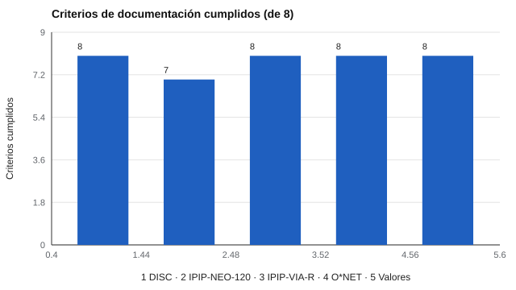

# 071 — Los Standards de AERA, APA y NCME


<!-- NAV -->
[← 070 — Estudios de invarianza entre grupos](../../part-06-baremos-sesgo-y-equidad/070-estudios-de-invarianza-entre-grupos/README.md) · [📚 Parte 07](../README.md) · [🗺️ Índice 001–200](../../../PROGRAMA.md) · [072 — Directrices de la International Test Commissi… →](../072-itc-y-normas-internacionales/README.md)
<!-- /NAV -->

**Parte 07 — Uso responsable y certificación** · Nivel profesional · 4 h · Estado `escrita`
**Pensada para:** quien construye, elige o usa pruebas, y quien es evaluado y quiere saber qué debería esperar de un test.
**Prerrequisitos:** clases 031 a 035.

## ¿Para qué te sirve esto?

Cuando alguien dice «este test cumple los estándares», ¿a qué estándares se refiere? El marco de referencia profesional más citado son los *Standards for Educational and Psychological Testing* (AERA, APA y NCME, 2014). No son una ley ni un sello de calidad, pero son el criterio con que se juzga si un test está bien construido y bien usado. Conocerlos te da un lenguaje para **exigir información** al desarrollador y para **no atribuirle a un test más de lo que sus datos permiten**.

## Al terminar esta clase podrás

- Describir la estructura y el espíritu de los *Standards*.
- Distinguir responsabilidades del desarrollador, del usuario y de quien comunica resultados.
- Auditar la documentación de un instrumento con una lista de verificación propia.
- Distinguir lo declarado de lo demostrado.

## La idea en palabras simples

Los *Standards* cubren validez, fiabilidad, equidad, desarrollo de pruebas, administración, informes y usos específicos. Su idea central: **el desarrollador entrega la evidencia necesaria para interpretar y usar los puntajes, y el usuario es responsable de que el uso concreto esté respaldado**. Es como un medicamento: el laboratorio documenta para qué sirve y con qué riesgos; el médico responde por cómo lo receta.

No son una ley: son criterios de **buena práctica** que se citan en la formación profesional, en peritajes y en decisiones de calidad.

## Cómo funciona, paso a paso

**1. Identificar** el uso previsto del instrumento.

**2. Revisar** qué evidencia entrega el desarrollador (manual, estudios).

**3. Auditar** la documentación con una lista de verificación.

**Ejemplo resuelto.** Un cuestionario de «liderazgo» sin manual: no declara población, normas ni evidencia. Según los *Standards*, el usuario no debería basar decisiones en él hasta contar con esa información.



*Figura 1.* La auditoría del propio catálogo encontró una declaración faltante.

## Si construyes el instrumento

- Publica población, procedimiento, fiabilidad, evidencia de validez, límites y uso previsto.
- Declara explícitamente el estado de validación: lo no estudiado se dice como tal.
- Usa listas de verificación propias y cámbialas con la práctica.
- No cites los *Standards* como si «certificaran» tu test.

## Si eres evaluado

- Tienes derecho a esperar que quien te evalúa use instrumentos con evidencia para ese uso.
- Pregunta qué manual y qué estudios respaldan la prueba.
- Si un resultado sobre ti se basa en un instrumento sin documentación, puedes cuestionar su uso.

## Qué muestra el laboratorio

`lab.py` aplica una lista de ocho criterios (autores, año, fuente, licencia, cita, tipo de respuesta, duración y declaración de estado de validación) a los cinco instrumentos del repositorio.

| Instrumento | Criterios cumplidos |
|---|---:|
| disc-abierto, ipip-via-r, onet-riasec-sf, valores-spranger | 8 / 8 |
| ipip-neo-120 | 7 / 8 (no declara su estado de validación en el archivo) |

**Análisis.** (1) Hallazgo real de la auditoría: el archivo de `ipip-neo-120` no dice que carece de estudio de validación propio; sí lo dice la ficha del catálogo. Es una mejora pendiente. (2) Una documentación completa no demuestra calidad, pero una documentación incompleta impide juzgarla. (3) La lista mide si el instrumento **declara** lo necesario, no su calidad psicométrica. (4) Los criterios son propios del repositorio, no los de los *Standards* literalmente.

## Errores frecuentes

- Citar los *Standards* como si «certificaran» un test.
- Creer que la lista mide calidad psicométrica.
- Aplicar criterios de un contexto (educación) a otro (clínico) sin adaptarlos.
- Confundir documentación completa con evidencia suficiente.

## Lo mínimo que debes llevarte

1. Los *Standards* son buena práctica, no ley.
2. El desarrollador entrega evidencia; el usuario responde del uso.
3. Declarar lo no estudiado es parte de la calidad.
4. Documentación completa ≠ calidad demostrada.

## Ejercicios

- **Inicial.** ¿Quién es responsable del uso concreto de un test? *Solución: el usuario que lo aplica y decide.*
- **Intermedio.** Agrega a `revisa()` un criterio de «población objetivo declarada» y aplica la lista.
- **Avanzado.** Corrige la documentación de `ipip-neo-120` sin cambiar sus ítems y verifica con la lista.
- **Aplicación.** Audita el manual de un test que uses y señala tres carencias.

## Glosario

- **Standards:** estándares profesionales de AERA, APA y NCME para pruebas.
- **Desarrollador / usuario:** quien crea / quien aplica o decide con el test.
- **Estado de validación:** declaración de qué evidencia de validez existe.
- **Lista de verificación:** conjunto de criterios para revisar documentación.

## Laboratorio

```bash
python classes/part-07-uso-responsable-y-certificacion/071-estandares-aera-apa-ncme/lab.py
python classes/part-07-uso-responsable-y-certificacion/figuras.py
```

## Autoevaluación y criterios

1. ¿Qué diferencia hay entre estándar y ley? 2. ¿Qué evidencia mínima exigirías? 3. ¿Cómo comunicas una limitación?
Se logra la clase si puedes auditar documentación y distinguir lo declarado de lo demostrado.

## Bibliografía

- AERA, APA, & NCME (2014). *Standards for Educational and Psychological Testing*. American Educational Research Association. 🔎 sin verificar (libro, norma o sitio no hallado en Crossref: comprobar a mano)
- American Psychological Association (2017). *Ethical Principles of Psychologists and Code of Conduct*. APA. ⚠️ hay una obra de título parecido en Crossref con otro año (2002): comprobar la edición a mano

Leyenda: ✅ existe en Crossref con título y año coincidentes (enlace al DOI); ⚠️ hay una obra de título parecido con otro año (no se enlaza: comprobar la edición); 🔎 no verificada automáticamente (libros sin DOI, normas y sitios web). Crossref confirma la existencia de la fuente, no que respalde cada afirmación de la clase. Ver [`docs/VERIFICACION_BIBLIOGRAFIA.md`](../../../docs/VERIFICACION_BIBLIOGRAFIA.md).

---

<!-- NAV -->
[← 070 — Estudios de invarianza entre grupos](../../part-06-baremos-sesgo-y-equidad/070-estudios-de-invarianza-entre-grupos/README.md)  
[📚 Parte 07](../README.md) · [🗺️ Índice 001–200](../../../PROGRAMA.md)  
[072 — Directrices de la International Test Commissi… →](../072-itc-y-normas-internacionales/README.md)
<!-- /NAV -->
