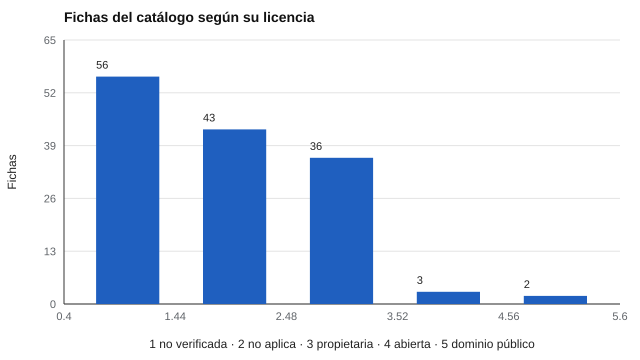

# 072 — Directrices de la International Test Commission


<!-- NAV -->
[← 071 — Los Standards de AERA, APA y NCME](../071-estandares-aera-apa-ncme/README.md) · [📚 Parte 07](../README.md) · [🗺️ Índice 001–200](../../../PROGRAMA.md) · [073 — El informe y la devolución de resultados a la… →](../073-informe-y-devolucion/README.md)
<!-- /NAV -->

**Parte 07 — Uso responsable y certificación** · Nivel profesional · 4 h · Estado `escrita`
**Pensada para:** quien administra catálogos o servicios de evaluación, y quien debe elegir instrumentos con criterio.
**Prerrequisitos:** clase 071.

## ¿Para qué te sirve esto?

Si tu trabajo incluye elegir, comprar o adaptar pruebas, necesitas criterios para no dejarte llevar por catálogos que prometen mucho. La **International Test Commission (ITC)** publica directrices internacionales sobre uso de tests, traducción y adaptación, y evaluación por computador e internet. Esta clase te las presenta y te muestra cómo **auditar un catálogo** (el de este repositorio, como ejemplo) con criterios de transparencia: distinguir lo **documentado**, lo **implementado** y lo **validado**.

## Al terminar esta clase podrás

- Reconocer las directrices ITC sobre uso, traducción/adaptación y evaluación por computador e internet.
- Distinguir lo documentado, lo implementado y lo validado en un catálogo.
- Auditar un catálogo con criterios de transparencia.
- Evitar inflar el recuento de «instrumentos disponibles».

## La idea en palabras simples

La ITC publica, entre otras: las *Guidelines on Test Use* (2013), las *Guidelines for Translating and Adapting Tests* (2017) y las directrices sobre evaluación computarizada y por internet (2006). Piden que el usuario sea **competente**, que el evaluado reciba **información**, que los datos tengan **seguridad** y que las adaptaciones tengan **evidencia**.

En un catálogo hay tres estados distintos que no deben confundirse:

- **Documentado:** existe una ficha que describe el instrumento.
- **Implementado:** el programa puede mostrarlo y puntuarlo (sus ítems están disponibles legalmente).
- **Validado:** existe evidencia de validez para un uso específico.

## Cómo funciona, paso a paso

**1. Contar** fichas por estado, licencia y verificación.

**2. Identificar** las de licencia propietaria y de uso clínico (exigen profesional habilitado).

**3. Comprobar** que ninguna ficha «validada» carezca de evidencia declarada.

**Ejemplo resuelto.** La ficha del WISC figura como propietaria de uso clínico y educativo: se estudia su fundamento y se usan alternativas abiertas para practicar; no se reproducen sus ítems ni claves.



*Figura 1.* La mayoría de las fichas tiene licencia aún sin verificar.

## Si construyes el instrumento

- Declara el estado de cada instrumento sin inflar el recuento.
- Define un plan para contrastar cada ficha con su fuente primaria y marcar `verificado`.
- No reproduzcas ítems ni claves de instrumentos propietarios.
- Lee la versión vigente de las directrices antes de citarlas.

## Si eres evaluado

- Pregunta si el instrumento con que te evalúan está validado para ese uso o solo documentado.
- Los instrumentos clínicos propietarios deben ser administrados por profesionales habilitados.
- Tienes derecho a información sobre cómo se usarán y guardarán tus datos.

## Qué muestra el laboratorio

`lab.py` audita `catalogo/fichas.yaml` (140 fichas).

| Medida | Valor |
|---|---:|
| Fichas documentadas / implementadas | 135 / 5 |
| Fichas verificadas contra fuente primaria | 5 de 140 |
| Licencia propietaria | 36 |
| Propietarias de uso clínico | 19 |
| «Validado» sin evidencia declarada | 0 |

Licencias: abierta 3, dominio público 2, no aplica 43, no verificado 56, propietaria 36.

**Análisis.** (1) El catálogo distingue documentar, implementar y validar. (2) Una ficha bibliográfica no es una prueba implementada, y un test implementado no está validado. (3) El 96 % de las fichas aún no se contrasta con la fuente primaria: eso es lo que más urge. (4) Los 19 instrumentos propietarios de uso clínico (por ejemplo, las escalas Wechsler, MMPI) exigen un profesional habilitado.

## Errores frecuentes

- Contar fichas como instrumentos disponibles.
- Dejar `verificado: false` indefinidamente sin plan.
- Citar las directrices sin leer la versión vigente.
- Presentar un instrumento propietario como si se pudiera reproducir.

## Lo mínimo que debes llevarte

1. La ITC publica directrices de uso, adaptación y evaluación digital.
2. Documentado, implementado y validado son estados distintos.
3. No se infla el recuento de instrumentos.
4. Los instrumentos clínicos propietarios requieren profesional habilitado.

## Ejercicios

- **Inicial.** ¿Qué distingue un instrumento documentado de uno implementado? *Solución: que tenga sus ítems disponibles y el programa pueda puntuarlo.*
- **Intermedio.** Calcula el porcentaje de fichas propietarias. *Solución: 36/140 = 25,7 %.*
- **Avanzado.** Elige cinco fichas y verifícalas contra su fuente primaria; actualiza `verificado`.
- **Aplicación.** Haz el inventario de los instrumentos de tu organización y clasifícalos en documentado, implementado y validado.

## Glosario

- **ITC:** Comisión Internacional de Tests.
- **Ficha documental:** descripción de un instrumento sin sus ítems.
- **Implementado:** instrumento ejecutable en el programa.
- **Fuente primaria:** documento original del instrumento (manual, artículo).

## Laboratorio

```bash
python classes/part-07-uso-responsable-y-certificacion/072-itc-y-normas-internacionales/lab.py
python classes/part-07-uso-responsable-y-certificacion/figuras.py
```

## Autoevaluación y criterios

1. ¿Qué responsabilidad tiene el usuario del test? 2. ¿Qué información entregarías al evaluado? 3. ¿Cómo evitas inflar el recuento del catálogo?
Se logra la clase si puedes auditar un catálogo con estados diferenciados.

## Bibliografía

- International Test Commission (2013). *ITC Guidelines on Test Use*. ITC.
- International Test Commission (2017). *The ITC Guidelines for Translating and Adapting Tests* (2.ª ed.). *International Journal of Testing*, 18(2), 101-134.
- International Test Commission (2006). International guidelines on computer-based and internet-delivered testing. *International Journal of Testing*, 6(2), 143-171.

---

<!-- NAV -->
[← 071 — Los Standards de AERA, APA y NCME](../071-estandares-aera-apa-ncme/README.md)  
[📚 Parte 07](../README.md) · [🗺️ Índice 001–200](../../../PROGRAMA.md)  
[073 — El informe y la devolución de resultados a la… →](../073-informe-y-devolucion/README.md)
<!-- /NAV -->
