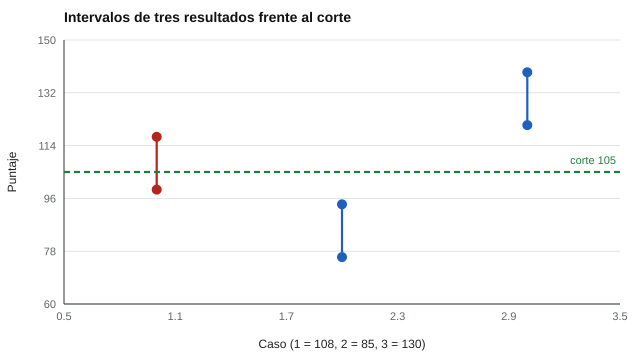

# 073 — El informe y la devolución de resultados


<!-- NAV -->
[← 072 — Directrices de la International Test Commissi…](../072-itc-y-normas-internacionales/README.md) · [📚 Parte 07](../README.md) · [🗺️ Índice 001–200](../../../PROGRAMA.md) · [074 — Uso en selección de personal: qué es defendib… →](../074-seleccion-de-personal/README.md)
<!-- /NAV -->

**Parte 07 — Uso responsable y certificación** · Nivel profesional · 4 h · Estado `escrita`
**Pensada para:** quien redacta informes y conversa resultados (psicólogos, orientadores, docentes), y quien los recibe.
**Prerrequisitos:** clases 025 y 030.

## ¿Para qué te sirve esto?

Entregar un resultado es una intervención: una frase mal escrita («su hijo tiene baja capacidad») puede fijar expectativas, afectar la autoestima y orientar decisiones durante años. Un buen informe comunica **qué se midió, con qué incertidumbre y qué no se puede concluir**, y la devolución es una **conversación**, no un veredicto. Esta clase te da reglas concretas y verificables para lograrlo, y te sirve tanto si escribes informes como si los recibes.

## Al terminar esta clase podrás

- Redactar un informe en lenguaje claro que comunique incertidumbre.
- Evitar etiquetas de persona y conclusiones categóricas sin respaldo.
- Planificar una devolución como conversación.
- Revisar un informe con una lista de comprobaciones.

## La idea en palabras simples

Un informe responde cinco preguntas: ¿qué se midió?, ¿con qué?, ¿cuánta incertidumbre tiene el resultado?, ¿con quién se compara? y ¿qué se puede y no se puede concluir? Las investigaciones sobre informes de puntajes muestran que los lectores malinterpretan percentiles, intervalos y escalas (Zenisky & Hambleton, 2012), así que el lenguaje debe ser simple y las cifras deben ir acompañadas de su explicación.

Reglas del laboratorio, verificables automáticamente:

1. **Intervalo** basado en el error típico de medida.
2. **Rango**, no etiquetas de persona.
3. **Alcance declarado:** qué mide y qué no.
4. Si el intervalo incluye el corte, **sin conclusión categórica**.

## Cómo funciona, paso a paso

**1. Calcular** el intervalo con el ETM (clase 025).

**2. Redactar** en rango, con alcance declarado y una invitación a conversar.

**3. Comparar** con el punto de referencia: ¿lo incluye el intervalo?

**Ejemplo resuelto.** *Mal:* «Su hijo tiene baja capacidad». *Mejor:* «En esta prueba, su resultado se ubica por debajo de lo que muestra la mayoría del grupo de referencia; el margen de error es de ±9 puntos y la prueba no describe todo lo que su hijo sabe hacer. Conversemos qué apoyos podrían ayudar».



*Figura 1.* El caso 108 no permite una conclusión categórica; los otros dos sí.

## Si construyes el instrumento

- Incluye en el manual plantillas de informe en lenguaje claro y ejemplos de devolución.
- Evita diagnósticos o etiquetas fuera de la competencia del evaluador.
- Informa a terceros solo con consentimiento y necesidad.
- Resultados que impliquen riesgo requieren un protocolo de derivación (parte 16).

## Si eres evaluado

- Tienes derecho a una explicación comprensible de tu resultado, con su margen de error.
- Pide siempre el alcance: qué mide la prueba y qué no.
- Un informe que te etiqueta («es poco inteligente») no es correcto: describe una prueba, no a la persona.

## Qué muestra el laboratorio

`lab.py` genera informes para tres puntajes (corte 105; DE 15; fiabilidad 0,90).

| Caso | Intervalo | Conclusión |
|---|---|---|
| 108 | 99 a 117 | incluye el corte → sin conclusión categórica |
| 85 | 76 a 94 | bajo el corte aun con el margen |
| 130 | 121 a 139 | sobre el corte aun con el margen |

Las cuatro comprobaciones (incluye intervalo, sin etiquetas de persona, declara alcance, invita a conversar) pasan en los tres casos.

**Análisis.** (1) El primer caso (108 con corte 105) no permite una conclusión categórica porque el intervalo incluye el corte. (2) Un informe responsable comunica incertidumbre, no la oculta. (3) Los textos del laboratorio son ejemplos: un informe real depende del instrumento, el propósito y la normativa. (4) Las comprobaciones automáticas verifican forma, no calidad del juicio profesional.

## Errores frecuentes

- Entregar un número sin su margen.
- Usar diagnósticos o etiquetas fuera de la competencia del evaluador.
- Informar a terceros sin consentimiento ni necesidad.
- Entregar el informe sin una conversación.

## Lo mínimo que debes llevarte

1. Un informe comunica qué, con qué, incertidumbre, referencia y límites.
2. Se escribe en rangos y sin etiquetas de persona.
3. Si el intervalo incluye el corte, no hay conclusión categórica.
4. La devolución es una conversación.

## Ejercicios

- **Inicial.** Reescribe «Es una persona poco inteligente» como informe. *Guía: describir el resultado en la prueba, su margen y su alcance.*
- **Intermedio.** Calcula el intervalo para 95, DE 10, fiabilidad 0,84. *Solución: ETM 4; 87,2 a 102,8.*
- **Avanzado.** Añade a `revisa()` una regla para detectar porcentajes sin explicación.
- **Aplicación.** Redacta un informe y una guion de devolución para una familia a partir de un resultado ficticio.

## Glosario

- **Informe:** documento que comunica un resultado y su interpretación.
- **Devolución:** conversación en que se comunica y se comenta el resultado.
- **Etiqueta de persona:** frase que atribuye una característica fija a alguien.
- **Alcance:** qué mide la prueba y qué no.

## Laboratorio

```bash
python classes/part-07-uso-responsable-y-certificacion/073-informe-y-devolucion/lab.py
python classes/part-07-uso-responsable-y-certificacion/figuras.py
```

## Autoevaluación y criterios

1. ¿Qué dudas tendría una familia? 2. ¿Cómo explicas un intervalo? 3. ¿Cuándo derivas?
Se logra la clase si puedes redactar un informe que cumpla las cuatro reglas.

## Bibliografía

- Zenisky, A. L., & Hambleton, R. K. (2012). Developing test score reports that work: The process and best practices for effective communication. *Educational Measurement: Issues and Practice*, 31(2), 12-20. ✅ [DOI](https://doi.org/10.1111/j.1745-3992.2012.00231.x)
- AERA, APA, & NCME (2014). *Standards for Educational and Psychological Testing*. 🔎 sin verificar (libro, norma o sitio no hallado en Crossref: comprobar a mano)

Leyenda: ✅ existe en Crossref con título y año coincidentes (enlace al DOI); ⚠️ hay una obra de título parecido con otro año (no se enlaza: comprobar la edición); 🔎 no verificada automáticamente (libros sin DOI, normas y sitios web). Crossref confirma la existencia de la fuente, no que respalde cada afirmación de la clase. Ver [`docs/VERIFICACION_BIBLIOGRAFIA.md`](../../../docs/VERIFICACION_BIBLIOGRAFIA.md).

---

<!-- NAV -->
[← 072 — Directrices de la International Test Commissi…](../072-itc-y-normas-internacionales/README.md)  
[📚 Parte 07](../README.md) · [🗺️ Índice 001–200](../../../PROGRAMA.md)  
[074 — Uso en selección de personal: qué es defendib… →](../074-seleccion-de-personal/README.md)
<!-- /NAV -->
