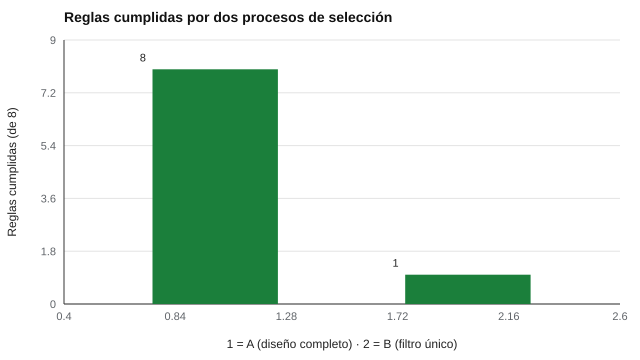

# 074 — Uso en selección de personal: qué es defendible


<!-- NAV -->
[← 073 — El informe y la devolución de resultados a la…](../073-informe-y-devolucion/README.md) · [📚 Parte 07](../README.md) · [🗺️ Índice 001–200](../../../PROGRAMA.md) · [075 — Rutas de certificación profesional →](../075-certificacion-profesional/README.md)
<!-- /NAV -->

**Parte 07 — Uso responsable y certificación** · Nivel profesional · 4 h · Estado `escrita`
**Pensada para:** quien diseña o audita procesos de selección, y quien postula a cargos.
**Prerrequisitos:** clases 034, 035, 039 y 068.

## ¿Para qué te sirve esto?

Un proceso de selección decide oportunidades de vida. Por eso su defendibilidad importa: no depende de cuán sofisticada sea una prueba, sino de **cómo está diseñado el proceso completo**. Esta clase te da una lista de ocho reglas verificables para evaluar un proceso, y te muestra por qué un cuestionario propio sin validar, usado como filtro único, es difícil de defender. Sirve si diseñas procesos, si los auditas o si quieres saber qué esperar cuando postulas.

## Al terminar esta clase podrás

- Evaluar un proceso de selección por su diseño, no por la sofisticación de una prueba.
- Aplicar una lista de control de ocho reglas.
- Decidir cuándo un instrumento no debe usarse para seleccionar.
- Proponer mejoras a un proceso débil.

## La idea en palabras simples

La evidencia sobre selección sugiere que los métodos estructurados (entrevistas estructuradas, muestras de trabajo) tienen buena validez predictiva, y que las estimaciones de validez de varios métodos se han revisado a la baja en reanálisis recientes (Schmidt & Hunter, 1998; Sackett et al., 2022). Un proceso defendible cumple, entre otras, estas **ocho reglas**:

1. Hay **análisis del puesto**.
2. Cada predictor tiene **evidencia de validez** para este uso.
3. **Ninguna prueba sin validar decide por sí sola.**
4. Hay **revisión humana** de los casos cercanos al corte.
5. Se **monitorea el impacto adverso**.
6. Hay **consentimiento** informado.
7. Hay **vías de acomodación** para quien lo necesite.
8. Se **declara cuánto pesa** cada prueba en la decisión.

## Cómo funciona, paso a paso

**1. Revisar el proceso** contra las ocho reglas.

**2. Identificar las faltantes.**

**3. Corregir el diseño**, no solo agregar una prueba.

**Ejemplo resuelto.** El proceso B falla siete reglas. La corrección no es «agregar una prueba»: es hacer el análisis del puesto, reemplazar el filtro único por métodos con evidencia, declarar pesos, revisar los casos cercanos al corte y monitorear el impacto.



*Figura 1.* Un diseño completo frente a un filtro único sin validar.

## Si construyes el instrumento

- No presentes un porcentaje de «ajuste» sin evidencia de validez (clase 118).
- No uses un test de personalidad falseable como único filtro (clase 040).
- Declara los pesos y los puntos de corte.
- Esta lista es didáctica, no una auditoría legal.

## Si eres evaluado

- Pregunta qué etapas tiene el proceso y qué peso tiene cada una.
- Tienes derecho a pedir acomodaciones y a que un resultado cercano al corte sea revisado por una persona.
- Si te descartan solo por un cuestionario, puedes preguntar con qué evidencia respaldan ese uso.

## Qué muestra el laboratorio

`lab.py` evalúa dos procesos con la lista de ocho reglas.

| Proceso | Reglas cumplidas |
|---|---:|
| A. Entrevista estructurada + muestra de trabajo (diseño completo) | 8 / 8 |
| B. Cuestionario propio sin validar como filtro único | 1 / 8 |

El proceso B falla: análisis del puesto, evidencia de validez por predictor, «ninguna prueba sin validar decide sola», revisión humana cerca del corte, monitoreo de impacto, acomodaciones y pesos declarados.

**Análisis.** (1) Un proceso es defendible por su diseño, no por la sofisticación de una prueba. (2) Un instrumento sin validar para el uso concreto no se usa para seleccionar, ni como filtro único ni como «apoyo» con peso oculto. (3) El verificador es una lista de control didáctica, no una auditoría legal. (4) Cumplir las ocho reglas no garantiza un buen proceso, pero incumplirlas lo hace difícil de defender.

## Errores frecuentes

- Presentar un porcentaje de «ajuste» sin evidencia de validez.
- Usar un test de personalidad falseable como único filtro.
- Ocultar el peso de cada prueba.
- Omitir la revisión humana de casos cercanos al corte.

## Lo mínimo que debes llevarte

1. Se juzga el proceso, no una prueba aislada.
2. Ocho reglas: puesto, evidencia, no filtro único, revisión humana, impacto, consentimiento, acomodaciones, pesos.
3. Una prueba sin validar no decide sola.
4. Las mejoras son de diseño, no de «agregar una prueba».

## Ejercicios

- **Inicial.** ¿Qué dice la regla «ninguna prueba sin validar decide por sí sola»? *Solución: que una prueba sin evidencia de validez para ese uso no puede ser el único criterio.*
- **Intermedio.** Diseña un proceso para un puesto de atención al cliente que cumpla las ocho reglas.
- **Avanzado.** Agrega una regla de retención y eliminación de datos (clase 078).
- **Aplicación.** Evalúa el último proceso de selección de tu organización con las ocho reglas.

## Glosario

- **Análisis del puesto:** estudio de las tareas y requisitos de un cargo.
- **Predictor:** prueba o método que se usa para predecir el desempeño.
- **Impacto adverso:** menor tasa de selección de un grupo.
- **Acomodación:** ajuste de condiciones para que una persona pueda rendir.

## Laboratorio

```bash
python classes/part-07-uso-responsable-y-certificacion/074-seleccion-de-personal/lab.py
python classes/part-07-uso-responsable-y-certificacion/figuras.py
```

## Autoevaluación y criterios

1. ¿Qué evidencia mínima exiges para usar un test? 2. ¿Cómo revisas casos cerca del corte? 3. ¿Qué haces si detectas impacto adverso?
Se logra la clase si puedes evaluar y mejorar un proceso de selección.

## Bibliografía

- Schmidt, F. L., & Hunter, J. E. (1998). The validity and utility of selection methods in personnel psychology. *Psychological Bulletin*, 124(2), 262-274. ✅ [DOI](https://doi.org/10.1037/0033-2909.124.2.262)
- Sackett, P. R., Zhang, C., Berry, C. M., & Lievens, F. (2022). Revisiting meta-analytic estimates of validity in personnel selection. *Journal of Applied Psychology*, 107(11), 2040-2068. ✅ [DOI](https://doi.org/10.1037/apl0000994)
- Society for Industrial and Organizational Psychology (2018). *Principles for the Validation and Use of Personnel Selection Procedures* (5.ª ed.). SIOP. ✅ [DOI](https://doi.org/10.1017/iop.2018.195)

Leyenda: ✅ existe en Crossref con título y año coincidentes (enlace al DOI); ⚠️ hay una obra de título parecido con otro año (no se enlaza: comprobar la edición); 🔎 no verificada automáticamente (libros sin DOI, normas y sitios web). Crossref confirma la existencia de la fuente, no que respalde cada afirmación de la clase. Ver [`docs/VERIFICACION_BIBLIOGRAFIA.md`](../../../docs/VERIFICACION_BIBLIOGRAFIA.md).

---

<!-- NAV -->
[← 073 — El informe y la devolución de resultados a la…](../073-informe-y-devolucion/README.md)  
[📚 Parte 07](../README.md) · [🗺️ Índice 001–200](../../../PROGRAMA.md)  
[075 — Rutas de certificación profesional →](../075-certificacion-profesional/README.md)
<!-- /NAV -->
