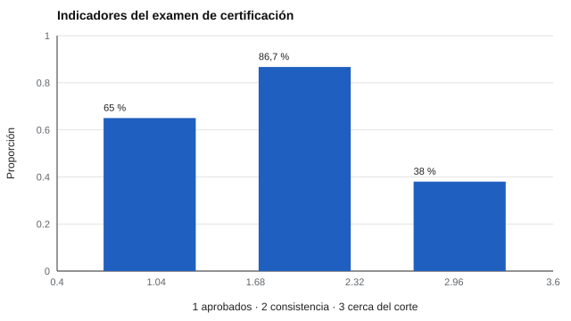

# 075 — Rutas de certificación profesional


<!-- NAV -->
[← 074 — Uso en selección de personal: qué es defendib…](../074-seleccion-de-personal/README.md) · [📚 Parte 07](../README.md) · [🗺️ Índice 001–200](../../../PROGRAMA.md) · [076 — Ley 19.628 y Ley 21.719: datos personales en… →](../076-ley-19-628-y-ley-21-719/README.md)
<!-- /NAV -->

**Parte 07 — Uso responsable y certificación** · Nivel profesional · 5 h · Estado `escrita`
**Pensada para:** quien diseña exámenes de certificación y quien aspira a certificarse.
**Prerrequisitos:** clases 025, 061 y 059.

## ¿Para qué te sirve esto?

Una certificación decide si alguien alcanza un **estándar mínimo** para ejercer. ¿De dónde sale el punto de corte? No es un hecho de la naturaleza: se **establece** con un procedimiento de juicio. Y como todo juicio, tiene error. Esta clase te enseña cómo se fija un corte (Angoff modificado), cuánto error tiene y qué documentación hace defendible una certificación. Importa si diseñas exámenes y también si te examinas: te explica por qué estar cerca del corte es una zona de incertidumbre.

## Al terminar esta clase podrás

- Establecer un punto de corte con un procedimiento Angoff modificado.
- Estimar el error del corte y la consistencia de clasificación.
- Describir qué documentación hace defendible una certificación.
- Plantear vías complementarias al examen (portafolio, práctica supervisada).

## La idea en palabras simples

En el método Angoff modificado (Angoff, 1971; Cizek & Bunch, 2007), un grupo de jueces imagina a una «**persona mínimamente competente**» y, para **cada ítem**, estima la probabilidad de que esa persona lo acierte. El corte es la suma de esas probabilidades promedio. Como los jueces no coinciden del todo, el corte tiene un **error típico**, que depende de cuántos jueces haya y de cuánto discrepen.

La **consistencia de clasificación** (Livingston & Lewis, 1995) dice qué proporción de personas recibiría la misma decisión (aprobado/reprobado) con otra forma de la prueba.

## Cómo funciona, paso a paso

**1. Entrenar a los jueces** y definir a la persona mínimamente competente.

**2. Pedir las probabilidades** por ítem.

**3. Calcular el corte** y su error.

**4. Estimar la consistencia** de clasificación y la zona de incertidumbre.

**Ejemplo resuelto.** Tres jueces estiman 0,6; 0,7; 0,8 para un ítem: media 0,70; ese ítem aporta 0,70 al corte. Con 30 ítems semejantes, el corte sería 21.



*Figura 1.* Casi cuatro de cada diez candidatos quedan en la zona de incertidumbre.

## Si construyes el instrumento

- Documenta los jueces (cuántos, qué experiencia, cómo se entrenaron), el procedimiento y el error del corte.
- Establece vías de revisión y apelación, sobre todo para quienes están cerca del corte.
- No presentes el corte como «el nivel de competencia»: es el resultado de un juicio.
- Complementa el examen con otras rutas (portafolio, práctica supervisada).

## Si eres evaluado

- Pregunta cómo se fijó el punto de corte y cuánto error tiene.
- Si quedas cerca del corte, es razonable solicitar revisión o repetir la prueba.
- Una certificación defendible informa los criterios, las vías de revisión y la normativa que la respalda.

## Qué muestra el laboratorio

`lab.py` simula 12 jueces, 30 ítems y 8.000 candidatos sintéticos.

| Medida | Valor |
|---|---:|
| Corte | 15,9 de 30 |
| DE entre jueces / error típico del corte | 1,57 / 0,45 |
| Tasa de aprobados | 0,650 |
| Consistencia de clasificación entre formas paralelas | 0,867 |
| Candidatos a menos de ~4 puntos del corte | 38 % |

**Análisis.** (1) El corte no es un hecho: es el resultado de un procedimiento de juicio y tiene su propio error (0,45 puntos). (2) La consistencia (0,867) muestra cuántas decisiones cambiarían con otra forma de la prueba: cerca del 13 %. (3) El 38 % de los candidatos queda en la zona de incertidumbre. (4) Los datos son sintéticos; una certificación real documenta jueces, procedimiento, normas y vías de apelación.

## Errores frecuentes

- Presentar el corte como «el nivel de competencia».
- Usar un único juez o jueces sin entrenamiento.
- Ignorar la zona de incertidumbre alrededor del corte.
- No ofrecer vías de revisión.

## Lo mínimo que debes llevarte

1. El corte se establece con un procedimiento de juicio.
2. Tiene error, que se estima.
3. La consistencia de clasificación mide la estabilidad de la decisión.
4. Se documenta jueces, procedimiento y apelación.

## Ejercicios

- **Inicial.** ¿Qué es una «persona mínimamente competente»? *Guía: la persona justo en el límite de la competencia exigida.*
- **Intermedio.** Calcula el corte con 4 ítems de medias 0,5; 0,6; 0,7; 0,9. *Solución: 2,7.*
- **Avanzado.** Reduce el número de jueces a 5 en `lab.py` y observa el error del corte.
- **Aplicación.** Diseña un proceso de certificación con examen, portafolio y práctica supervisada.

## Glosario

- **Punto de corte:** puntaje mínimo para aprobar.
- **Angoff modificado:** método de juicio por ítem para fijar el corte.
- **Persona mínimamente competente:** referencia imaginaria usada por los jueces.
- **Consistencia de clasificación:** estabilidad de la decisión entre formas de la prueba.

## Laboratorio

```bash
python classes/part-07-uso-responsable-y-certificacion/075-certificacion-profesional/lab.py
python classes/part-07-uso-responsable-y-certificacion/figuras.py
```

## Autoevaluación y criterios

1. ¿Qué documentarías sobre los jueces? 2. ¿Cómo manejas a quienes quedan cerca del corte? 3. ¿Qué otras rutas (portafolio, práctica supervisada) complementan un examen?
Se logra la clase si puedes fijar un corte, estimar su error y documentarlo.

## Bibliografía

- Angoff, W. H. (1971). Scales, norms, and equivalent scores. En R. L. Thorndike (Ed.), *Educational Measurement* (2.ª ed.). American Council on Education. 🔎 sin verificar (libro, norma o sitio no hallado en Crossref: comprobar a mano)
- Cizek, G. J., & Bunch, M. B. (2007). *Standard Setting: A Guide to Establishing and Evaluating Performance Standards on Tests*. Sage. ⚠️ hay una obra de título parecido en Crossref con otro año (2010): comprobar la edición a mano
- Livingston, S. A., & Lewis, C. (1995). Estimating the consistency and accuracy of classifications based on test scores. *Journal of Educational Measurement*, 32(2), 179-197. ✅ [DOI](https://doi.org/10.1111/j.1745-3984.1995.tb00462.x)

Leyenda: ✅ existe en Crossref con título y año coincidentes (enlace al DOI); ⚠️ hay una obra de título parecido con otro año (no se enlaza: comprobar la edición); 🔎 no verificada automáticamente (libros sin DOI, normas y sitios web). Crossref confirma la existencia de la fuente, no que respalde cada afirmación de la clase. Ver [`docs/VERIFICACION_BIBLIOGRAFIA.md`](../../../docs/VERIFICACION_BIBLIOGRAFIA.md).

---

<!-- NAV -->
[← 074 — Uso en selección de personal: qué es defendib…](../074-seleccion-de-personal/README.md)  
[📚 Parte 07](../README.md) · [🗺️ Índice 001–200](../../../PROGRAMA.md)  
[076 — Ley 19.628 y Ley 21.719: datos personales en… →](../076-ley-19-628-y-ley-21-719/README.md)
<!-- /NAV -->
