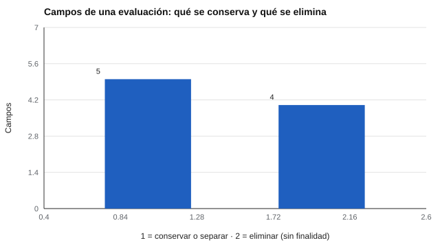

# 076 — Ley 19.628 y Ley 21.719: datos personales en evaluación


<!-- NAV -->
[← 075 — Rutas de certificación profesional](../075-certificacion-profesional/README.md) · [📚 Parte 07](../README.md) · [🗺️ Índice 001–200](../../../PROGRAMA.md) · [077 — Consentimiento informado y confidencialidad →](../077-consentimiento-informado-y-confidencialidad/README.md)
<!-- /NAV -->

**Parte 07 — Uso responsable y certificación** · Nivel profesional · 4 h · Estado `escrita`
**Pensada para:** quien recolecta, guarda o analiza datos de evaluación, y quien entrega sus datos al ser evaluado.
**Prerrequisitos:** clases 071 y 073.

> **Aviso.** Esta clase es material educativo, **no asesoría jurídica**. La normativa cambia: antes de aplicar nada, consulte el texto vigente en la Biblioteca del Congreso Nacional (bcn.cl) y a un profesional del derecho.

## ¿Para qué te sirve esto?

Una evaluación recoge datos personales: nombre, RUT, fecha de nacimiento, respuestas, a veces información de salud. En Chile, la protección de estos datos está cambiando con una nueva ley. Si trabajas con evaluaciones, necesitas saber **qué datos recoges y para qué**; si eres evaluado, conviene que sepas qué puedes preguntar y esperar. Esta clase no te enseña derecho: te enseña a **hacer un inventario de datos** y a aplicar un principio básico, la **minimización**: no recoger lo que no se necesita.

## Al terminar esta clase podrás

- Ubicar el marco chileno de protección de datos personales y su estado de vigencia.
- Inventariar los datos de una evaluación y justificar cada uno por su finalidad.
- Distinguir identificadores, cuasi-identificadores y datos sensibles.
- Aplicar el principio de minimización.

## La idea en palabras simples

**Marco chileno (a confirmar siempre en la fuente oficial):**

- **Ley 19.628** (1999): sobre protección de la vida privada; régimen que rigió hasta ahora el tratamiento de datos personales en Chile.
- **Ley 21.719**: publicada el 13 de diciembre de 2024; modifica íntegramente el régimen de la 19.628 y crea la Agencia de Protección de Datos Personales.
- **Estado de vigencia verificado el 12 de noviembre de 2026** (en fuentes secundarias: estudios jurídicos y prensa especializada): la fecha de entrada en vigencia establecida por la ley es el **1 de diciembre de 2026**; existe un proyecto de ley (Boletín 18.623-07) que la posterga, aprobado en primer trámite por el Senado el 28 de octubre de 2026 con nueva fecha propuesta de 15 de octubre de 2027, **aún no publicado como ley**. Verifique el estado actual de la tramitación antes de tomar decisiones.

**Ideas generales de los regímenes modernos de datos personales** (a confirmar en el texto legal): licitud, finalidad, proporcionalidad, calidad, seguridad, transparencia, derechos del titular (acceso, rectificación, supresión, oposición, portabilidad) y protección reforzada de datos sensibles.

**Tipos de datos en una evaluación:**

- **Identificador directo:** identifica por sí solo (RUT, nombre).
- **Cuasi-identificador:** identifica al combinarse con otros (fecha de nacimiento, comuna).
- **Dato sensible:** de categorías protegidas de forma reforzada (por ejemplo, salud, origen étnico).

## Cómo funciona, paso a paso

**1. Listar** todos los campos que se recogen.

**2. Preguntar, campo por campo, «¿para qué lo necesito?»** Si no hay finalidad, se elimina.

**3. Separar** los identificadores directos del resultado (seudonimización).

**Ejemplo resuelto.** Para elegir el baremo por edad basta con la fecha de nacimiento (o la edad). El diagnóstico previo, sin finalidad, no se recolecta: reduce riesgo y deber de custodia.



*Figura 1.* Casi la mitad de los campos del ejemplo no tenía una finalidad declarada.

## Si construyes el instrumento

- Haz el inventario de datos antes de diseñar el formulario.
- Recoge solo lo que necesitas y justifica cada campo.
- Separa los identificadores de los resultados y limita quién accede a cada cosa.
- Consulta el texto legal vigente y a un profesional del derecho para tus decisiones.

## Si eres evaluado

- Tienes derecho a preguntar qué datos tuyos se recogen, para qué y por cuánto tiempo (según la normativa vigente; verifícalo en la fuente oficial).
- Si un formulario te pide datos que parecen innecesarios (por ejemplo, un diagnóstico previo para una prueba escolar), puedes preguntar su finalidad.
- Los datos de salud u origen étnico merecen especial cuidado.

## Qué muestra el laboratorio

`lab.py` inventaría una evaluación con 9 campos.

| Campo | Categoría | Finalidad | Acción |
|---|---|---|---|
| rut | identificador directo | vincular con el expediente | separar del resultado |
| nombre | identificador directo | entregar el informe | separar del resultado |
| fecha_nacimiento | cuasi-identificador | elegir el baremo por edad | conservar |
| comuna | cuasi-identificador | — | **eliminar** |
| diagnostico_previo | dato sensible | — | **eliminar** |
| pertenencia_etnica | dato sensible | — | **eliminar** |
| puntaje_bruto | resultado | calcular el puntaje tipificado | conservar |
| tiempo_por_item | dato técnico | detectar respuestas sin esfuerzo | conservar |
| ip_origen | dato técnico | — | **eliminar** |

**Análisis.** (1) 4 de 9 campos no tienen finalidad y se eliminan. (2) El principio de minimización pregunta, campo por campo, «¿para qué lo necesito?». (3) Los datos sensibles exigen condiciones reforzadas. (4) El texto de esta clase no es interpretación jurídica: la ley 21.719 reemplaza el régimen de la 19.628 y su vigencia y detalle se verifican en la fuente oficial antes de aplicar.

## Errores frecuentes

- Recolectar «por si sirve más adelante».
- Creer que seudonimizar equivale a anonimizar (clase 078).
- Tratar los textos del laboratorio como interpretación jurídica.
- Asumir que todo dato de evaluación es sensible, o que ninguno lo es.

## Lo mínimo que debes llevarte

1. El marco chileno está cambiando; se verifica en la fuente oficial.
2. Todo dato recogido necesita una finalidad.
3. Se separan los identificadores de los resultados.
4. Esta clase no es asesoría jurídica.

## Ejercicios

- **Inicial.** ¿Qué es un cuasi-identificador? *Solución: un dato que, combinado con otros, puede identificar a una persona.*
- **Intermedio.** Agrega los campos «curso» y «establecimiento» al inventario y decide su finalidad.
- **Avanzado.** Redacta una política de retención para el inventario (qué se guarda, cuánto y quién accede).
- **Aplicación.** Haz el inventario de datos de una evaluación de tu entorno y marca qué eliminarías.

## Glosario

- **Dato personal:** información sobre una persona identificada o identificable.
- **Minimización:** recoger solo los datos necesarios.
- **Seudonimización:** reemplazar identificadores por códigos.
- **Dato sensible:** dato de categoría con protección reforzada.

## Laboratorio

```bash
python classes/part-07-uso-responsable-y-certificacion/076-ley-19-628-y-ley-21-719/lab.py
python classes/part-07-uso-responsable-y-certificacion/figuras.py
```

## Autoevaluación y criterios

1. ¿Qué principio justifica eliminar un campo sin finalidad? 2. ¿Qué cambia con la nueva ley respecto de la 19.628 (verificar en el texto)? 3. ¿Qué datos tuyos evaluarías con protección reforzada?
Se logra la clase si puedes inventariar datos y justificar minimización con base en la finalidad.

## Bibliografía y fuentes

- Biblioteca del Congreso Nacional de Chile (bcn.cl). Ley 19.628 sobre protección de la vida privada y Ley 21.719 que regula la protección y el tratamiento de los datos personales y crea la Agencia de Protección de Datos Personales (texto vigente: verificar). 🔎 sin verificar (libro, norma o sitio no hallado en Crossref: comprobar a mano)
- Academia Judicial de Chile. *Ley 21.719* (actualización normativa). 🔎 sin verificar (libro, norma o sitio no hallado en Crossref: comprobar a mano)
- AERA, APA, & NCME (2014). *Standards for Educational and Psychological Testing* (privacidad y confidencialidad). 🔎 sin verificar (libro, norma o sitio no hallado en Crossref: comprobar a mano)

Leyenda: ✅ existe en Crossref con título y año coincidentes (enlace al DOI); ⚠️ hay una obra de título parecido con otro año (no se enlaza: comprobar la edición); 🔎 no verificada automáticamente (libros sin DOI, normas y sitios web). Crossref confirma la existencia de la fuente, no que respalde cada afirmación de la clase. Ver [`docs/VERIFICACION_BIBLIOGRAFIA.md`](../../../docs/VERIFICACION_BIBLIOGRAFIA.md).

---

<!-- NAV -->
[← 075 — Rutas de certificación profesional](../075-certificacion-profesional/README.md)  
[📚 Parte 07](../README.md) · [🗺️ Índice 001–200](../../../PROGRAMA.md)  
[077 — Consentimiento informado y confidencialidad →](../077-consentimiento-informado-y-confidencialidad/README.md)
<!-- /NAV -->
