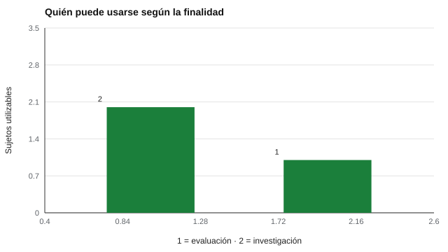

# 077 — Consentimiento informado y confidencialidad


<!-- NAV -->
[← 076 — Ley 19.628 y Ley 21.719: datos personales en…](../076-ley-19-628-y-ley-21-719/README.md) · [📚 Parte 07](../README.md) · [🗺️ Índice 001–200](../../../PROGRAMA.md) · [078 — Retención, anonimización y eliminación de dat… →](../078-retencion-anonimizacion-y-eliminacion-de-datos/README.md)
<!-- /NAV -->

**Parte 07 — Uso responsable y certificación** · Nivel profesional · 4 h · Estado `escrita`
**Pensada para:** quien pide consentimiento y custodia resultados, y quien lo otorga o lo retira.
**Prerrequisitos:** clase 076.

> Esta clase es material educativo, no asesoría jurídica.

## ¿Para qué te sirve esto?

Antes de evaluarte, deberían explicarte qué se medirá, para qué, quién verá el resultado y cuánto tiempo se guardará, y deberías poder decir «sí» o «no». Eso es el **consentimiento informado**. Pero un formulario firmado no basta: hay que cumplir lo que dice. Esta clase te enseña los elementos de un consentimiento válido y cómo un sistema puede **hacerlo cumplir** (finalidad específica y posibilidad de retiro), con un registro auditable.

## Al terminar esta clase podrás

- Describir los elementos de un consentimiento informado válido.
- Implementar un registro de consentimiento que respete finalidad y retiro.
- Entender la diferencia entre integridad (hash) y confidencialidad.
- Explicar los límites de la confidencialidad.

## La idea en palabras simples

Un consentimiento es **libre** (sin presión), **específico** (para una finalidad concreta), **informado** (se explicó) y **revocable** (se puede retirar). En menores se suma el **asentimiento** del niño o niña (su acuerdo, adaptado a su edad) y la **autorización** de quien ejerce su cuidado. Debe explicar qué se mide, para qué, quién verá los resultados, cuánto se conservan y cómo retirarlo.

**Confidencialidad:** que la información no se divulgue a quien no corresponde. Tiene límites legales y éticos (riesgo para la persona o terceros), que se explican de antemano.

## Cómo funciona, paso a paso

**1. Registrar** el consentimiento por sujeto y por finalidad (evaluación, investigación, informe a la familia…).

**2. Consultar el registro** antes de cada uso: solo se usan los datos de quienes autorizaron esa finalidad.

**3. Permitir el retiro** y respetarlo.

**4. Auditar:** guardar un registro cuya integridad pueda verificarse (huella SHA-256).

**Ejemplo resuelto.** Si un colegio usa los resultados de una evaluación para un estudio externo, necesita un consentimiento específico para investigación: el firmado para «evaluación» no basta.



*Figura 1.* El mismo conjunto de datos se puede usar de forma distinta según la finalidad autorizada.

## Si construyes el instrumento

- Redacta un consentimiento específico por finalidad, en lenguaje claro y sin letra chica.
- Implementa el retiro como un proceso real, no solo como una cláusula.
- Guarda un registro auditable de quién autorizó qué y cuándo.
- Controla el acceso: la integridad (hash) no impide que alguien lea el dato.

## Si eres evaluado

- Puedes pedir que te expliquen para qué se usarán tus datos y quién los verá.
- Puedes decir que no a usos distintos del principal (por ejemplo, investigación) sin perder tu evaluación, cuando el servicio no los requiere.
- Puedes retirar tu consentimiento; pregunta qué ocurre con los datos ya tratados.

## Qué muestra el laboratorio

`lab.py` simula 3 sujetos; el s003 retiró su consentimiento.

| Finalidad del análisis | Sujetos que se pueden usar |
|---|---|
| Evaluación | s001, s002 |
| Investigación | s001 (s002 no autorizó esa finalidad; s003 retiró) |

La huella SHA-256 del registro de auditoría cambia al alterar un solo registro (`cfe0e7fd…` frente a `2e550769…`).

**Análisis.** (1) El consentimiento es específico (finalidad) y revocable. (2) La confidencialidad exige que el sistema lo haga cumplir, no solo que exista un formulario. (3) La huella permite **detectar** cambios, no impide que ocurran: el control de acceso es otra capa (clase 080). (4) Es un ejemplo mínimo; un sistema real necesita controles de acceso, cifrado y procedimientos de retiro y eliminación.

## Errores frecuentes

- Consentimiento «paraguas» para cualquier uso.
- Hacer el consentimiento condición de un servicio que no lo requiere.
- Creer que el hash protege el dato.
- No explicar de antemano los límites de la confidencialidad.

## Lo mínimo que debes llevarte

1. Consentimiento: libre, específico, informado y revocable.
2. En menores, asentimiento más autorización.
3. El sistema debe hacerlo cumplir.
4. El hash da integridad, no confidencialidad.

## Ejercicios

- **Inicial.** ¿Qué diferencia hay entre consentimiento y asentimiento? *Solución: el consentimiento lo da el adulto o la persona con capacidad; el asentimiento es el acuerdo del niño o niña, adaptado a su edad.*
- **Intermedio.** Agrega una finalidad «informe a la familia» y modifica el registro.
- **Avanzado.** Implementa que el retiro dispare la eliminación de los datos y deje constancia.
- **Aplicación.** Redacta un consentimiento para una evaluación escolar con dos finalidades.

## Glosario

- **Consentimiento informado:** autorización libre, específica, informada y revocable.
- **Asentimiento:** acuerdo de un niño o niña a participar.
- **Confidencialidad:** deber de no divulgar información a quien no corresponde.
- **Huella (hash):** código que permite detectar si un dato cambió.

## Laboratorio

```bash
python classes/part-07-uso-responsable-y-certificacion/077-consentimiento-informado-y-confidencialidad/lab.py
python classes/part-07-uso-responsable-y-certificacion/figuras.py
```

## Autoevaluación y criterios

1. ¿Qué haces si alguien retira el consentimiento tras el análisis? 2. ¿Quién accede a qué? 3. ¿Cómo pruebas que no hubo uso indebido?
Se logra la clase si puedes diseñar un consentimiento específico y un registro auditable.

## Bibliografía

- World Medical Association (2013). Declaration of Helsinki: Ethical principles for medical research involving human subjects. *JAMA*, 310(20), 2191-2194. 🔎 sin verificar (libro, norma o sitio no hallado en Crossref: comprobar a mano)
- American Psychological Association (2017). *Ethical Principles of Psychologists and Code of Conduct*. ⚠️ hay una obra de título parecido en Crossref con otro año (2002): comprobar la edición a mano
- AERA, APA, & NCME (2014). *Standards for Educational and Psychological Testing*. 🔎 sin verificar (libro, norma o sitio no hallado en Crossref: comprobar a mano)

Leyenda: ✅ existe en Crossref con título y año coincidentes (enlace al DOI); ⚠️ hay una obra de título parecido con otro año (no se enlaza: comprobar la edición); 🔎 no verificada automáticamente (libros sin DOI, normas y sitios web). Crossref confirma la existencia de la fuente, no que respalde cada afirmación de la clase. Ver [`docs/VERIFICACION_BIBLIOGRAFIA.md`](../../../docs/VERIFICACION_BIBLIOGRAFIA.md).

---

<!-- NAV -->
[← 076 — Ley 19.628 y Ley 21.719: datos personales en…](../076-ley-19-628-y-ley-21-719/README.md)  
[📚 Parte 07](../README.md) · [🗺️ Índice 001–200](../../../PROGRAMA.md)  
[078 — Retención, anonimización y eliminación de dat… →](../078-retencion-anonimizacion-y-eliminacion-de-datos/README.md)
<!-- /NAV -->
