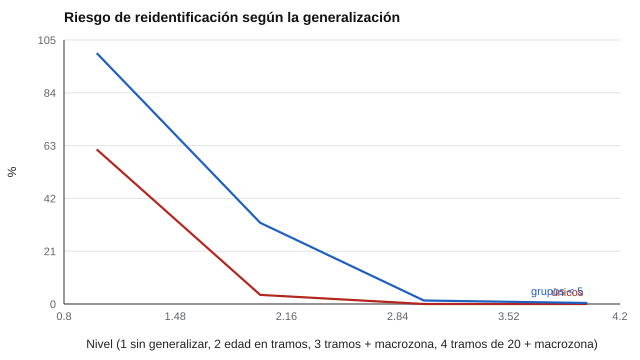

# 078 — Retención, anonimización y eliminación de datos


<!-- NAV -->
[← 077 — Consentimiento informado y confidencialidad](../077-consentimiento-informado-y-confidencialidad/README.md) · [📚 Parte 07](../README.md) · [🗺️ Índice 001–200](../../../PROGRAMA.md) · [079 — Decisiones automatizadas y derecho a explicac… →](../079-decisiones-automatizadas-y-derecho-a-explicacion/README.md)
<!-- /NAV -->

**Parte 07 — Uso responsable y certificación** · Nivel profesional · 4 h · Estado `escrita`
**Pensada para:** quien guarda, comparte o publica datos de evaluación, y quien entrega sus datos.
**Prerrequisitos:** clases 076 y 077.

> Esta clase es material educativo, no asesoría jurídica. Los plazos y exigencias dependen de la normativa vigente.

## ¿Para qué te sirve esto?

«Quitamos los nombres, así que los datos son anónimos.» Esta frase es una de las falsas seguridades más comunes. Con unos pocos datos corrientes (edad, comuna, sexo) muchas personas pueden **reidentificarse**. Esta clase te enseña a medirlo con el **k-anonimato**, a reducir el riesgo generalizando datos y a diseñar una política de **retención y eliminación**. Es útil si publicas tablas o compartes bases de datos, y si quieres entender por qué te piden ciertos datos o te los agrupan.

## Al terminar esta clase podrás

- Explicar por qué quitar el nombre no anonimiza.
- Calcular el k-anonimato y el porcentaje de personas únicas.
- Diseñar una política de retención y eliminación.
- Reconocer los límites del k-anonimato.

## La idea en palabras simples

Los **cuasi-identificadores** (edad, comuna, sexo, fecha de nacimiento) combinados pueden singularizar a una persona. El **k-anonimato** (Sweeney, 2002) exige que cada combinación de cuasi-identificadores se comparta con **al menos k personas**: si k = 1, hay personas únicas y reidentificables. Se mejora **generalizando** (tramos de edad en lugar de edades exactas, macrozonas en lugar de comunas).

Además, **seudonimizar** (cambiar nombres por códigos) **no es anonimizar**: el dato sigue siendo personal mientras exista la tabla de equivalencias o la reidentificación sea razonable (Rocher et al., 2019).

## Cómo funciona, paso a paso

**1. Elegir** los cuasi-identificadores.

**2. Contar** cuántas personas comparten cada combinación (k) y cuántas son únicas.

**3. Generalizar** hasta lograr un k aceptable.

**4. Fijar plazos de retención** y eliminación segura (incluidos respaldos).

**Ejemplo resuelto.** Con 40 comunas, 53 edades y 2 sexos hay 4.240 combinaciones para 2.000 personas: la mayoría quedan solas. Generalizando a 4 zonas, 4 tramos y 2 sexos hay 32 combinaciones: grupos de ~60.



*Figura 1.* Generalizar reduce el riesgo, a costa de resolución analítica.

## Si construyes el instrumento

- Mide el riesgo de reidentificación antes de publicar tablas o bases.
- Suprime celdas pequeñas y generaliza.
- Fija plazos de retención por finalidad y elimina de forma segura, incluidos los respaldos.
- Recuerda que el k-anonimato no protege frente a la inferencia de atributos (por ejemplo, si todos los de un grupo comparten el mismo diagnóstico).

## Si eres evaluado

- Pregunta cuánto tiempo se guardarán tus resultados y cómo se eliminarán.
- Si te dicen que tus datos son «anónimos», pregunta qué se hizo para lograrlo.
- Cuanto más específica es la información que entregas (edad exacta, comuna, curso), más fácil es que te identifiquen.

## Qué muestra el laboratorio

`lab.py` simula 2.000 personas con tres cuasi-identificadores.

| Generalización | k | Únicos | Grupos < 5 |
|---|---:|---:|---:|
| Ninguna (edad, comuna, sexo) | 1 | 61,5 % | 99,8 % |
| Edad en tramos de 10 | 1 | 3,6 % | 32,3 % |
| Tramos de 10 + macrozona | 3 | 0,0 % | 1,4 % |
| Tramos de 20 + macrozona | 4 | 0,0 % | 0,4 % |

**Análisis.** (1) Quitar el nombre no anonimiza: con tres campos corrientes, la mayoría queda singularizada (61,5 %). (2) Generalizando se reduce el riesgo a costa de resolución analítica. (3) Seudonimizar no es anonimizar. (4) Los datos son sintéticos; el riesgo real depende de la población y de la información externa disponible.

## Errores frecuentes

- Suponer que un conjunto «sin nombre» es anónimo.
- Publicar tablas con celdas pequeñas.
- Conservar datos «para siempre».
- Olvidar los respaldos al eliminar.

## Lo mínimo que debes llevarte

1. Los cuasi-identificadores combinados pueden identificar.
2. k-anonimato: cada combinación la comparten al menos k personas.
3. Generalizar reduce el riesgo.
4. La política fija plazos y eliminación segura.

## Ejercicios

- **Inicial.** ¿Qué es un cuasi-identificador? *Solución: un dato que combinado con otros puede identificar.*
- **Intermedio.** Calcula combinaciones posibles con 5 tramos de edad, 10 zonas y 2 sexos. *Solución: 100.*
- **Avanzado.** Aplica supresión de celdas < 5 en `lab.py` y reporta cuántas personas se pierden.
- **Aplicación.** Redacta una política de retención para resultados de un diagnóstico escolar.

## Glosario

- **Cuasi-identificador:** dato que, combinado con otros, puede identificar a una persona.
- **k-anonimato:** propiedad por la cual cada combinación se comparte con al menos k personas.
- **Generalización:** reemplazar un dato exacto por un tramo.
- **Seudonimización:** reemplazar identificadores por códigos.

## Laboratorio

```bash
python classes/part-07-uso-responsable-y-certificacion/078-retencion-anonimizacion-y-eliminacion-de-datos/lab.py
python classes/part-07-uso-responsable-y-certificacion/figuras.py
```

## Autoevaluación y criterios

1. ¿Qué plazo de retención justificarías para resultados de un diagnóstico escolar? 2. ¿Cómo eliminas un dato de un respaldo? 3. ¿Cómo evalúas el riesgo antes de publicar?
Se logra la clase si puedes medir el riesgo de reidentificación y proponer generalización y plazos.

## Bibliografía

- Sweeney, L. (2002). k-anonymity: A model for protecting privacy. *International Journal of Uncertainty, Fuzziness and Knowledge-Based Systems*, 10(5), 557-570. ✅ [DOI](https://doi.org/10.1142/s0218488502001648)
- Ohm, P. (2010). Broken promises of privacy: Responding to the surprising failure of anonymization. *UCLA Law Review*, 57, 1701-1777. 🔎 sin verificar (libro, norma o sitio no hallado en Crossref: comprobar a mano)
- Rocher, L., Hendrickx, J. M., & de Montjoye, Y.-A. (2019). Estimating the success of re-identifications in incomplete datasets using generative models. *Nature Communications*, 10, 3069. ✅ [DOI](https://doi.org/10.1038/s41467-019-10933-3)

Leyenda: ✅ existe en Crossref con título y año coincidentes (enlace al DOI); ⚠️ hay una obra de título parecido con otro año (no se enlaza: comprobar la edición); 🔎 no verificada automáticamente (libros sin DOI, normas y sitios web). Crossref confirma la existencia de la fuente, no que respalde cada afirmación de la clase. Ver [`docs/VERIFICACION_BIBLIOGRAFIA.md`](../../../docs/VERIFICACION_BIBLIOGRAFIA.md).

---

<!-- NAV -->
[← 077 — Consentimiento informado y confidencialidad](../077-consentimiento-informado-y-confidencialidad/README.md)  
[📚 Parte 07](../README.md) · [🗺️ Índice 001–200](../../../PROGRAMA.md)  
[079 — Decisiones automatizadas y derecho a explicac… →](../079-decisiones-automatizadas-y-derecho-a-explicacion/README.md)
<!-- /NAV -->
