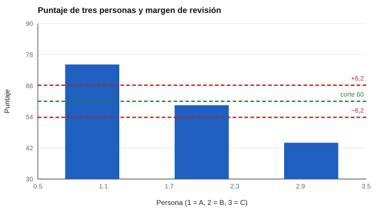

# 079 — Decisiones automatizadas y derecho a explicación


<!-- NAV -->
[← 078 — Retención, anonimización y eliminación de dat…](../078-retencion-anonimizacion-y-eliminacion-de-datos/README.md) · [📚 Parte 07](../README.md) · [🗺️ Índice 001–200](../../../PROGRAMA.md) · [080 — Seguridad de bancos de ítems y de resultados →](../080-seguridad-de-bancos-de-items-y-de/README.md)
<!-- /NAV -->

**Parte 07 — Uso responsable y certificación** · Nivel profesional · 4 h · Estado `escrita`
**Pensada para:** quien diseña o usa sistemas que puntúan o filtran personas, y quien es afectado por esas decisiones.
**Prerrequisitos:** clases 064, 074 y 076.

> Esta clase es material educativo, no asesoría jurídica. Las referencias a la nueva normativa de datos personales deben verificarse en la fuente oficial.

## ¿Para qué te sirve esto?

Cada vez más procesos de selección, admisión o apoyo usan sistemas que puntúan o clasifican personas automáticamente. Si una decisión te afecta, deberías poder saber **qué pesó** en ella, **rebatirla** y que **una persona** la revise. Esta clase te enseña a diseñar decisiones **explicables** con intervención humana y a leer críticamente cuando alguien te dice «lo decidió el sistema».

## Al terminar esta clase podrás

- Distinguir un modelo transparente de uno opaco para decisiones sobre personas.
- Emitir motivos y marcar casos de revisión humana.
- Relacionar el margen de error con una regla de intervención humana.
- Reconocer que la transparencia no reemplaza el análisis de equidad.

## La idea en palabras simples

Cuando una decisión que afecta a una persona (seleccionar, admitir, excluir) se apoya en un sistema automático, importan tres cosas:

- **Explicabilidad:** poder decir qué pesó y cuánto.
- **Contestabilidad:** poder rebatir la decisión.
- **Intervención humana:** que una persona pueda revisarla.

La discusión sobre un «derecho a explicación» es compleja y debatida (Wachter et al., 2017; Rudin, 2019 defiende usar modelos interpretables en decisiones de alto impacto). La normativa chilena de datos personales recoge ideas sobre decisiones automatizadas, que deben verificarse en el texto oficial.

Un camino simple: un **puntaje lineal con pesos declarados** permite explicar y rebatir. Y el **margen de error** (clase 025) se traduce en una regla: los casos dentro del margen **siempre** los revisa un humano.

## Cómo funciona, paso a paso

**1. Declarar** los pesos y el corte.

**2. Calcular** el puntaje y ordenar los motivos por contribución.

**3. Marcar** como «revisión humana obligatoria» los casos dentro del margen del corte.

**Ejemplo resuelto.** Persona B: 0,50 · 50 + 0,35 · 70 + 0,15 · 60 = 25 + 24,5 + 9 = 58,5. Está a 1,5 puntos del corte (60), dentro del margen de ±6,2: un humano revisa.



*Figura 1.* El caso B está cerca del corte y requiere revisión humana.

## Si construyes el instrumento

- Declara los pesos y su justificación (los del laboratorio son un ejemplo sin validez demostrada).
- Genera para cada decisión los motivos reales del cálculo: una «explicación» que no refleje el cálculo es engañosa.
- Ofrece un procedimiento de apelación y registra sus resultados.
- Recuerda que un modelo transparente puede igualmente discriminar: se analiza la equidad (clase 064).

## Si eres evaluado

- Si una decisión te afecta, puedes preguntar qué datos y qué criterios se usaron y pedir que una persona la revise.
- Si el resultado estuvo cerca del corte, es razonable pedir revisión.
- Pide los motivos por escrito.

## Qué muestra el laboratorio

`lab.py` calcula un puntaje con pesos declarados (prueba de razonamiento 0,50; muestra de trabajo 0,35; entrevista estructurada 0,15), corte 60 y margen de revisión ±6,2.

| Persona | Puntaje | Decisión | Revisión |
|---|---:|---|---|
| A | 74,2 | avanza | no |
| B | 58,5 | no avanza | **obligatoria** (dentro del margen) |
| C | 44,0 | no avanza | no |

Cada decisión lista los motivos ordenados por contribución (por ejemplo, para A: razonamiento aporta 40,0; muestra de trabajo, 24,5; entrevista, 9,8).

**Análisis.** (1) Un puntaje con pesos declarados permite explicar la decisión y rebatirla; un modelo opaco no puede. (2) El margen de revisión traduce la incertidumbre de la clase 025 en una regla. (3) Los pesos del laboratorio son un ejemplo. (4) La explicación solo es válida si refleja el cálculo real.

## Errores frecuentes

- Automatizar sin posibilidad de apelación.
- Dar una «explicación» que no refleja el cálculo real.
- Creer que transparencia equivale a equidad.
- No revisar los casos cercanos al corte.

## Lo mínimo que debes llevarte

1. Explicabilidad, contestabilidad e intervención humana.
2. Los casos dentro del margen se revisan por una persona.
3. La explicación debe reflejar el cálculo real.
4. Transparencia no es equidad.

## Ejercicios

- **Inicial.** ¿Por qué se marcan los casos cercanos al corte? *Solución: porque dentro del margen de error la decisión no es concluyente.*
- **Intermedio.** Cambia el peso de la entrevista a 0,30 y reescala los demás; recalcula B.
- **Avanzado.** Añade un registro de apelaciones y su resultado.
- **Aplicación.** Redacta el texto que recibiría una persona rechazada, con motivos y vías de revisión.

## Glosario

- **Explicabilidad:** capacidad de decir qué pesó en una decisión.
- **Contestabilidad:** posibilidad de rebatir una decisión.
- **Intervención humana:** revisión por una persona.
- **Margen de revisión:** distancia al corte dentro de la cual se revisa.

## Laboratorio

```bash
python classes/part-07-uso-responsable-y-certificacion/079-decisiones-automatizadas-y-derecho-a-explicacion/lab.py
python classes/part-07-uso-responsable-y-certificacion/figuras.py
```

## Autoevaluación y criterios

1. ¿Qué información debe recibir la persona afectada? 2. ¿Quién revisa y con qué criterio? 3. ¿Qué evidencia de equidad exiges?
Se logra la clase si puedes diseñar una decisión explicable con intervención humana.

## Bibliografía

- Wachter, S., Mittelstadt, B., & Floridi, L. (2017). Why a right to explanation of automated decision-making does not exist in the General Data Protection Regulation. *International Data Privacy Law*, 7(2), 76-99.
- Rudin, C. (2019). Stop explaining black box machine learning models for high stakes decisions and use interpretable models instead. *Nature Machine Intelligence*, 1, 206-215.

---

<!-- NAV -->
[← 078 — Retención, anonimización y eliminación de dat…](../078-retencion-anonimizacion-y-eliminacion-de-datos/README.md)  
[📚 Parte 07](../README.md) · [🗺️ Índice 001–200](../../../PROGRAMA.md)  
[080 — Seguridad de bancos de ítems y de resultados →](../080-seguridad-de-bancos-de-items-y-de/README.md)
<!-- /NAV -->
