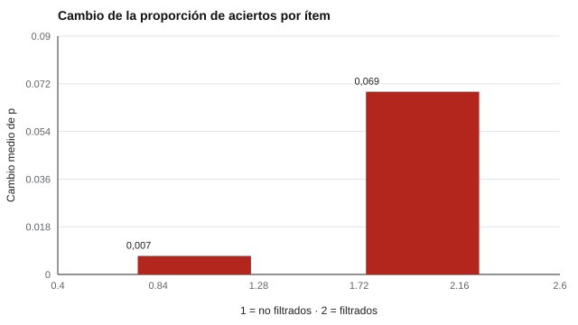

# 080 — Seguridad de bancos de ítems y de resultados


<!-- NAV -->
[← 079 — Decisiones automatizadas y derecho a explicac…](../079-decisiones-automatizadas-y-derecho-a-explicacion/README.md) · [📚 Parte 07](../README.md) · [🗺️ Índice 001–200](../../../PROGRAMA.md) · [081 — Modelos de la inteligencia: Spearman, Thursto… →](../../part-08-inteligencia-y-capacidades-cognitivas/081-modelos-de-la-inteligencia-spearman-thurstone-chc/README.md)
<!-- /NAV -->

**Parte 07 — Uso responsable y certificación** · Nivel profesional · 4 h · Estado `escrita`
**Pensada para:** quien administra pruebas de alto impacto y bases de resultados, y quien las rinde.
**Prerrequisitos:** clases 060 y 077.

## ¿Para qué te sirve esto?

Un banco de ítems es un activo: si se filtra antes del examen, los puntajes dejan de significar lo que significaban. Y las bases de resultados son datos sensibles. Esta clase te enseña a **detectar** una posible filtración con evidencia estadística, a **verificar la integridad** de archivos con huellas SHA-256 y a distinguir tres propiedades de seguridad que suelen mezclarse: **integridad, confidencialidad y disponibilidad**.

## Al terminar esta clase podrás

- Detectar la filtración de ítems con evidencia estadística.
- Verificar la integridad de archivos con huellas SHA-256.
- Distinguir integridad, confidencialidad y disponibilidad.
- Proponer un plan de seguridad por capas.

## La idea en palabras simples

Si algunas personas conocen de antemano ciertos ítems, **esos ítems se vuelven más fáciles** para ellas, y la proporción de aciertos de esos ítems sube respecto del resto. Eso deja una huella estadística (Cizek & Wollack, 2017). Pero hay que distinguir una filtración de un aprendizaje real o de un cambio de población.

- **Integridad:** que el dato no se modifique sin que se note (para esto sirve la huella SHA-256).
- **Confidencialidad:** que solo acceda quien corresponde (control de acceso, cifrado).
- **Disponibilidad:** que el dato esté disponible cuando se necesita.

Medidas para un banco: control de acceso, cifrado, rotación de ítems, límites de exposición (clase 060), marcas de agua y detección estadística.

## Cómo funciona, paso a paso

**1. Medir** el cambio de la proporción de aciertos por ítem entre dos períodos.

**2. Marcar** los ítems cuyo cambio supera un umbral (por ejemplo, 3 desviaciones sobre los demás).

**3. Revisar** esos ítems.

**Ejemplo resuelto.** Un ítem pasa de p = 0,50 a 0,58 en un período en que los demás suben 0,01 ± 0,016: (0,08 − 0,01) / 0,016 = 4,4 DE → se revisa.



*Figura 1.* Los ítems filtrados suben diez veces más.

## Si construyes el instrumento

- Combina capas: acceso restringido, cifrado, rotación, límites de exposición y monitoreo.
- No almacenes las claves de corrección junto al banco público.
- Genera un manifiesto de huellas de los archivos para detectar modificaciones.
- Un banco abierto (como los de este repositorio) no tiene este problema; los de alto impacto sí.

## Si eres evaluado

- Un examen de alto impacto protege sus ítems para que el resultado sea justo: por eso hay reglas sobre materiales y dispositivos.
- Si crees que un examen se filtró, avísalo a quien administra: protege la validez del resultado para todos.
- Tus resultados deberían guardarse con controles de acceso y de integridad.

## Qué muestra el laboratorio

`lab.py` simula 1.000 examinados y 40 ítems; el 25 % tuvo acceso previo a 10 ítems.

| Medida | Valor |
|---|---:|
| Cambio medio de p en ítems no filtrados | +0,007 (DE 0,016) |
| Cambio medio de p en los 10 filtrados | +0,069 |
| Ítems marcados (> 3 DE) | 8 de 10 filtrados; 0 de los 30 restantes |

Además genera un manifiesto SHA-256 de `instruments/*.yaml`; agregar un byte a `disc-abierto.yaml` cambia la huella (`110f0d3a…` → `24071d2f…`).

**Análisis.** (1) Una filtración deja huella estadística en los ítems expuestos, pero hay que distinguirla de aprendizaje real o de cambios de población. (2) La detección no es perfecta: dos ítems filtrados (con p alta de partida) no se destacan. (3) El hash garantiza integridad, no confidencialidad: un banco secreto además necesita control de acceso, cifrado y rotación. (4) El umbral de 3 DE es una decisión del laboratorio.

## Errores frecuentes

- Interpretar todo aumento de p como filtración.
- Creer que el hash protege el contenido.
- Almacenar claves de corrección junto al banco público.
- Usar un único control de seguridad.

## Lo mínimo que debes llevarte

1. Una filtración sube la proporción de aciertos de los ítems expuestos.
2. Integridad, confidencialidad y disponibilidad son distintas.
3. El hash detecta cambios, no impide el acceso.
4. La seguridad es por capas.

## Ejercicios

- **Inicial.** ¿Qué diferencia hay entre integridad y confidencialidad? *Solución: integridad = que no se modifique sin notarlo; confidencialidad = que solo acceda quien corresponde.*
- **Intermedio.** ¿Qué umbral usarías con 100 ítems para limitar falsos positivos? Justifícalo (por ejemplo, con corrección por múltiples comparaciones).
- **Avanzado.** Añade un ítem filtrado que siempre se acierta y verifica su detección.
- **Aplicación.** Escribe un plan de seguridad por capas para un examen de certificación.

## Glosario

- **Filtración:** conocimiento previo e indebido de ítems del examen.
- **Integridad / confidencialidad / disponibilidad:** tres propiedades de seguridad de la información.
- **Huella SHA-256:** resumen criptográfico de un archivo.
- **Manifiesto de integridad:** lista de huellas de archivos.

## Laboratorio

```bash
python classes/part-07-uso-responsable-y-certificacion/080-seguridad-de-bancos-de-items-y-de/lab.py
python classes/part-07-uso-responsable-y-certificacion/figuras.py
```

## Autoevaluación y criterios

1. ¿Qué señales además de p indican filtración? (tiempos, patrones de respuesta) 2. ¿Cómo rotas ítems? 3. ¿Qué haces tras confirmar una filtración?
Se logra la clase si puedes detectar anomalías y proponer un plan de seguridad por capas.

## Bibliografía

- Cizek, G. J., & Wollack, J. A. (Eds.) (2017). *Handbook of Quantitative Methods for Detecting Cheating on Tests*. Routledge.
- Impara, J. C., & Foster, D. (2006). Item and test development strategies to minimize test fraud. En S. M. Downing & T. M. Haladyna (Eds.), *Handbook of Test Development*. Lawrence Erlbaum.
- Way, W. D. (1998). Protecting the integrity of computerized testing item pools. *Educational Measurement: Issues and Practice*, 17(4), 17-27.

---

<!-- NAV -->
[← 079 — Decisiones automatizadas y derecho a explicac…](../079-decisiones-automatizadas-y-derecho-a-explicacion/README.md)  
[📚 Parte 07](../README.md) · [🗺️ Índice 001–200](../../../PROGRAMA.md)  
[081 — Modelos de la inteligencia: Spearman, Thursto… →](../../part-08-inteligencia-y-capacidades-cognitivas/081-modelos-de-la-inteligencia-spearman-thurstone-chc/README.md)
<!-- /NAV -->
