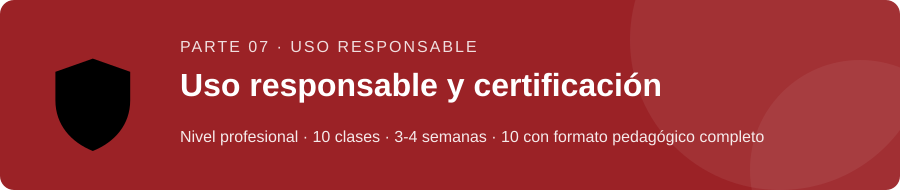
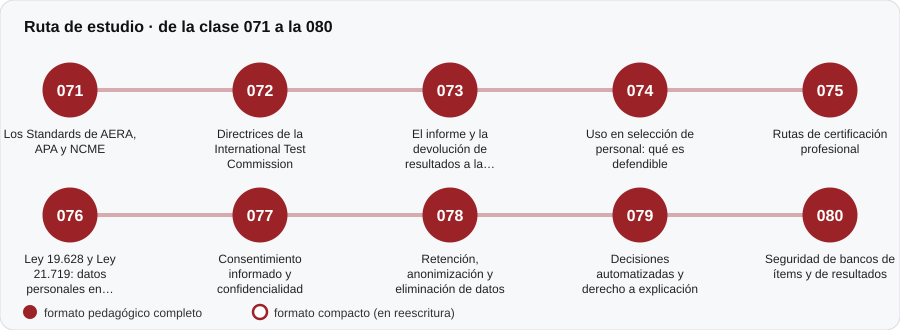

# 🛡️ Parte 07 — Uso responsable y certificación

**Nivel:** profesional · **Duración estimada:** 3-4 semanas · **Clases:** 10

## De qué trata

Los estándares que rigen la práctica, la protección de datos personales en Chile, el informe y la devolución de resultados, y los usos que no se deben hacer de un puntaje.

## Por qué importa

Medir bien no basta; también importa cómo se informa, a quién y para qué. Es la parte que protege a las personas evaluadas.

## Según tu papel

- **Si construyes o aplicas instrumentos:** Estándares AERA/APA/NCME, directrices ITC, consentimiento, retención de datos y seguridad de bancos.
- **Si eres evaluado o recibes resultados:** Conocerás tus derechos: ser informado, consentir, acceder a tus resultados y pedir explicación de decisiones automatizadas.

## Al terminar esta parte podrás

- Redactar un informe y una devolución comprensibles.
- Aplicar criterios básicos de consentimiento y protección de datos.

## Cómo estudiarla

Puede leerse en paralelo con cualquier otra parte. Las referencias legales deben contrastarse con la norma vigente; no es asesoría jurídica.

## Ruta de estudio

## Clases en orden de estudio

Las clases están numeradas de forma consecutiva (001 a 200) en el orden de estudio: sigue el número.

| Orden | ID | Clase | Qué aprenderás | Formato | Horas |
|---:|---|---|---|---|---:|
| 1 | 071 | [Los Standards de AERA, APA y NCME](071-estandares-aera-apa-ncme/README.md) | Describir la estructura y el espíritu de los *Standards*. | ✅ pedagógico | 4 |
| 2 | 072 | [Directrices de la International Test Commission](072-itc-y-normas-internacionales/README.md) | Reconocer las directrices ITC sobre uso, traducción/adaptación y evaluación por computador e internet. | ✅ pedagógico | 4 |
| 3 | 073 | [El informe y la devolución de resultados a la persona](073-informe-y-devolucion/README.md) | Redactar un informe en lenguaje claro que comunique incertidumbre. | ✅ pedagógico | 4 |
| 4 | 074 | [Uso en selección de personal: qué es defendible](074-seleccion-de-personal/README.md) | Evaluar un proceso de selección por su diseño, no por la sofisticación de una prueba. | ✅ pedagógico | 5 |
| 5 | 075 | [Rutas de certificación profesional](075-certificacion-profesional/README.md) | Establecer un punto de corte con un procedimiento Angoff modificado. | ✅ pedagógico | 3 |
| 6 | 076 | [Ley 19.628 y Ley 21.719: datos personales en evaluación](076-ley-19-628-y-ley-21-719/README.md) | Ubicar el marco chileno de protección de datos personales y su estado de vigencia. | ✅ pedagógico | 4 |
| 7 | 077 | [Consentimiento informado y confidencialidad](077-consentimiento-informado-y-confidencialidad/README.md) | Describir los elementos de un consentimiento informado válido. | ✅ pedagógico | 4 |
| 8 | 078 | [Retención, anonimización y eliminación de datos](078-retencion-anonimizacion-y-eliminacion-de-datos/README.md) | Explicar por qué quitar el nombre no anonimiza. | ✅ pedagógico | 4 |
| 9 | 079 | [Decisiones automatizadas y derecho a explicación](079-decisiones-automatizadas-y-derecho-a-explicacion/README.md) | Distinguir un modelo transparente de uno opaco para decisiones sobre personas. | ✅ pedagógico | 4 |
| 10 | 080 | [Seguridad de bancos de ítems y de resultados](080-seguridad-de-bancos-de-items-y-de/README.md) | Detectar la filtración de ítems con evidencia estadística. | ✅ pedagógico | 4 |

[← Volver al índice del programa](../../README.md) · [Índice numérico de las 200 clases](../../PROGRAMA.md)
