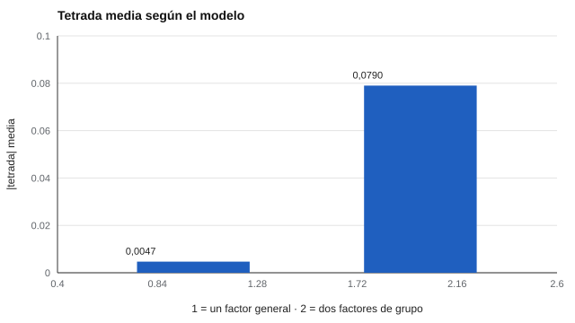

# 081 — Modelos de la inteligencia: Spearman, Thurstone, CHC


<!-- NAV -->
[← 080 — Seguridad de bancos de ítems y de resultados](../../part-07-uso-responsable-y-certificacion/080-seguridad-de-bancos-de-items-y-de/README.md) · [📚 Parte 08](../README.md) · [🗺️ Índice 001–200](../../../PROGRAMA.md) · [082 — Inteligencia fluida y cristalizada →](../082-inteligencia-fluida-y-cristalizada/README.md)
<!-- /NAV -->

**Parte 08 — Inteligencia y capacidades cognitivas** · Nivel intermedio · 4 h · Estado `escrita`
**Pensada para:** quien usa o interpreta pruebas cognitivas, y quien se pregunta qué significa «inteligencia» en un informe.
**Prerrequisitos:** clases 042 y 048.

## ¿Para qué te sirve esto?

«Inteligencia» es una palabra que cada persona usa a su manera. En psicometría hay modelos concretos que dicen cuántas capacidades hay y cómo se relacionan: ¿una sola, varias separadas, o una estructura jerárquica? Esta clase te presenta los tres grandes modelos, te muestra cómo se contrastan con datos y te advierte de un punto importante: **un resultado estadístico, el «manifold positivo», no decide entre ellos**. Te ayudará a leer con criterio cualquier informe que hable de «CI» o de «factor g».

## Al terminar esta clase podrás

- Contrastar los modelos de un factor general, de capacidades primarias y jerárquicos (CHC).
- Calcular las diferencias tetrada de Spearman.
- Entender por qué el «manifold positivo» no zanja el debate.
- Interpretar un puntaje total con cautela.

## La idea en palabras simples

- **Spearman (1904):** hay un factor general **g** que explica las correlaciones positivas entre pruebas: quien rinde bien en una tiende a rendir bien en otras.
- **Thurstone (1938):** hay varias **capacidades primarias** (verbal, numérica, espacial…), más independientes entre sí.
- **Modelos jerárquicos** (Carroll, 1993) y la **teoría CHC** (Cattell-Horn-Carroll; McGrew, 2009): capacidades organizadas en **estratos**: un factor general arriba, capacidades amplias (razonamiento fluido, conocimiento, memoria…) en el medio y habilidades específicas abajo.

Una consecuencia comprobable del modelo de un solo factor: las **diferencias tetrada** (r₁₃·r₂₄ − r₁₄·r₂₃) deberían ser cercanas a 0.

## Cómo funciona, paso a paso

**1. Calcular** las correlaciones entre pruebas.

**2. Calcular las tetradas** y compararlas con 0.

**3. Mirar** cuánta varianza explica el primer componente.

**Ejemplo resuelto.** r₁₃ = 0,4; r₂₄ = 0,4; r₁₄ = 0,3; r₂₃ = 0,3: tetrada = 0,16 − 0,09 = 0,07 → se aleja de 0; un solo factor no es suficiente para esas cuatro pruebas.



*Figura 1.* Con un solo factor las tetradas son casi 0; con factores de grupo, no.

## Si construyes el instrumento

- No presentes g como «una cosa» en el cerebro: es una regularidad estadística cuya interpretación es debatida.
- Elige el modelo según el propósito (un total para describir, perfiles para diagnosticar) y decláralo.
- Si reportas un puntaje total y subpuntajes, aplica los índices de la clase 048.
- No apliques un modelo de población general a un subgrupo sin comprobarlo.

## Si eres evaluado

- Un «CI» o un puntaje total resume muchas capacidades en un número: es útil, pero pierde información.
- Que existan correlaciones positivas entre pruebas no prueba que haya una «inteligencia única».
- Pide el perfil por capacidades además del total.

## Qué muestra el laboratorio

`lab.py` simula 6 pruebas (N = 6.000) con dos modelos.

| Modelo | \|tetrada\| media | % varianza 1.er componente | Correlación mínima |
|---|---:|---:|---:|
| A. Un factor general | 0,0047 | 50,7 % | 0,26 |
| B. Dos factores de grupo (r = 0,4) | 0,0790 | 43,3 % | 0,20 |

**Análisis.** (1) Bajo un solo factor las tetradas son ~0; con factores de grupo se alejan de 0. (2) Aun así, en ambos casos todas las correlaciones son positivas y hay un primer componente grande: el «manifold positivo» **no distingue** entre un g causal y varias capacidades correlacionadas. (3) El modelo CHC organiza las capacidades en estratos; cuál estructura es «la verdadera» es un debate abierto, no un dato del test. (4) Los datos son simulados.

## Errores frecuentes

- Usar g como si fuera una «cosa» en el cerebro.
- Elegir el modelo por conveniencia de interpretación.
- Aplicar un modelo de población general a un subgrupo sin comprobarlo.
- Creer que un primer componente grande prueba un factor causal.

## Lo mínimo que debes llevarte

1. Hay tres grandes familias de modelos: un factor, varias capacidades, jerárquicos.
2. Las tetradas ≈ 0 son una predicción del modelo de un factor.
3. El manifold positivo no decide entre modelos.
4. Un total resume y pierde información.

## Ejercicios

- **Inicial.** ¿Qué predice la teoría de Spearman sobre las tetradas? *Solución: que son cercanas a 0.*
- **Intermedio.** Calcula la tetrada con r₁₃ = 0,35; r₂₄ = 0,35; r₁₄ = 0,30; r₂₃ = 0,30. *Solución: 0,1225 − 0,09 = 0,0325.*
- **Avanzado.** Aumenta a 0,8 la correlación entre los factores de grupo del modelo B y observa las tetradas.
- **Aplicación.** Explica a una familia, en tres frases, qué significa y qué no significa «CI».

## Glosario

- **Factor g:** factor general de las capacidades cognitivas.
- **Capacidades primarias:** capacidades específicas relativamente independientes.
- **CHC:** teoría jerárquica de Cattell, Horn y Carroll.
- **Diferencia tetrada:** r₁₃·r₂₄ − r₁₄·r₂₃.

## Laboratorio

```bash
python classes/part-08-inteligencia-y-capacidades-cognitivas/081-modelos-de-la-inteligencia-spearman-thurstone-chc/lab.py
python classes/part-08-inteligencia-y-capacidades-cognitivas/figuras.py
```

## Autoevaluación y criterios

1. ¿Qué evidencia favorecería un modelo jerárquico? 2. ¿Qué implica para la interpretación de un puntaje total? 3. ¿Qué rol juega la muestra?
Se logra la clase si puedes calcular tetradas y discutir el alcance de cada modelo.

## Bibliografía

- Spearman, C. (1904). «General intelligence,» objectively determined and measured. *American Journal of Psychology*, 15(2), 201-292.
- Thurstone, L. L. (1938). *Primary Mental Abilities*. University of Chicago Press.
- Carroll, J. B. (1993). *Human Cognitive Abilities*. Cambridge University Press.
- McGrew, K. S. (2009). CHC theory and the human cognitive abilities project: Standing on the shoulders of the giants of psychometric intelligence research. *Intelligence*, 37(1), 1-10.

---

<!-- NAV -->
[← 080 — Seguridad de bancos de ítems y de resultados](../../part-07-uso-responsable-y-certificacion/080-seguridad-de-bancos-de-items-y-de/README.md)  
[📚 Parte 08](../README.md) · [🗺️ Índice 001–200](../../../PROGRAMA.md)  
[082 — Inteligencia fluida y cristalizada →](../082-inteligencia-fluida-y-cristalizada/README.md)
<!-- /NAV -->
