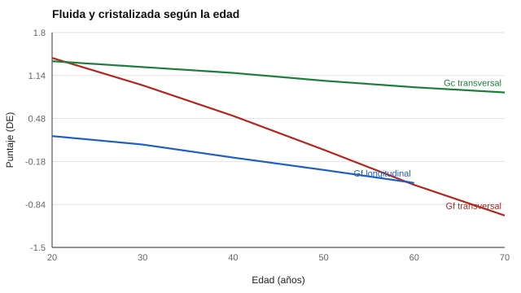

# 082 — Inteligencia fluida y cristalizada


<!-- NAV -->
[← 081 — Modelos de la inteligencia: Spearman, Thursto…](../081-modelos-de-la-inteligencia-spearman-thurstone-chc/README.md) · [📚 Parte 08](../README.md) · [🗺️ Índice 001–200](../../../PROGRAMA.md) · [083 — Razonamiento abstracto: matrices y series →](../083-razonamiento-abstracto-matrices-y-series/README.md)
<!-- /NAV -->

**Parte 08 — Inteligencia y capacidades cognitivas** · Nivel intermedio · 4 h · Estado `escrita`
**Pensada para:** quien interpreta diferencias cognitivas entre edades, y quien lee noticias sobre «el declive cognitivo».
**Prerrequisitos:** clase 081.

## ¿Para qué te sirve esto?

«Los adultos mayores razonan peor que los jóvenes.» ¿Es verdad? Depende de **cómo se compare**. Si comparas hoy a personas de 20 y de 60 años, ves una diferencia grande; pero esas personas **nacieron en épocas distintas, con distinta educación**. Esta clase te enseña la distinción entre inteligencia **fluida** y **cristalizada** y, sobre todo, a no confundir tres cosas que se mezclan al comparar edades: **edad, cohorte y período**. Es una lección de lectura crítica que sirve para cualquier estudio.

## Al terminar esta clase podrás

- Distinguir Gf (razonar con material nuevo) de Gc (conocimiento acumulado).
- Diferenciar estudios transversales y longitudinales.
- Reconocer los efectos de edad, cohorte y período.
- Interpretar comparaciones entre edades con cautela.

## La idea en palabras simples

Cattell y Horn distinguieron (Horn & Cattell, 1967):

- **Inteligencia fluida (Gf):** resolver problemas **nuevos**, razonar sin conocimiento previo (matrices, series).
- **Inteligencia cristalizada (Gc):** conocimiento y destrezas **aprendidos** (vocabulario, cultura general).

Las tareas de Gf suelen mostrar puntajes menores con la edad; las de Gc se mantienen o suben hasta edades avanzadas.

Pero hay tres «relojes» que se confunden:

- **Edad:** cuántos años tiene la persona.
- **Cohorte:** cuándo nació (el entorno en que creció).
- **Período:** cuándo se midió.

Un estudio **transversal** compara edades distintas **hoy**; uno **longitudinal** sigue a la misma gente en el tiempo (Schaie, 1965). Además, los puntajes promedio han subido entre cohortes en muchos países (efecto Flynn; Flynn, 1987).

## Cómo funciona, paso a paso

**1. Simular** una población con efecto de edad y de cohorte (parámetros **supuestos**, no empíricos).

**2. Comparar** el diseño transversal con el longitudinal.

**Ejemplo resuelto.** Un estudio transversal compara personas de 20 y 60 años: diferencia = 1,41 − (−0,54) = 1,95 DE. Si 1,2 DE se debe a la cohorte (0,3 por década, cuatro décadas), el cambio asociado a la edad es 0,75 DE.



*Figura 1.* El corte transversal exagera el declive de Gf; Gc se mantiene.

## Si construyes el instrumento

- Construye baremos por edad con cuidado (clases 061 y 067) y revísalos con el tiempo: las normas envejecen.
- Distingue qué tareas miden Gf (razonamiento con material nuevo) y cuáles Gc.
- No atribuyas a la edad lo que puede ser un cambio de cohorte.
- Documenta los parámetros y supuestos del estudio.

## Si eres evaluado

- Un resultado inferior al de personas más jóvenes no implica un «declive» tuyo: puede reflejar otra época de formación.
- Las tareas de razonamiento con material nuevo son sensibles a la edad; las de conocimiento, menos.
- Si evalúan a un adulto mayor, pregunta con qué baremo: debe ser de su edad.

## Qué muestra el laboratorio

`lab.py` simula una población (parámetros supuestos; efecto de cohorte +0,3 DE por década).

| Edad | Gf transversal | Gc transversal | Gf longitudinal (cohorte 1966) |
|---:|---:|---:|---:|
| 20 | 1,41 | 1,36 | 0,21 |
| 40 | 0,52 | 1,18 | −0,12 |
| 60 | −0,54 | 0,96 | −0,51 |
| 70 | −1,01 | 0,88 | — |

**Análisis.** (1) En el transversal, los de 60 años están ~2 DE bajo los de 20, pero en gran parte porque nacieron en otra cohorte; el declive «propio» (longitudinal) es ~0,7 DE. (2) Las comparaciones entre edades confunden edad, cohorte y período. (3) Gc se mantiene en el transversal (de 1,36 a 0,96, mucho menos que Gf). (4) Los parámetros son supuestos: la trayectoria real varía por dominio, persona y contexto.

## Errores frecuentes

- Interpretar diferencias transversales como declive individual.
- Atribuir a la edad lo que es cambio en el acceso a educación.
- Generalizar los parámetros del laboratorio a la población real.
- Usar baremos de adultos jóvenes para evaluar a adultos mayores.

## Lo mínimo que debes llevarte

1. Gf: razonar con material nuevo; Gc: conocimiento acumulado.
2. Transversal compara edades hoy; longitudinal sigue a las mismas personas.
3. Edad, cohorte y período se confunden.
4. Los baremos deben corresponder a la edad.

## Ejercicios

- **Inicial.** ¿Qué tipo de tarea medirías para Gf y para Gc? *Guía: matrices o series para Gf; vocabulario para Gc.*
- **Intermedio.** Si el efecto de cohorte fuera 0,2 por década, ¿cuánto del contraste transversal 20–60 sería cohorte? *Solución: 0,8 DE.*
- **Avanzado.** Introduce un efecto de período (mejora para todos) en `lab.py` y describe qué diseño lo separa.
- **Aplicación.** Lee una noticia sobre «declive cognitivo» y señala qué diseño usó el estudio.

## Glosario

- **Gf / Gc:** inteligencia fluida / cristalizada.
- **Cohorte:** grupo de personas nacidas en la misma época.
- **Estudio transversal / longitudinal:** compara grupos hoy / sigue a las mismas personas.
- **Efecto Flynn:** aumento de puntajes promedio entre generaciones.

## Laboratorio

```bash
python classes/part-08-inteligencia-y-capacidades-cognitivas/082-inteligencia-fluida-y-cristalizada/lab.py
python classes/part-08-inteligencia-y-capacidades-cognitivas/figuras.py
```

## Autoevaluación y criterios

1. ¿Qué diseño separa edad, cohorte y período? 2. ¿Por qué se debe cuidar el baremo por edad? 3. ¿Qué evidencia sobre cambio cognitivo no es de laboratorio?
Se logra la clase si puedes interpretar comparaciones de edad con las amenazas explícitas.

## Bibliografía

- Horn, J. L., & Cattell, R. B. (1967). Age differences in fluid and crystallized intelligence. *Acta Psychologica*, 26, 107-129. ✅ [DOI](https://doi.org/10.1016/0001-6918(67)90011-x)
- Schaie, K. W. (1965). A general model for the study of developmental problems. *Psychological Bulletin*, 64(2), 92-107. ✅ [DOI](https://doi.org/10.1037/h0022371)
- Flynn, J. R. (1987). Massive IQ gains in 14 nations: What IQ tests really measure. *Psychological Bulletin*, 101(2), 171-191. ✅ [DOI](https://doi.org/10.1037/0033-2909.101.2.171)

Leyenda: ✅ existe en Crossref con título y año coincidentes (enlace al DOI); ⚠️ hay una obra de título parecido con otro año (no se enlaza: comprobar la edición); 🔎 no verificada automáticamente (libros sin DOI, normas y sitios web). Crossref confirma la existencia de la fuente, no que respalde cada afirmación de la clase. Ver [`docs/VERIFICACION_BIBLIOGRAFIA.md`](../../../docs/VERIFICACION_BIBLIOGRAFIA.md).

---

<!-- NAV -->
[← 081 — Modelos de la inteligencia: Spearman, Thursto…](../081-modelos-de-la-inteligencia-spearman-thurstone-chc/README.md)  
[📚 Parte 08](../README.md) · [🗺️ Índice 001–200](../../../PROGRAMA.md)  
[083 — Razonamiento abstracto: matrices y series →](../083-razonamiento-abstracto-matrices-y-series/README.md)
<!-- /NAV -->
