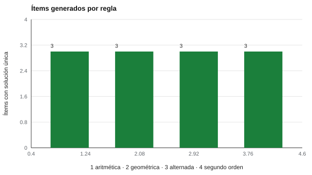

# 083 — Razonamiento abstracto: matrices y series


<!-- NAV -->
[← 082 — Inteligencia fluida y cristalizada](../082-inteligencia-fluida-y-cristalizada/README.md) · [📚 Parte 08](../README.md) · [🗺️ Índice 001–200](../../../PROGRAMA.md) · [084 — Razonamiento verbal y comprensión de instrucc… →](../084-razonamiento-verbal-y-comprension-de-instrucciones/README.md)
<!-- /NAV -->

**Parte 08 — Inteligencia y capacidades cognitivas** · Nivel intermedio · 5 h · Estado `escrita`
**Pensada para:** quien diseña ítems de razonamiento, y quien se enfrenta a pruebas de series o matrices.
**Prerrequisitos:** clases 015 y 081.

## ¿Para qué te sirve esto?

Las pruebas de razonamiento abstracto (series numéricas, matrices con figuras) se usan mucho porque requieren poco conocimiento previo. Pero los ítems de pruebas comerciales están protegidos, y escribir buenos ítems es difícil: un ítem con **dos respuestas posibles** es un ítem defectuoso. Esta clase te enseña qué hace difícil a un ítem de este tipo, cómo **generar ítems propios** con un programa y cómo **verificar** que tengan una única solución.

## Al terminar esta clase podrás

- Describir las reglas que hacen difícil un ítem de matrices o series.
- Generar ítems originales con solución única verificable.
- Evitar el uso de ítems protegidos: se diseñan los propios.
- Estimar la dificultad de un ítem generado con datos.

## La idea en palabras simples

Las tareas de razonamiento abstracto piden **inducir una regla y aplicarla**. En matrices, la dificultad se explica por el número y el tipo de reglas y por la carga de memoria de trabajo (Carpenter et al., 1990). La **generación automática de ítems** (Embretson, 1998; Gierl & Haladyna, 2013) define esas reglas como un programa y produce ítems con una dificultad prevista.

El laboratorio genera series con **cuatro reglas**:

- **Aritmética:** suma constante (9, 14, 19, …).
- **Geométrica:** multiplicación constante (3, 6, 12, …).
- **Alternada:** dos series entrelazadas.
- **De segundo orden:** las diferencias forman una progresión.

Y un **resolutor independiente** enumera las reglas candidatas: si hay más de una respuesta posible, el ítem es defectuoso.

## Cómo funciona, paso a paso

**1. Generar** la serie con una regla y una semilla.

**2. Resolver** con el resolutor: ¿hay una única respuesta?

**3. Crear distractores** a partir de errores típicos.

**Ejemplo resuelto.** Serie 7, 8, 10, 13, 17, 22: diferencias 1, 2, 3, 4, 5 → la siguiente diferencia es 6 → **28**.



*Figura 1.* Los 12 ítems generados tienen solución única.

## Si construyes el instrumento

- Genera ítems con semilla para que el banco sea reproducible y auditable.
- Verifica la unicidad de la solución con un resolutor independiente.
- La dificultad real y la calidad de los distractores se estiman con datos (clase 015).
- Deduplica el banco: con ciertas semillas puede repetirse un ítem.

## Si eres evaluado

- Las series y matrices miden razonamiento con material nuevo; no es necesario saber nada previo, pero sí conviene practicar el formato.
- Si un ítem te parece tener dos respuestas válidas, es un defecto del ítem; puedes señalarlo.
- Una prueba con ítems generados necesita un piloto antes de usarse.

## Qué muestra el laboratorio

`lab.py` genera 12 ítems (3 por regla) y los resuelve con un resolutor independiente.

| Tipo | Serie visible | Respuesta |
|---|---|---:|
| Aritmética | 9, 14, 19, 24, 29, 34 | 39 |
| Geométrica | 3, 6, 12, 24, 48 | 96 |
| Alternada | 6, 50, 10, 52, 14, 54, 18 | 56 |
| Segundo orden | 7, 8, 10, 13, 17, 22 | 28 |

Ítems con solución única verificada por el resolutor: **12 de 12**.

**Análisis.** (1) Generar ítems con semilla permite bancos originales y auditables. (2) La dificultad real y la calidad de los distractores se estiman con datos, no con la intuición. (3) Un ítem con dos explicaciones válidas es defectuoso: el resolutor lo detecta. (4) Con la semilla usada apareció una serie geométrica duplicada (3, 6, 12, 24, 48); un banco real se deduplica.

## Errores frecuentes

- Declarar «difícil» un ítem por intuición.
- Publicar ítems con dos explicaciones válidas.
- No deduplicar el banco.
- Usar un banco generado sin piloto ni análisis de ítems.

## Lo mínimo que debes llevarte

1. El razonamiento abstracto consiste en inducir y aplicar una regla.
2. Se pueden generar ítems con reglas explícitas.
3. La unicidad de la solución se verifica.
4. La dificultad se estima con datos.

## Ejercicios

- **Inicial.** Completa 2, 6, 18, 54, ? *Solución: 162.*
- **Intermedio.** Diseña una serie con dos reglas entrelazadas y verifica su unicidad.
- **Avanzado.** Añade una regla (Fibonacci) y actualiza el resolutor.
- **Aplicación.** Escribe cinco ítems originales de series y pídele a un colega que los resuelva.

## Glosario

- **Razonamiento abstracto:** inferir y aplicar reglas con material nuevo.
- **Serie de segundo orden:** serie cuyas diferencias forman una progresión.
- **Resolutor:** programa que encuentra las soluciones posibles de un ítem.
- **Generación automática de ítems:** producción de ítems a partir de reglas.

## Laboratorio

```bash
python classes/part-08-inteligencia-y-capacidades-cognitivas/083-razonamiento-abstracto-matrices-y-series/lab.py
python classes/part-08-inteligencia-y-capacidades-cognitivas/figuras.py
```

## Autoevaluación y criterios

1. ¿Qué ventaja y qué riesgo tiene la generación automática? 2. ¿Cómo estimarías la dificultad de un ítem generado? 3. ¿Por qué no copiar ítems de pruebas comerciales?
Se logra la clase si puedes generar ítems originales y verificarlos.

## Bibliografía

- Carpenter, P. A., Just, M. A., & Shell, P. (1990). What one intelligence test measures: A theoretical account of the processing in the Raven Progressive Matrices Test. *Psychological Review*, 97(3), 404-431. ✅ [DOI](https://doi.org/10.1037/0033-295x.97.3.404)
- Embretson, S. E. (1998). A cognitive design system approach to generating valid tests: Application to abstract reasoning. *Psychological Methods*, 3(3), 380-396. ✅ [DOI](https://doi.org/10.1037/1082-989x.3.3.380)
- Gierl, M. J., & Haladyna, T. M. (Eds.) (2013). *Automatic Item Generation: Theory and Practice*. Routledge. ✅ [DOI](https://doi.org/10.4324/9780203803912)

Leyenda: ✅ existe en Crossref con título y año coincidentes (enlace al DOI); ⚠️ hay una obra de título parecido con otro año (no se enlaza: comprobar la edición); 🔎 no verificada automáticamente (libros sin DOI, normas y sitios web). Crossref confirma la existencia de la fuente, no que respalde cada afirmación de la clase. Ver [`docs/VERIFICACION_BIBLIOGRAFIA.md`](../../../docs/VERIFICACION_BIBLIOGRAFIA.md).

---

<!-- NAV -->
[← 082 — Inteligencia fluida y cristalizada](../082-inteligencia-fluida-y-cristalizada/README.md)  
[📚 Parte 08](../README.md) · [🗺️ Índice 001–200](../../../PROGRAMA.md)  
[084 — Razonamiento verbal y comprensión de instrucc… →](../084-razonamiento-verbal-y-comprension-de-instrucciones/README.md)
<!-- /NAV -->
