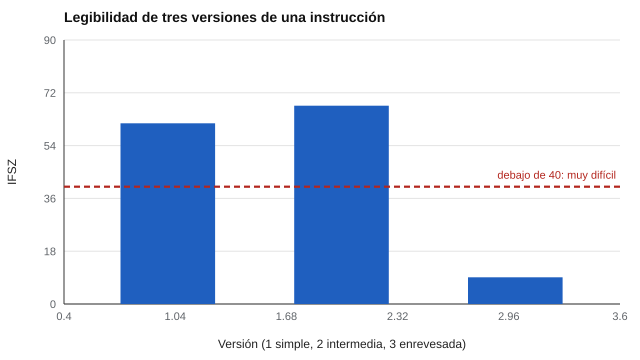

# 084 — Razonamiento verbal y comprensión de instrucciones


<!-- NAV -->
[← 083 — Razonamiento abstracto: matrices y series](../083-razonamiento-abstracto-matrices-y-series/README.md) · [📚 Parte 08](../README.md) · [🗺️ Índice 001–200](../../../PROGRAMA.md) · [085 — Razonamiento numérico →](../085-razonamiento-numerico/README.md)
<!-- /NAV -->

**Parte 08 — Inteligencia y capacidades cognitivas** · Nivel intermedio · 4 h · Estado `escrita`
**Pensada para:** quien redacta instrucciones y pruebas verbales, y quien las lee bajo presión.
**Prerrequisitos:** clases 031 y 011.

## ¿Para qué te sirve esto?

Si una prueba de razonamiento tiene instrucciones escritas de forma rebuscada, quien falle podría no haber fallado en razonar, sino en **descifrar el texto**. Eso es **varianza irrelevante al constructo**: algo que influye en el puntaje sin ser lo que se quiere medir. Esta clase te da una herramienta sencilla para medir la **legibilidad** de un texto en español y para decidir cuándo la complejidad textual es parte de lo que se evalúa y cuándo es un obstáculo.

## Al terminar esta clase podrás

- Distinguir razonamiento verbal de dominio lector.
- Evaluar la legibilidad de instrucciones con un índice en español.
- Identificar varianza irrelevante al constructo por redacción compleja.
- Decidir cuándo simplificar y cuándo no.

## La idea en palabras simples

Un índice de legibilidad para español, la fórmula de Szigriszt-Pazos, con la escala orientativa INFLESZ, usa dos cosas: cuántas **sílabas por palabra** y cuántas **palabras por frase** tiene el texto:

```
IFSZ = 206,835 − 62,3 · (sílabas/palabras) − (palabras/frases)
```

Escala orientativa (Barrio-Cantalejo et al., 2008): > 80 muy fácil; 65–80 bastante fácil; 55–65 normal; 40–55 algo difícil; < 40 muy difícil.

Frases largas y palabras largas hacen bajar el índice. Pero es una **guía**: no mide vocabulario técnico ni estructura.

## Cómo funciona, paso a paso

**1. Contar** palabras, sílabas y frases (el laboratorio usa un contador de sílabas heurístico y aproximado).

**2. Calcular** el IFSZ.

**3. Interpretar** con la escala y con criterio.

**Ejemplo resuelto.** Texto de 20 palabras, 2 frases y 42 sílabas: IFSZ = 206,835 − 62,3 · 2,1 − 10 = 65,99 → «bastante fácil».



*Figura 1.* La versión enrevesada cae a 9,1 («muy difícil»).

## Si construyes el instrumento

- Escribe las instrucciones en lenguaje claro: frases cortas y palabras comunes.
- Si el constructo es comprender textos complejos, la complejidad **es parte del constructo**: no la simplifiques, pero decláralo.
- Pruébalas con personas de la población objetivo (clase 019).
- Considera lectores con otra lengua materna o con dificultades lectoras.

## Si eres evaluado

- Si las instrucciones te resultan confusas, pregunta antes de empezar: aclarar el enunciado es parte de un proceso justo.
- Una redacción rebuscada puede hacerte fallar sin que sea un problema de razonamiento.
- Si rindes en una segunda lengua, pide información sobre apoyos disponibles.

## Qué muestra el laboratorio

`lab.py` calcula el IFSZ de tres versiones de una misma instrucción.

| Versión de la instrucción | IFSZ | Lectura |
|---|---:|---|
| A. Simple («Lea cada pregunta. Elija una respuesta. …») | 61,6 | normal |
| B. Intermedia | 67,6 | bastante fácil |
| C. Enrevesada («Previamente a la consignación…») | 9,1 | muy difícil |

**Análisis.** (1) La versión C exige más lectura que razonamiento: si el objetivo es medir comprensión de instrucciones o razonamiento, una redacción innecesariamente compleja agrega varianza irrelevante al constructo (clase 031). (2) El índice es una guía y el contador de sílabas es aproximado: un texto corto con términos técnicos puede ser difícil aunque su índice sea alto. (3) No se aplica igual a lectores de distintas edades o lengua materna. (4) Los textos son ejemplos construidos.

## Errores frecuentes

- Tratar el índice como medida de dificultad cognitiva.
- Simplificar tanto que cambie el constructo.
- Confiar en el contador de sílabas aproximado sin revisar hiatos y diptongos.
- Aplicar el mismo índice a lectores muy distintos.

## Lo mínimo que debes llevarte

1. Redacción compleja agrega varianza irrelevante al constructo.
2. IFSZ usa sílabas por palabra y palabras por frase.
3. El índice es una guía, no una prueba.
4. Si la complejidad es parte del constructo, se declara.

## Ejercicios

- **Inicial.** ¿Qué dos variables entran en el índice? *Solución: sílabas por palabra y palabras por frase.*
- **Intermedio.** Reescribe la versión C en lenguaje claro y recalcula.
- **Avanzado.** Mejora `silabas()` para manejar hiatos con tilde (por ejemplo «día») y compara.
- **Aplicación.** Evalúa la legibilidad de las instrucciones de una prueba que conozcas.

## Glosario

- **Legibilidad:** facilidad con que un texto se lee y comprende.
- **IFSZ:** índice de Flesch-Szigriszt.
- **INFLESZ:** escala orientativa de interpretación del índice.
- **Varianza irrelevante al constructo:** parte del puntaje debida a algo ajeno a lo que se mide.

## Laboratorio

```bash
python classes/part-08-inteligencia-y-capacidades-cognitivas/084-razonamiento-verbal-y-comprension-de-instrucciones/lab.py
python classes/part-08-inteligencia-y-capacidades-cognitivas/figuras.py
```

## Autoevaluación y criterios

1. ¿Cuándo la complejidad textual es parte del constructo? 2. ¿Cómo probarías si la redacción afecta a un grupo? 3. ¿Qué haces con instrucciones en segunda lengua?
Se logra la clase si puedes evaluar legibilidad y decidir si la complejidad es pertinente.

## Bibliografía

- Szigriszt Pazos, F. (1993). *Sistemas predictivos de legibilidad del mensaje escrito: fórmula de perspicuidad*. Tesis doctoral, Universidad Complutense de Madrid.
- Barrio-Cantalejo, I. M., et al. (2008). Validación de la escala INFLESZ para evaluar la legibilidad de los textos dirigidos a pacientes. *Anales del Sistema Sanitario de Navarra*, 31(2), 135-152.
- Flesch, R. (1948). A new readability yardstick. *Journal of Applied Psychology*, 32(3), 221-233.

---

<!-- NAV -->
[← 083 — Razonamiento abstracto: matrices y series](../083-razonamiento-abstracto-matrices-y-series/README.md)  
[📚 Parte 08](../README.md) · [🗺️ Índice 001–200](../../../PROGRAMA.md)  
[085 — Razonamiento numérico →](../085-razonamiento-numerico/README.md)
<!-- /NAV -->
