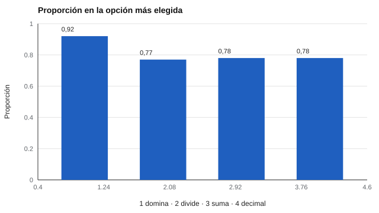

# 085 — Razonamiento numérico


<!-- NAV -->
[← 084 — Razonamiento verbal y comprensión de instrucc…](../084-razonamiento-verbal-y-comprension-de-instrucciones/README.md) · [📚 Parte 08](../README.md) · [🗺️ Índice 001–200](../../../PROGRAMA.md) · [086 — Razonamiento espacial →](../086-razonamiento-espacial/README.md)
<!-- /NAV -->

**Parte 08 — Inteligencia y capacidades cognitivas** · Nivel intermedio · 4 h · Estado `escrita`
**Pensada para:** quien diseña ítems numéricos, quien enseña matemática y quien rinde pruebas con cálculos.
**Prerrequisitos:** clases 015 y 083.

## ¿Para qué te sirve esto?

En una prueba de alternativas, una respuesta incorrecta puede decir mucho: si una persona marca «5» en «40 % de 200», lo más probable es que **dividió** en lugar de multiplicar. Bien diseñados, los **distractores** no son relleno: cada uno representa un **error conceptual típico**. Así, un puntaje se convierte en un **diagnóstico** de qué se está equivocando el estudiante. Esta clase te enseña a diseñar y analizar ítems numéricos de ese modo.

## Al terminar esta clase podrás

- Diseñar ítems numéricos con distractores basados en errores típicos.
- Realizar un análisis de distractores con valor diagnóstico.
- Distinguir razonamiento numérico de cálculo y de conocimiento curricular.
- Reconocer los límites de una «firma» de error sintética.

## La idea en palabras simples

Brown y Burton (1978) mostraron que muchos errores en matemática no son azar: son **procedimientos equivocados** coherentes (los llamaron «bugs»). Si cada distractor atrae a quienes cometen **ese** error, el patrón de respuestas dice **qué** procedimiento está usando la persona.

Ítem de ejemplo: «**40 % de 200**».

- Correcta: 80.
- E1 (dividir): 200 / 40 = 5.
- E2 (sumar): 40 + 200 = 240.
- E3 (error de decimal): 40 · 200 / 10 = 800.

## Cómo funciona, paso a paso

**1. Identificar** los errores típicos.

**2. Construir un distractor** para cada uno.

**3. Analizar** qué opción elige cada perfil de estudiante.

**Ejemplo resuelto.** Quien marca 5 probablemente dividió; quien marca 240, sumó.



*Figura 1.* Cada perfil de error tiene una «firma» clara.

## Si construyes el instrumento

- Construye los distractores a partir de errores reales de estudiantes (observación, entrevistas cognitivas).
- Si un distractor lo elige menos del 5 %, reemplázalo (clase 017).
- Valida que cada distractor mida el error que se supone.
- Evita contextos numéricos que favorezcan a una cultura sobre otra.

## Si eres evaluado

- Cada alternativa incorrecta suele corresponder a un error común: si te equivocaste, el patrón de tu error ayuda a saber qué reforzar.
- Un resultado numérico bajo puede ser falta de instrucción, no baja capacidad.
- Pide que te muestren qué error cometiste, no solo el puntaje.

## Qué muestra el laboratorio

`lab.py` simula 4.000 respuestas por perfil (datos sintéticos) para el ítem «X % de N».

| Perfil | Correcta | E1 | E2 | E3 | Opción más elegida |
|---|---:|---:|---:|---:|---|
| Domina | 0,92 | 0,03 | 0,03 | 0,03 | correcta |
| Confunde división | 0,08 | 0,77 | 0,07 | 0,07 | E1 |
| Suma en vez de multiplicar | 0,08 | 0,07 | 0,78 | 0,07 | E2 |
| Error de decimal | 0,08 | 0,07 | 0,07 | 0,78 | E3 |

**Análisis.** (1) El análisis de distractores convierte un puntaje en un diagnóstico: cada perfil de error tiene una «firma». (2) Los perfiles son **sintéticos**; en la práctica hay que validar que el distractor refleje de verdad el error que se supone (entrevista cognitiva). (3) Distractores que nadie elige no aportan. (4) Un puntaje numérico bajo no equivale a baja capacidad.

## Errores frecuentes

- Perfiles de error asumidos sin validación.
- Distractores absurdos que nadie elige.
- Confundir bajo desempeño numérico con baja capacidad.
- Usar contextos culturalmente sesgados.

## Lo mínimo que debes llevarte

1. Los distractores representan errores conceptuales.
2. El patrón de respuestas diagnostica el error.
3. La firma debe validarse con personas reales.
4. Bajo puntaje no es baja capacidad.

## Ejercicios

- **Inicial.** ¿Qué es un distractor funcional? *Solución: uno que atrae a quienes cometen un error concreto.*
- **Intermedio.** Diseña los distractores de «15 % de 80» (correcta 12). *Guía: 80/15; 15 + 80; 120.*
- **Avanzado.** Agrega un perfil que adivina al azar y calcula su firma.
- **Aplicación.** Revisa un ítem numérico de una evaluación real y propone distractores basados en errores observados.

## Glosario

- **Distractor funcional:** alternativa incorrecta que atrae a quienes cometen un error específico.
- **Bug procedimental:** procedimiento equivocado pero coherente.
- **Firma de error:** patrón de respuestas característico de un error.
- **Razonamiento numérico:** uso de relaciones cuantitativas para resolver problemas.

## Laboratorio

```bash
python classes/part-08-inteligencia-y-capacidades-cognitivas/085-razonamiento-numerico/lab.py
python classes/part-08-inteligencia-y-capacidades-cognitivas/figuras.py
```

## Autoevaluación y criterios

1. ¿Cómo se valida un distractor? 2. ¿Qué haces con un distractor que elige menos del 5 %? 3. ¿Cómo evitas sesgo cultural en contextos numéricos?
Se logra la clase si puedes diseñar distractores con justificación y analizar su funcionamiento.

## Bibliografía

- Brown, J. S., & Burton, R. R. (1978). Diagnostic models for procedural bugs in basic mathematical skills. *Cognitive Science*, 2(2), 155-192. ✅ [DOI](https://doi.org/10.1016/s0364-0213(78)80004-4)
- Gierl, M. J., Bulut, O., Guo, Q., & Zhang, X. (2017). Developing, analyzing, and using distractors for multiple-choice tests in education. *Review of Educational Research*, 87(6), 1082-1116. ✅ [DOI](https://doi.org/10.3102/0034654317726529)
- Haladyna, T. M., & Rodriguez, M. C. (2013). *Developing and Validating Test Items*. Routledge. ✅ [DOI](https://doi.org/10.4324/9780203850381)

Leyenda: ✅ existe en Crossref con título y año coincidentes (enlace al DOI); ⚠️ hay una obra de título parecido con otro año (no se enlaza: comprobar la edición); 🔎 no verificada automáticamente (libros sin DOI, normas y sitios web). Crossref confirma la existencia de la fuente, no que respalde cada afirmación de la clase. Ver [`docs/VERIFICACION_BIBLIOGRAFIA.md`](../../../docs/VERIFICACION_BIBLIOGRAFIA.md).

---

<!-- NAV -->
[← 084 — Razonamiento verbal y comprensión de instrucc…](../084-razonamiento-verbal-y-comprension-de-instrucciones/README.md)  
[📚 Parte 08](../README.md) · [🗺️ Índice 001–200](../../../PROGRAMA.md)  
[086 — Razonamiento espacial →](../086-razonamiento-espacial/README.md)
<!-- /NAV -->
