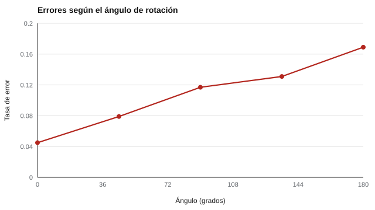

# 086 — Razonamiento espacial


<!-- NAV -->
[← 085 — Razonamiento numérico](../085-razonamiento-numerico/README.md) · [📚 Parte 08](../README.md) · [🗺️ Índice 001–200](../../../PROGRAMA.md) · [087 — Resolución de problemas y aprendizaje →](../087-resolucion-de-problemas-y-aprendizaje/README.md)
<!-- /NAV -->

**Parte 08 — Inteligencia y capacidades cognitivas** · Nivel intermedio · 4 h · Estado `escrita`
**Pensada para:** quien diseña o interpreta tareas espaciales, y quien se pregunta qué mide una prueba de «rotar figuras».
**Prerrequisitos:** clases 027 y 081.

## ¿Para qué te sirve esto?

Imaginar cómo se ve un objeto si lo giras es una habilidad espacial muy usada en ingeniería, arquitectura, cirugía o diseño. Se mide con tareas de **rotación mental**. Pero medirla bien tiene sus trampas: el indicador natural, la **pendiente** (cuánto tarda más cada grado extra de giro), es una medida **diferencial** que puede ser poco fiable con pocos ensayos. Esta clase te enseña cómo se mide y cómo saber si el resultado es confiable.

## Al terminar esta clase podrás

- Describir la rotación mental y su medición.
- Estimar la pendiente individual tiempo-ángulo y su fiabilidad.
- Combinar velocidad y precisión.
- Reconocer los límites de las comparaciones de grupo en tareas espaciales.

## La idea en palabras simples

Shepard y Metzler (1971) mostraron que el tiempo para decidir si dos figuras tridimensionales son iguales (una girada) **aumenta casi linealmente con el ángulo de rotación**. La **pendiente** (milisegundos por grado) se interpreta como la **velocidad de rotación mental**.

Se usa además el **ángulo efectivo mínimo** (≤ 180°): girar 270° en un sentido equivale a 90° en el otro.

## Cómo funciona, paso a paso

**1. Presentar pares de figuras** con distintos ángulos de rotación (8 ángulos × 10 ensayos).

**2. Registrar** tiempo y acierto.

**3. Ajustar** una recta tiempo-ángulo por persona (intercepto y pendiente).

**4. Estimar la fiabilidad** de la pendiente (por mitades de ensayos y Spearman-Brown).

**Ejemplo resuelto.** Con intercepto 900 ms y pendiente 6 ms/grado, el tiempo esperado a 135° es 900 + 810 = **1.710 ms**.



*Figura 1.* A mayor ángulo, más errores (y más tiempo).

## Si construyes el instrumento

- Usa suficientes ensayos: la pendiente es diferencial y con pocos ensayos es poco fiable (clase 097).
- Combina velocidad y precisión; quien responde rápido y mal parece veloz.
- Calibra la medición del tiempo entre dispositivos (clase 093).
- Interpreta las diferencias de grupo con cautela: dependen de entrenamiento y contexto.

## Si eres evaluado

- Una tarea de rotación mide una habilidad entrenable: practicar mejora el resultado.
- Un resultado en pantallas distintas puede no ser comparable si los tiempos no se calibraron.
- Pregunta cuántos ensayos tiene la prueba: pocas pruebas dan resultados inestables.

## Qué muestra el laboratorio

`lab.py` simula 200 personas con 8 ángulos × 10 ensayos.

| Medida | Valor |
|---|---:|
| Pendiente verdadera media | 5,81 ms/grado |
| Pendiente estimada (mitad pares) | 5,82 ms/grado |
| Fiabilidad de la pendiente individual | r mitades 0,81; Spearman-Brown 0,90 |

Tasa de error por ángulo efectivo: 0° → 0,045; 45° → 0,079; 90° → 0,117; 135° → 0,131; 180° → 0,169.

**Análisis.** (1) El efecto del ángulo es nítido y, con 80 ensayos por mitad, la pendiente individual es razonablemente fiable. (2) Es una medida diferencial: con pocos ensayos su fiabilidad cae mucho (clase 097). (3) Conviene sumar la precisión (aciertos) a la velocidad (clase 089). (4) Los datos son simulados con un modelo lineal.

## Errores frecuentes

- Interpretar la pendiente con pocos ensayos.
- Ignorar los errores: quien responde rápido y mal parece veloz.
- Comparar entre dispositivos sin calibrar los tiempos.
- Atribuir diferencias de grupo a causas innatas sin considerar entrenamiento y contexto.

## Lo mínimo que debes llevarte

1. El tiempo crece casi linealmente con el ángulo.
2. La pendiente es la velocidad de rotación mental.
3. Es una medida diferencial: necesita muchos ensayos.
4. Se combinan velocidad y precisión.

## Ejercicios

- **Inicial.** ¿Qué indica la pendiente? *Solución: cuánto tiempo extra cuesta cada grado de rotación.*
- **Intermedio.** Calcula el tiempo esperado a 90° con intercepto 800 y pendiente 5. *Solución: 1.250 ms.*
- **Avanzado.** Reduce a 3 ensayos por ángulo y reporta la fiabilidad de la pendiente.
- **Aplicación.** Diseña una breve tarea de rotación mental con 40 ensayos y decide cómo evaluarías su fiabilidad.

## Glosario

- **Rotación mental:** imaginar cómo se ve un objeto al girarlo.
- **Pendiente:** milisegundos adicionales por grado de rotación.
- **Intercepto:** tiempo base sin rotación.
- **Medida diferencial:** diferencia entre dos mediciones (menos fiable que cada una).

## Laboratorio

```bash
python classes/part-08-inteligencia-y-capacidades-cognitivas/086-razonamiento-espacial/lab.py
python classes/part-08-inteligencia-y-capacidades-cognitivas/figuras.py
```

## Autoevaluación y criterios

1. ¿Por qué se usa el ángulo efectivo mínimo (≤ 180°)? 2. ¿Cómo combinas velocidad y precisión? 3. ¿Qué entrenamiento mejora la rotación?
Se logra la clase si puedes estimar pendiente e intercepto y reportar su fiabilidad.

## Bibliografía

- Shepard, R. N., & Metzler, J. (1971). Mental rotation of three-dimensional objects. *Science*, 171(3972), 701-703. ✅ [DOI](https://doi.org/10.1126/science.171.3972.701)
- Linn, M. C., & Petersen, A. C. (1985). Emergence and characterization of sex differences in spatial ability: A meta-analysis. *Child Development*, 56(6), 1479-1498. ✅ [DOI](https://doi.org/10.2307/1130467)

Leyenda: ✅ existe en Crossref con título y año coincidentes (enlace al DOI); ⚠️ hay una obra de título parecido con otro año (no se enlaza: comprobar la edición); 🔎 no verificada automáticamente (libros sin DOI, normas y sitios web). Crossref confirma la existencia de la fuente, no que respalde cada afirmación de la clase. Ver [`docs/VERIFICACION_BIBLIOGRAFIA.md`](../../../docs/VERIFICACION_BIBLIOGRAFIA.md).

---

<!-- NAV -->
[← 085 — Razonamiento numérico](../085-razonamiento-numerico/README.md)  
[📚 Parte 08](../README.md) · [🗺️ Índice 001–200](../../../PROGRAMA.md)  
[087 — Resolución de problemas y aprendizaje →](../087-resolucion-de-problemas-y-aprendizaje/README.md)
<!-- /NAV -->
