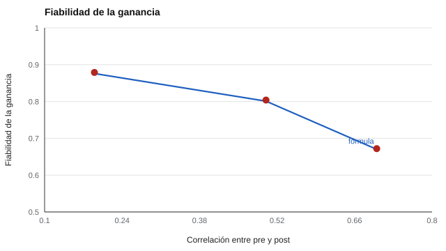

# 087 — Resolución de problemas y aprendizaje


<!-- NAV -->
[← 086 — Razonamiento espacial](../086-razonamiento-espacial/README.md) · [📚 Parte 08](../README.md) · [🗺️ Índice 001–200](../../../PROGRAMA.md) · [088 — Aptitudes mentales primarias →](../088-aptitudes-mentales-primarias/README.md)
<!-- /NAV -->

**Parte 08 — Inteligencia y capacidades cognitivas** · Nivel intermedio · 4 h · Estado `escrita`
**Pensada para:** quien usa evaluación dinámica o mide cambio entre dos momentos, y quien recibe un informe de «potencial de aprendizaje».
**Prerrequisitos:** clases 021 y 025.

## ¿Para qué te sirve esto?

Una prueba tradicional dice cuánto sabe alguien hoy. La **evaluación dinámica** hace otra pregunta: **¿cuánto aprende con una breve ayuda?** Se evalúa antes, se enseña un poco y se vuelve a evaluar: la diferencia sería el «potencial de aprendizaje». Suena atractivo, pero tiene un problema estadístico serio: **el puntaje de ganancia** (post − pre) puede ser muy poco fiable. Esta clase te enseña por qué, y cómo interpretar con cautela cualquier «mejora» individual.

## Al terminar esta clase podrás

- Describir la evaluación dinámica (pre–instrucción–post).
- Calcular la fiabilidad de un puntaje de ganancia.
- Interpretar la «ganancia» individual con cautela.
- Elegir alternativas a la ganancia.

## La idea en palabras simples

La **evaluación dinámica** mide el cambio tras una breve ayuda para estimar el potencial de aprendizaje (Grigorenko & Sternberg, 1998). El **puntaje de ganancia** es G = post − pre. El problema: cuando el pre y el post están muy relacionados, **casi toda la variación de la ganancia es error** (Lord, 1956; Cronbach & Furby, 1970). Es como restar dos cifras casi iguales: lo que queda es sobre todo ruido.

```
ρ_G = (ρ_x·σ_x² + ρ_y·σ_y² − 2·r_xy·σ_x·σ_y) / (σ_x² + σ_y² − 2·r_xy·σ_x·σ_y)
```

## Cómo funciona, paso a paso

**1. Obtener** la fiabilidad del pre y del post y su correlación.

**2. Aplicar** la fórmula.

**Ejemplo resuelto.** σ_x = σ_y = 1; ρ = 0,9; r_xy = 0,8: ρ_G = (0,9 + 0,9 − 1,6) / (2 − 1,6) = 0,2 / 0,4 = **0,50**.



*Figura 1.* Con más correlación entre pre y post, la ganancia es menos fiable (línea: fórmula; puntos: simulación).

## Si construyes el instrumento

- No etiquetes a una persona como «aprende rápido» o «lento» por un par de puntajes.
- Prefiere análisis de grupo, el nivel post controlando por el pre o índices de cambio fiable (clase 025).
- Considera el efecto techo y la regresión a la media.
- Los resultados de grupo (efecto de un programa) son más fiables que los individuales.

## Si eres evaluado

- Si un informe habla de tu «potencial de aprendizaje», pregunta cómo se calculó y qué margen de error tiene.
- Una mejora de un momento a otro puede deberse a la práctica o al azar.
- Un resultado tras una breve ayuda no define lo que puedes aprender.

## Qué muestra el laboratorio

`lab.py` simula N = 20.000 con fiabilidad de pre y post de 0,90.

| r (pre, post) | Fiabilidad de la ganancia (fórmula) | Simulada |
|---:|---:|---:|
| 0,19 | 0,876 | 0,879 |
| 0,50 | 0,801 | 0,804 |
| 0,70 | 0,670 | 0,672 |

**Análisis.** (1) La fórmula coincide con la simulación. (2) Aunque pre y post tengan fiabilidad 0,90, la ganancia puede tener fiabilidad baja si pre y post correlacionan alto. (3) Una «ganancia» individual casi siempre se interpreta con cautela: se prefieren análisis de grupo, el nivel post controlando el pre, o índices de cambio fiable. (4) Que alguien «aprenda rápido» no se concluye de un solo par de puntajes.

## Errores frecuentes

- Etiquetar a alguien como «aprende rápido» o «lento» por un par de puntajes.
- Ignorar el efecto techo y la regresión a la media.
- Informar la ganancia sin su fiabilidad.
- Creer que la fiabilidad del pre y del post garantiza la de la ganancia.

## Lo mínimo que debes llevarte

1. La ganancia = post − pre es poco fiable cuando pre y post se relacionan mucho.
2. La fórmula dice cuánto.
3. Los análisis de grupo son más fiables.
4. No se etiqueta por un par de puntajes.

## Ejercicios

- **Inicial.** ¿Por qué la ganancia suele ser poco fiable? *Solución: porque restar dos medidas muy correlacionadas deja sobre todo error.*
- **Intermedio.** Calcula ρ_G con ρ = 0,85 y r = 0,6. *Solución: (1,7 − 1,2) / (2 − 1,2) = 0,625.*
- **Avanzado.** Añade en `lab.py` un efecto techo y observa la ganancia.
- **Aplicación.** Redacta cómo informarías a una familia el resultado de una evaluación dinámica sin etiquetar.

## Glosario

- **Evaluación dinámica:** evaluación con una fase de ayuda entre dos mediciones.
- **Puntaje de ganancia:** diferencia entre el puntaje posterior y el previo.
- **Efecto techo:** acumulación de puntajes en el máximo.
- **Cambio fiable:** cambio mayor que el atribuible al error (clase 025).

## Laboratorio

```bash
python classes/part-08-inteligencia-y-capacidades-cognitivas/087-resolucion-de-problemas-y-aprendizaje/lab.py
python classes/part-08-inteligencia-y-capacidades-cognitivas/figuras.py
```

## Autoevaluación y criterios

1. ¿Cuándo es útil una evaluación dinámica? 2. ¿Qué alternativa a la ganancia usarías? 3. ¿Qué evidencia de validez requiere?
Se logra la clase si puedes calcular la fiabilidad de una ganancia e interpretarla con cautela.

## Bibliografía

- Lord, F. M. (1956). The measurement of growth. *Educational and Psychological Measurement*, 16(4), 421-437. ✅ [DOI](https://doi.org/10.1177/001316445601600401)
- Cronbach, L. J., & Furby, L. (1970). How we should measure «change»—or should we? *Psychological Bulletin*, 74(1), 68-80. ✅ [DOI](https://doi.org/10.1037/h0029382)
- Grigorenko, E. L., & Sternberg, R. J. (1998). Dynamic testing. *Psychological Bulletin*, 124(1), 75-111. ✅ [DOI](https://doi.org/10.1037/0033-2909.124.1.75)

Leyenda: ✅ existe en Crossref con título y año coincidentes (enlace al DOI); ⚠️ hay una obra de título parecido con otro año (no se enlaza: comprobar la edición); 🔎 no verificada automáticamente (libros sin DOI, normas y sitios web). Crossref confirma la existencia de la fuente, no que respalde cada afirmación de la clase. Ver [`docs/VERIFICACION_BIBLIOGRAFIA.md`](../../../docs/VERIFICACION_BIBLIOGRAFIA.md).

---

<!-- NAV -->
[← 086 — Razonamiento espacial](../086-razonamiento-espacial/README.md)  
[📚 Parte 08](../README.md) · [🗺️ Índice 001–200](../../../PROGRAMA.md)  
[088 — Aptitudes mentales primarias →](../088-aptitudes-mentales-primarias/README.md)
<!-- /NAV -->
