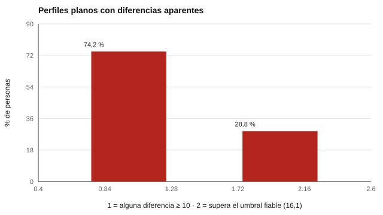

# 088 — Aptitudes mentales primarias


<!-- NAV -->
[← 087 — Resolución de problemas y aprendizaje](../087-resolucion-de-problemas-y-aprendizaje/README.md) · [📚 Parte 08](../README.md) · [🗺️ Índice 001–200](../../../PROGRAMA.md) · [089 — Velocidad de procesamiento →](../089-velocidad-de-procesamiento/README.md)
<!-- /NAV -->

**Parte 08 — Inteligencia y capacidades cognitivas** · Nivel intermedio · 4 h · Estado `escrita`
**Pensada para:** quien interpreta perfiles de aptitudes (orientación, selección, educación) y quien recibe un perfil.
**Prerrequisitos:** clases 025 y 081.

## ¿Para qué te sirve esto?

Muchos informes entregan un **perfil**: «fortaleza verbal, debilidad espacial». Es atractivo, pero hay una trampa estadística: con varias subpruebas, hay muchas comparaciones posibles, y **por puro azar** casi todo el mundo muestra alguna «fortaleza» o «debilidad». Esta clase te enseña a calcular cuándo una diferencia entre subpruebas es **realmente fiable**, y por qué conviene tratar los perfiles como hipótesis y no como hallazgos.

## Al terminar esta clase podrás

- Describir el modelo de aptitudes primarias de Thurstone.
- Calcular el error típico de la diferencia entre subpruebas.
- Evitar sobreinterpretar perfiles.
- Redactar un perfil sin sobreafirmar.

## La idea en palabras simples

Thurstone (1938) propuso capacidades primarias (comprensión verbal, fluidez, razonamiento, espacial, numérica, memoria, velocidad perceptual). Las baterías basadas en este enfoque entregan **perfiles** de subpruebas. Pero una diferencia entre dos subpruebas tiene **más error** que cada subprueba:

```
EE_dif = DE · √(2 − ρ_a − ρ_b)
```

Con 5 subpruebas hay **10 comparaciones** posibles por persona: encontrar alguna diferencia llamativa es lo esperable, incluso si la persona tiene un perfil verdaderamente plano.

## Cómo funciona, paso a paso

**1. Calcular** el EE de la diferencia con las fiabilidades y la DE.

**2. Obtener** la diferencia mínima fiable al 95 % (1,96 · EE).

**3. Simular** personas con perfil plano para ver cuánta «diferencia» aparece sola.

**Ejemplo resuelto.** Dos subpruebas con fiabilidad 0,90 y 0,80, DE 15: EE_dif = 15 · √(2 − 1,7) = 8,2; umbral 16,1. Una diferencia de 12 puntos no es fiable.



*Figura 1.* Perfiles planos que parecen tener «fortalezas y debilidades».

## Si construyes el instrumento

- Informa la diferencia mínima fiable entre subpruebas en el manual.
- Corrige por comparaciones múltiples cuando analices perfiles.
- No basa decisiones individuales en análisis de perfil sin evidencia de validez incremental (McDermott et al., 1990).
- Declara que los perfiles son hipótesis a contrastar con otras fuentes.

## Si eres evaluado

- Un perfil con «fortalezas y debilidades» puede ser, en gran parte, ruido: pregunta qué diferencias son fiables.
- Una diferencia de pocos puntos entre dos subpruebas no es concluyente.
- Los perfiles orientan conversaciones; no definen lo que eres capaz de hacer.

## Qué muestra el laboratorio

`lab.py` usa 5 aptitudes (DE = 15; fiabilidad 0,85 cada una): EE de la diferencia = **8,22**; diferencia mínima fiable al 95 % = **16,1** puntos. Con 20.000 personas de perfil verdaderamente plano:

| Medida | Proporción |
|---|---:|
| Alguna diferencia ≥ 10 puntos entre subpruebas | 74,2 % |
| Alguna diferencia mayor al umbral fiable (16,1) | 28,8 % |

**Análisis.** (1) Con cinco subpruebas hay 10 comparaciones por persona; sin corrección, lo normal es encontrar «fortalezas y debilidades» en perfiles que son planos. (2) Aun con el umbral fiable, el 28,8 % muestra alguna diferencia por azar: el umbral no corrige por comparaciones múltiples. (3) Un perfil se interpreta con diferencias fiables y de forma acotada. (4) Las interpretaciones de perfil tienen evidencia de validez incremental limitada y deben tratarse como hipótesis.

## Errores frecuentes

- Interpretar cada fortaleza o debilidad de un perfil como un hallazgo.
- Basar decisiones individuales en el perfil sin evidencia de validez incremental.
- Ignorar que el umbral no corrige por comparaciones múltiples.
- Reportar diferencias sin su error.

## Lo mínimo que debes llevarte

1. Una diferencia entre subpruebas tiene más error que cada una.
2. Con 5 subpruebas hay 10 comparaciones.
3. Los perfiles planos parecen tener fortalezas y debilidades.
4. Los perfiles son hipótesis.

## Ejercicios

- **Inicial.** ¿Cuántas comparaciones hay entre 6 subpruebas? *Solución: 15.*
- **Intermedio.** Calcula EE_dif con ρ = 0,9 y 0,9, DE 10. *Solución: 10 · √0,2 = 4,47.*
- **Avanzado.** Aplica una corrección de Bonferroni al umbral en `lab.py`.
- **Aplicación.** Redacta un párrafo de perfil con tres diferencias, indicando cuáles son fiables.

## Glosario

- **Aptitudes primarias:** capacidades específicas propuestas por Thurstone.
- **Perfil:** conjunto de puntajes de subpruebas.
- **EE de la diferencia:** error típico de la diferencia entre dos puntajes.
- **Validez incremental:** información que un perfil agrega sobre el puntaje global.

## Laboratorio

```bash
python classes/part-08-inteligencia-y-capacidades-cognitivas/088-aptitudes-mentales-primarias/lab.py
python classes/part-08-inteligencia-y-capacidades-cognitivas/figuras.py
```

## Autoevaluación y criterios

1. ¿Cuándo un perfil agrega información sobre un puntaje global? 2. ¿Cómo redactas un perfil sin sobreafirmar? 3. ¿Qué evidencia necesitarías?
Se logra la clase si puedes calcular umbrales de diferencia fiable y limitar la interpretación de perfiles.

## Bibliografía

- Thurstone, L. L. (1938). *Primary Mental Abilities*. University of Chicago Press. 🔎 sin verificar (libro, norma o sitio no hallado en Crossref: comprobar a mano)
- McDermott, P. A., Fantuzzo, J. W., & Glutting, J. J. (1990). Just say no to subtest analysis: A critique on Wechsler theory and practice. *Journal of Psychoeducational Assessment*, 8(3), 290-302. ✅ [DOI](https://doi.org/10.1177/073428299000800307)
- AERA, APA, & NCME (2014). *Standards for Educational and Psychological Testing*. 🔎 sin verificar (libro, norma o sitio no hallado en Crossref: comprobar a mano)

Leyenda: ✅ existe en Crossref con título y año coincidentes (enlace al DOI); ⚠️ hay una obra de título parecido con otro año (no se enlaza: comprobar la edición); 🔎 no verificada automáticamente (libros sin DOI, normas y sitios web). Crossref confirma la existencia de la fuente, no que respalde cada afirmación de la clase. Ver [`docs/VERIFICACION_BIBLIOGRAFIA.md`](../../../docs/VERIFICACION_BIBLIOGRAFIA.md).

---

<!-- NAV -->
[← 087 — Resolución de problemas y aprendizaje](../087-resolucion-de-problemas-y-aprendizaje/README.md)  
[📚 Parte 08](../README.md) · [🗺️ Índice 001–200](../../../PROGRAMA.md)  
[089 — Velocidad de procesamiento →](../089-velocidad-de-procesamiento/README.md)
<!-- /NAV -->
