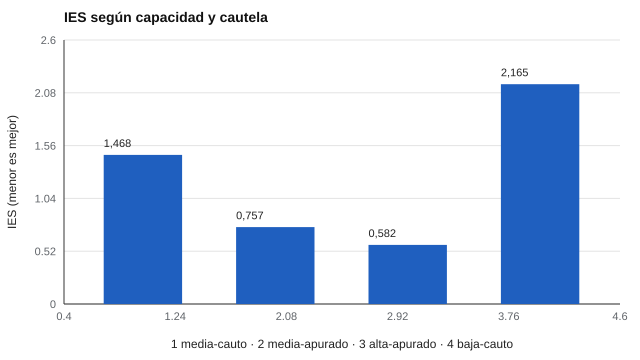

# 089 — Velocidad de procesamiento


<!-- NAV -->
[← 088 — Aptitudes mentales primarias](../088-aptitudes-mentales-primarias/README.md) · [📚 Parte 08](../README.md) · [🗺️ Índice 001–200](../../../PROGRAMA.md) · [090 — Familias de evaluación cognitiva individual… →](../090-familias-de-evaluacion-cognitiva-individual-uso-restricciones/README.md)
<!-- /NAV -->

**Parte 08 — Inteligencia y capacidades cognitivas** · Nivel intermedio · 4 h · Estado `escrita`
**Pensada para:** quien interpreta tiempos de reacción, y quien rinde tareas cronometradas.
**Prerrequisitos:** clases 086 y 093.

## ¿Para qué te sirve esto?

Medir qué tan rápido piensa alguien parece fácil: se cronometra. Pero el tiempo mezcla **capacidad** con **estrategia**: una persona cautelosa responde más lento y más preciso que una apurada, aunque tengan la **misma** capacidad. Si no se separan, se puede etiquetar como «lento» a alguien simplemente prudente o ansioso. Esta clase te enseña ese compromiso **velocidad–precisión** y por qué un solo indicador combinado no basta.

## Al terminar esta clase podrás

- Explicar el compromiso velocidad–precisión.
- Interpretar un modelo de difusión mínimo.
- Evaluar indicadores combinados como el IES.
- Evitar concluir «procesamiento lento» de un tiempo largo.

## La idea en palabras simples

La velocidad de procesamiento se asocia con otras capacidades y con la edad (Salthouse, 1996). Pero el tiempo de respuesta depende de dos cosas:

- **Capacidad** (qué tan rápido se acumula la evidencia): en el modelo de difusión (Ratcliff, 1978), la **deriva (v)**.
- **Cautela** (cuánta evidencia se exige antes de responder): la **barrera (a)**.

Más cautela implica más lentitud y más precisión (Heitz, 2014). El **IES** (tiempo dividido por precisión) intenta combinar ambos, pero no elimina el efecto de la estrategia.

## Cómo funciona, paso a paso

**1. Simular** ensayos con una capacidad y una cautela dadas.

**2. Calcular** el tiempo medio (RT), la precisión y el IES.

**Ejemplo resuelto.** IES = 1,364 / 0,929 = 1,468; para «media apurado», 0,579 / 0,765 = 0,757. Aunque hay la misma capacidad, el IES varía casi a la mitad.



*Figura 1.* El IES cambia con la estrategia, no solo con la capacidad.

## Si construyes el instrumento

- Estandariza las instrucciones («responda lo más rápido y exacto que pueda») y controla el entorno.
- Informa velocidad y precisión por separado, y la variabilidad.
- Cuando importe, usa modelos que separen ambos componentes.
- El modelo del laboratorio es mínimo: no incluye variabilidad entre ensayos ni sesgo de inicio.

## Si eres evaluado

- Responder lento no significa pensar mal: puede ser prudencia o ansiedad.
- Si te piden «rápido y exacto», conviene mantener un equilibrio; las instrucciones cambian el resultado.
- En pruebas cronometradas, pregunta cómo se combinan velocidad y precisión en el puntaje.

## Qué muestra el laboratorio

`lab.py` simula 1.500 ensayos por caso (deriva v = capacidad; barrera a = cautela).

| Caso | RT medio (s) | Precisión | IES |
|---|---:|---:|---:|
| Capacidad media, cauto | 1,364 | 0,929 | 1,468 |
| Capacidad media, apurado | 0,579 | 0,765 | 0,757 |
| Capacidad alta, apurado | 0,531 | 0,911 | 0,582 |
| Capacidad baja, cauto | 1,680 | 0,776 | 2,165 |

**Análisis.** (1) Con la **misma** capacidad (primeras dos filas), el RT cambia de 1,36 a 0,58 s y la precisión de 0,93 a 0,77 solo por la cautela. (2) El IES no elimina ese efecto de estrategia (1,47 frente a 0,76). (3) Por eso se informa velocidad y precisión por separado, se estandarizan las instrucciones y, cuando importa, se usan modelos que separan ambos componentes. (4) Los casos son simulaciones.

## Errores frecuentes

- Comparar RT entre personas con instrucciones o estilos distintos.
- Usar solo el RT medio.
- Creer que el IES elimina el efecto de la estrategia.
- Concluir «procesamiento lento» de un tiempo largo en una persona prudente o ansiosa.

## Lo mínimo que debes llevarte

1. El tiempo mezcla capacidad y estrategia.
2. Más cautela: más lento y más preciso.
3. El IES no elimina la estrategia.
4. Se informan velocidad y precisión por separado.

## Ejercicios

- **Inicial.** ¿Qué parámetro representa la cautela? *Solución: la barrera (a).*
- **Intermedio.** Si la precisión sube de 0,77 a 0,93 y el RT de 0,58 a 1,36, ¿qué implica para la comparación? *Solución: hay un compromiso: no se pueden comparar los tiempos solos.*
- **Avanzado.** Añade variabilidad de ensayo a ensayo en la deriva (`v`) y observa los errores lentos.
- **Aplicación.** Redacta instrucciones estandarizadas para una tarea de tiempo de reacción.

## Glosario

- **Compromiso velocidad–precisión:** relación inversa entre rapidez y exactitud.
- **Modelo de difusión:** modelo que describe la acumulación de evidencia hasta una decisión.
- **Deriva (v):** velocidad de acumulación de evidencia.
- **IES:** indicador combinado de tiempo y precisión.

## Laboratorio

```bash
python classes/part-08-inteligencia-y-capacidades-cognitivas/089-velocidad-de-procesamiento/lab.py
python classes/part-08-inteligencia-y-capacidades-cognitivas/figuras.py
```

## Autoevaluación y criterios

1. ¿Cómo estandarizar instrucciones? 2. ¿Cuándo es útil un modelo de difusión? 3. ¿Qué informarías además del RT?
Se logra la clase si puedes separar estrategia y capacidad al interpretar tiempos.

## Bibliografía

- Ratcliff, R. (1978). A theory of memory retrieval. *Psychological Review*, 85(2), 59-108. ✅ [DOI](https://doi.org/10.1037/0033-295x.85.2.59)
- Heitz, R. P. (2014). The speed-accuracy tradeoff: History, physiology, methodology, and behavior. *Frontiers in Neuroscience*, 8, 150. ✅ [DOI](https://doi.org/10.3389/fnins.2014.00150)
- Salthouse, T. A. (1996). The processing-speed theory of adult age differences in cognition. *Psychological Review*, 103(3), 403-428. ✅ [DOI](https://doi.org/10.1037/0033-295x.103.3.403)

Leyenda: ✅ existe en Crossref con título y año coincidentes (enlace al DOI); ⚠️ hay una obra de título parecido con otro año (no se enlaza: comprobar la edición); 🔎 no verificada automáticamente (libros sin DOI, normas y sitios web). Crossref confirma la existencia de la fuente, no que respalde cada afirmación de la clase. Ver [`docs/VERIFICACION_BIBLIOGRAFIA.md`](../../../docs/VERIFICACION_BIBLIOGRAFIA.md).

---

<!-- NAV -->
[← 088 — Aptitudes mentales primarias](../088-aptitudes-mentales-primarias/README.md)  
[📚 Parte 08](../README.md) · [🗺️ Índice 001–200](../../../PROGRAMA.md)  
[090 — Familias de evaluación cognitiva individual… →](../090-familias-de-evaluacion-cognitiva-individual-uso-restricciones/README.md)
<!-- /NAV -->
