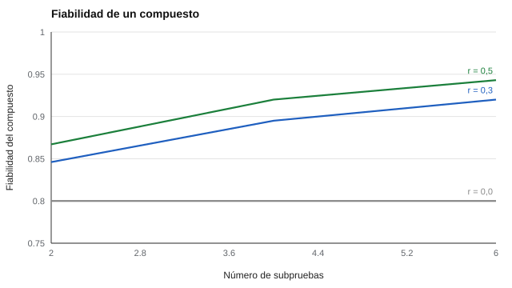

# 090 — Familias de evaluación cognitiva individual: uso, restricciones y alternativas abiertas


<!-- NAV -->
[← 089 — Velocidad de procesamiento](../089-velocidad-de-procesamiento/README.md) · [📚 Parte 08](../README.md) · [🗺️ Índice 001–200](../../../PROGRAMA.md) · [091 — Atención sostenida y vigilancia →](../../part-09-atencion-memoria-y-funciones-ejecutivas/091-atencion-sostenida-y-vigilancia/README.md)
<!-- /NAV -->

**Parte 08 — Inteligencia y capacidades cognitivas** · Nivel intermedio · 4 h · Estado `escrita`
**Pensada para:** quien necesita entender qué son las baterías cognitivas individuales, quién puede aplicarlas y qué alternativas existen para formarse.
**Prerrequisitos:** clases 072 y 088.

## ¿Para qué te sirve esto?

Cuando se habla de «test de CI», casi siempre se trata de baterías individuales como las escalas Wechsler, Woodcock-Johnson o Kaufman. Son **instrumentos propietarios**: sus ítems, claves y normas tienen dueño, y solo **profesionales habilitados** pueden aplicarlas. Este programa **no los reproduce**. Esta clase te enseña cómo se usan, qué restricciones tienen, cómo se calcula la fiabilidad de un **puntaje compuesto** (el «CI total») y qué alternativas abiertas sirven para aprender sin infringir derechos.

## Al terminar esta clase podrás

- Distinguir uso educativo, cribado, investigación y diagnóstico.
- Calcular la fiabilidad de un puntaje compuesto.
- Documentar las restricciones de las baterías individuales sin reproducir material protegido.
- Elegir alternativas abiertas para practicar.

## La idea en palabras simples

Las baterías cognitivas individuales (familias Wechsler, Woodcock-Johnson, Kaufman, entre otras) son instrumentos **propietarios** de administración restringida. En este repositorio solo existen como **fichas informativas** (qué son, qué uso tienen, qué restricciones); la parte práctica se aprende con instrumentos abiertos y con laboratorios.

Un **puntaje compuesto** (como un índice total) es más fiable que sus subpruebas porque promedia varias: su fiabilidad crece con el número de subpruebas y con su intercorrelación (Nunnally & Bernstein, 1994).

Distinciones de uso:

- **Cribado:** detecta posible riesgo; es breve y no diagnostica.
- **Diagnóstico:** evaluación integral realizada por profesionales habilitados.
- **Educativo / investigación:** con propósitos y evidencia distintos.

## Cómo funciona, paso a paso

**1. Identificar** el uso (cribado, educativo, diagnóstico, investigación).

**2. Verificar** quién puede administrar el instrumento (manual y normativa vigente).

**3. Calcular** la fiabilidad del compuesto.

**Ejemplo resuelto.** Cuatro subpruebas con ρ = 0,80 y r = 0,3: varianza del compuesto = 4 + 4·3·0,3 = 7,6; error = 4 · 0,2 = 0,8; ρ_c = 1 − 0,8 / 7,6 = **0,895**.



*Figura 1.* A mayor número de subpruebas y mayor correlación entre ellas, mayor la fiabilidad del compuesto.

## Si construyes el instrumento

- Distingue claramente los usos y exige evidencia distinta para cada uno.
- No reproduzcas material protegido «con fines educativos».
- Presenta un índice compuesto con su intervalo (clase 030), no como «el CI de la persona».
- No uses alternativas abiertas como si equivalieran a una batería clínica.

## Si eres evaluado

- Una evaluación con una batería clínica debe ser realizada por un profesional habilitado; puedes preguntar quién la aplicará y con qué formación.
- Pide siempre el intervalo del puntaje, no solo un número.
- Un test breve o abierto en línea no equivale a una evaluación individual completa.

## Qué muestra el laboratorio

`lab.py` tiene dos partes.

**Parte 1: fiabilidad del compuesto (subpruebas con fiabilidad 0,80).**

| r entre subpruebas | 2 subpruebas | 4 subpruebas | 6 subpruebas |
|---:|---:|---:|---:|
| 0,0 | 0,800 | 0,800 | 0,800 |
| 0,3 | 0,846 | 0,895 | 0,920 |
| 0,5 | 0,867 | 0,920 | 0,943 |

**Parte 2:** lista de las 16 fichas de la familia A (inteligencia y razonamiento) del catálogo; **8** son propietarias de uso clínico o educativo individual (por ejemplo, WISC, WAIS, Woodcock-Johnson, KABC, Raven y otras) y su administración está restringida a profesionales habilitados.

**Análisis.** (1) Con subpruebas independientes (r = 0) el compuesto no gana fiabilidad; con correlación, sí. (2) Con 6 subpruebas y r = 0,5 se llega a 0,943. (3) Una ficha informativa no es un instrumento implementado ni validado (clase 072). (4) Las restricciones de administración deben verificarse en el manual y la normativa.

## Errores frecuentes

- Presentar un índice compuesto como «el CI de la persona» sin su intervalo.
- Usar alternativas abiertas como si equivalieran a una batería clínica.
- Conservar o difundir material protegido «con fines educativos».
- Usar un mismo instrumento para cribado y diagnóstico sin evidencia distinta.

## Lo mínimo que debes llevarte

1. Las baterías individuales son propietarias y de administración restringida.
2. El compuesto es más fiable que sus subpruebas.
3. Cribado, diagnóstico, educación e investigación requieren evidencia distinta.
4. No se reproduce material protegido.

## Ejercicios

- **Inicial.** ¿Qué diferencia hay entre cribado y diagnóstico? *Solución: el cribado detecta posible riesgo; el diagnóstico es una evaluación integral por profesionales habilitados.*
- **Intermedio.** Calcula ρ_c con 2 subpruebas de ρ = 0,7 y r = 0,4. *Solución: var = 2 + 2·0,4 = 2,8; error 0,6; 1 − 0,214 = 0,786.*
- **Avanzado.** Elige una ficha propietaria y completa su ficha técnica con fuente primaria (licencia, edades, requisitos profesionales).
- **Aplicación.** Escribe una explicación para una familia sobre por qué un test en línea no reemplaza una evaluación individual.

## Glosario

- **Batería cognitiva individual:** conjunto de subpruebas aplicado por un profesional a una persona.
- **Propietario:** con derechos reservados; no se reproduce.
- **Puntaje compuesto:** índice que combina varias subpruebas.
- **Cribado / diagnóstico:** detección preliminar / evaluación integral.

## Laboratorio

```bash
python classes/part-08-inteligencia-y-capacidades-cognitivas/090-familias-de-evaluacion-cognitiva-individual-uso-restricciones/lab.py
python classes/part-08-inteligencia-y-capacidades-cognitivas/figuras.py
```

## Autoevaluación y criterios

1. ¿Quién puede administrar una batería individual? (verificar normativa y manual) 2. ¿Qué alternativa abierta usarías para enseñar? 3. ¿Cómo comunicarías el intervalo de un índice?
Se logra la clase si puedes distinguir usos, calcular la fiabilidad de un compuesto y respetar las restricciones.

## Bibliografía

- Nunnally, J. C., & Bernstein, I. H. (1994). *Psychometric Theory* (3.ª ed.). McGraw-Hill. 🔎 sin verificar (libro, norma o sitio no hallado en Crossref: comprobar a mano)
- Flanagan, D. P., Ortiz, S. O., & Alfonso, V. C. (2013). *Essentials of Cross-Battery Assessment* (3.ª ed.). Wiley. 🔎 sin verificar (libro, norma o sitio no hallado en Crossref: comprobar a mano)
- International Test Commission (2013). *ITC Guidelines on Test Use*. 🔎 sin verificar (libro, norma o sitio no hallado en Crossref: comprobar a mano)

Leyenda: ✅ existe en Crossref con título y año coincidentes (enlace al DOI); ⚠️ hay una obra de título parecido con otro año (no se enlaza: comprobar la edición); 🔎 no verificada automáticamente (libros sin DOI, normas y sitios web). Crossref confirma la existencia de la fuente, no que respalde cada afirmación de la clase. Ver [`docs/VERIFICACION_BIBLIOGRAFIA.md`](../../../docs/VERIFICACION_BIBLIOGRAFIA.md).

---

<!-- NAV -->
[← 089 — Velocidad de procesamiento](../089-velocidad-de-procesamiento/README.md)  
[📚 Parte 08](../README.md) · [🗺️ Índice 001–200](../../../PROGRAMA.md)  
[091 — Atención sostenida y vigilancia →](../../part-09-atencion-memoria-y-funciones-ejecutivas/091-atencion-sostenida-y-vigilancia/README.md)
<!-- /NAV -->
