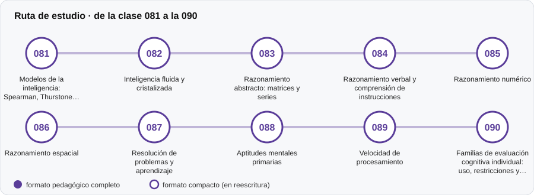

# 💡 Parte 08 — Inteligencia y capacidades cognitivas

**Nivel:** intermedio · **Duración estimada:** 3-4 semanas · **Clases:** 10

## De qué trata

Modelos de la inteligencia y cómo se evalúan las capacidades cognitivas (razonamiento, aptitudes, velocidad), con sus límites.

## Por qué importa

Las pruebas cognitivas son de las más usadas y de las más malinterpretadas; entender qué miden evita usos abusivos.

## Según tu papel

- **Si construyes o aplicas instrumentos:** Tipos de tareas de razonamiento, aptitudes primarias y familias de evaluación individual.
- **Si eres evaluado o recibes resultados:** Aclara qué significa un resultado cognitivo y qué no dice sobre tu potencial.

## Al terminar esta parte podrás

- Comparar modelos de inteligencia.
- Describir qué mide cada tipo de tarea.
- Reconocer los límites de interpretar un solo puntaje.

## Cómo estudiarla

Después de las partes 02 y 03. Los instrumentos cognitivos comerciales se estudian como fichas documentales, no se reproducen.

## Ruta de estudio

## Clases en orden de estudio

Las clases están numeradas de forma consecutiva (001 a 200) en el orden de estudio: sigue el número.

| Orden | ID | Clase | Qué aprenderás | Formato | Horas |
|---:|---|---|---|---|---:|
| 1 | 081 | [Modelos de la inteligencia: Spearman, Thurstone, CHC](081-modelos-de-la-inteligencia-spearman-thurstone-chc/README.md) | Contrastar los modelos de un factor general, de capacidades primarias y jerárquicos (CHC). | ✅ pedagógico | 4 |
| 2 | 082 | [Inteligencia fluida y cristalizada](082-inteligencia-fluida-y-cristalizada/README.md) | Distinguir Gf (razonar con material nuevo) de Gc (conocimiento acumulado). | ✅ pedagógico | 4 |
| 3 | 083 | [Razonamiento abstracto: matrices y series](083-razonamiento-abstracto-matrices-y-series/README.md) | Describir las reglas que hacen difícil un ítem de matrices o series. | ✅ pedagógico | 4 |
| 4 | 084 | [Razonamiento verbal y comprensión de instrucciones](084-razonamiento-verbal-y-comprension-de-instrucciones/README.md) | Distinguir razonamiento verbal de dominio lector. | ✅ pedagógico | 4 |
| 5 | 085 | [Razonamiento numérico](085-razonamiento-numerico/README.md) | Diseñar ítems numéricos con distractores basados en errores típicos. | ✅ pedagógico | 4 |
| 6 | 086 | [Razonamiento espacial](086-razonamiento-espacial/README.md) | Describir la rotación mental y su medición. | ✅ pedagógico | 4 |
| 7 | 087 | [Resolución de problemas y aprendizaje](087-resolucion-de-problemas-y-aprendizaje/README.md) | Describir la evaluación dinámica (pre–instrucción–post). | ✅ pedagógico | 4 |
| 8 | 088 | [Aptitudes mentales primarias](088-aptitudes-mentales-primarias/README.md) | Describir el modelo de aptitudes primarias de Thurstone. | ✅ pedagógico | 4 |
| 9 | 089 | [Velocidad de procesamiento](089-velocidad-de-procesamiento/README.md) | Explicar el compromiso velocidad–precisión. | ✅ pedagógico | 4 |
| 10 | 090 | [Familias de evaluación cognitiva individual: uso, restricciones y alternativas abiertas](090-familias-de-evaluacion-cognitiva-individual-uso-restricciones/README.md) | Distinguir uso educativo, cribado, investigación y diagnóstico. | ✅ pedagógico | 4 |

[← Volver al índice del programa](../../README.md) · [Índice numérico de las 200 clases](../../PROGRAMA.md)
