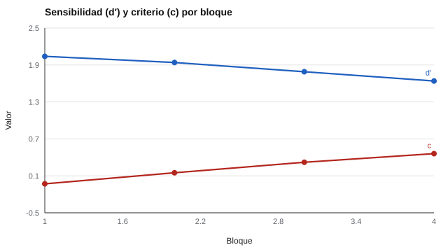

# 091 — Atención sostenida y vigilancia


<!-- NAV -->
[← 090 — Familias de evaluación cognitiva individual…](../../part-08-inteligencia-y-capacidades-cognitivas/090-familias-de-evaluacion-cognitiva-individual-uso-restricciones/README.md) · [📚 Parte 09](../README.md) · [🗺️ Índice 001–200](../../../PROGRAMA.md) · [092 — Atención selectiva y dividida →](../092-atencion-selectiva-y-dividida/README.md)
<!-- /NAV -->

**Parte 09 — Atención, memoria y funciones ejecutivas** · Nivel intermedio · 4 h · Estado `escrita`
**Pensada para:** quien interpreta pruebas de atención, y quien las rinde.
**Prerrequisitos:** clases 027 y 089.

> Material educativo. Un resultado en una tarea de atención no es un diagnóstico: cualquier sospecha clínica requiere evaluación profesional.

## ¿Para qué te sirve esto?

En las tareas de vigilancia (por ejemplo, «presione cuando aparezca el número 9» durante varios minutos), el rendimiento suele empeorar con el tiempo. Eso se llama **decremento de vigilancia**. La pregunta es: ¿la persona **se vuelve peor detectando** (se agota su atención) o simplemente **se vuelve más cauta** (responde menos)? La **teoría de detección de señales** separa ambas cosas con dos números, **d′** y **c**. Entenderlos evita confundir atención con cautela al interpretar una prueba.

## Al terminar esta clase podrás

- Describir una tarea de desempeño continuo y el decremento de vigilancia.
- Calcular d′ y el criterio c (teoría de detección de señales).
- Distinguir sensibilidad de cautela.
- Reconocer los límites de d′ con pocas señales.

## La idea en palabras simples

En una tarea con **señales** (lo que hay que detectar) y **ruido** (todo lo demás), la persona puede:

- **Acertar:** responder ante una señal (acierto) o no responder (omisión).
- **Equivocarse al revés:** responder cuando no había señal (**falsa alarma**).

La teoría de detección de señales separa:

- **Sensibilidad (d′):** cuán bien distingue señal de ruido. d′ = z(aciertos) − z(falsas alarmas).
- **Criterio (c):** cuán cautelosa es. c = −½ · [z(aciertos) + z(falsas alarmas)]. Un c positivo indica una persona más conservadora (responde menos).

## Cómo funciona, paso a paso

**1. Registrar** aciertos y falsas alarmas por bloque.

**2. Convertir** las proporciones a puntajes z.

**3. Calcular** d′ y c.

**Ejemplo resuelto.** Aciertos 0,80 y falsas alarmas 0,10: z(0,80) = 0,84; z(0,10) = −1,28; d′ = 2,12; c = −½(0,84 − 1,28) = 0,22.



*Figura 1.* La sensibilidad cae un poco; el criterio sube mucho: el decremento es en buena parte cautela.

## Si construyes el instrumento

- Registra siempre las falsas alarmas, no solo las omisiones.
- Usa suficientes señales por bloque: con 20, d′ y c por persona son muy ruidosos.
- Informa d′ y c y no solo el número de aciertos.
- No interpretes un decremento como «déficit de atención» (diagnóstico) sin evaluación clínica.

## Si eres evaluado

- En una tarea de vigilancia, responder menos al final puede ser cautela; no necesariamente que «no prestas atención».
- El cansancio, el aburrimiento y la motivación afectan el resultado.
- Un resultado en una tarea breve de laboratorio no describe tu atención en la vida diaria.

## Qué muestra el laboratorio

`lab.py` simula 4 bloques de 200 estímulos (10 % de señales; 40 observadores simulados por bloque).

| Bloque | Aciertos | Falsas alarmas | d′ | c | Verdad (d′, c) |
|---:|---:|---:|---:|---:|---|
| 1 | 0,859 | 0,161 | 2,04 | −0,03 | (2,0; 0,0) |
| 2 | 0,801 | 0,132 | 1,94 | 0,15 | (1,9; 0,15) |
| 3 | 0,724 | 0,112 | 1,79 | 0,32 | (1,8; 0,30) |
| 4 | 0,644 | 0,099 | 1,64 | 0,46 | (1,7; 0,45) |

**Análisis.** (1) Los aciertos caen de 0,86 a 0,64, pero d′ cae solo 0,4 y c sube casi 0,5: gran parte del «decremento» es un criterio más conservador. (2) Informar solo «omisiones» confunde atención con cautela. (3) En muestras pequeñas, d′ y c por persona son ruidosos. (4) Es una simulación con parámetros conocidos.

## Errores frecuentes

- Informar solo omisiones.
- Calcular d′ por persona con pocas señales.
- Interpretar un decremento como un diagnóstico.
- Ignorar las falsas alarmas.

## Lo mínimo que debes llevarte

1. d′ = sensibilidad; c = criterio (cautela).
2. Hay que registrar las falsas alarmas.
3. El decremento puede ser sobre todo cambio de criterio.
4. Una tarea de laboratorio no es un diagnóstico.

## Ejercicios

- **Inicial.** ¿Qué indica un c positivo? *Solución: una persona más conservadora (responde menos).*
- **Intermedio.** Aciertos 0,70 y falsas alarmas 0,05: z = 0,52 y −1,64. *Solución: d′ = 2,16.*
- **Avanzado.** Simula un observador cuyo d′ cae pero c se mantiene y compara los patrones.
- **Aplicación.** Explica a una familia, sin diagnosticar, por qué un niño puede «fallar» en una tarea de vigilancia.

## Glosario

- **Vigilancia:** mantener la atención para detectar eventos poco frecuentes.
- **d′ (d prima):** índice de sensibilidad.
- **Criterio (c):** índice de cautela de respuesta.
- **Falsa alarma:** responder cuando no había señal.

## Laboratorio

```bash
python classes/part-09-atencion-memoria-y-funciones-ejecutivas/091-atencion-sostenida-y-vigilancia/lab.py
python classes/part-09-atencion-memoria-y-funciones-ejecutivas/figuras.py
```

## Autoevaluación y criterios

1. ¿Por qué se necesita registrar las falsas alarmas? 2. ¿Cuántas señales necesitas? 3. ¿Qué otra explicación tiene un decremento?
Se logra la clase si puedes separar d′ y c al interpretar una tarea.

## Bibliografía

- Hautus, M. J. (1995). Corrections for extreme proportions and their biasing effects on estimated values of d′. *Behavior Research Methods, Instruments, & Computers*, 27(1), 46-51.
- Macmillan, N. A., & Creelman, C. D. (2005). *Detection Theory: A User's Guide* (2.ª ed.). Lawrence Erlbaum.
- Warm, J. S., Parasuraman, R., & Matthews, G. (2008). Vigilance requires hard mental work and is stressful. *Human Factors*, 50(3), 433-441.

---

<!-- NAV -->
[← 090 — Familias de evaluación cognitiva individual…](../../part-08-inteligencia-y-capacidades-cognitivas/090-familias-de-evaluacion-cognitiva-individual-uso-restricciones/README.md)  
[📚 Parte 09](../README.md) · [🗺️ Índice 001–200](../../../PROGRAMA.md)  
[092 — Atención selectiva y dividida →](../092-atencion-selectiva-y-dividida/README.md)
<!-- /NAV -->
